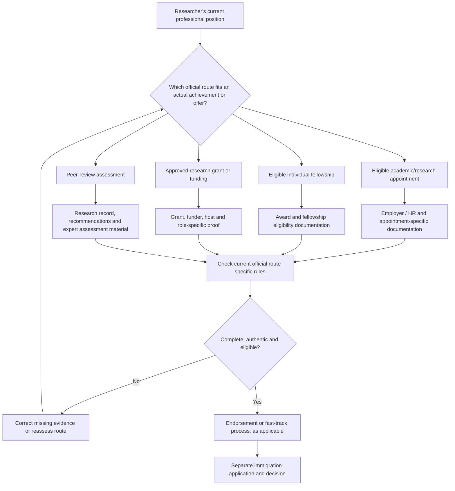

# UK Global Talent Visa — Academia & Research

**Mettelo Resource Hub · Edition 1.0 · Updated 10 November 2026**  
Prepared by **Johnson Taiwo** · Mettelo

[← Global Talent guides](README.md) · [← Immigration](../README.md) · [← Mettelo Resource Hub](../../README.md)  
[Route-specific tracker](research-checklist.md) · [Tracker instructions](tracker-guide.md)

> **Important:** Use the research endorsement route that matches your actual appointment, fellowship, approved grant or peer-review eligibility. The 24-month plan is optional career development, not a visa requirement.

## Visual decision architecture — academia and research

Research applications follow **different endorsement routes**, each with its own eligibility and documentation. Do not assemble a generic evidence bundle before identifying your actual route.

**Reader note:** This diagram does not mean an applicant may freely choose any of the four routes. Eligibility depends on the actual appointment, award, funding or research record and current official rules.

## Find your research route in two minutes

| What you genuinely have now | Check first | Next real action |
| --- | --- | --- |
| **Accepted eligible UK research appointment** | [Route 1](#route-1-actual-uk-research-appointment) | Ask the UK employing institution's HR team to check appointment and recruitment confirmation |
| **Approved individual fellowship awarded to you** | [Route 2](#route-2-award-a-genuinely-eligible-fellowship) | Match the **exact fellowship name and award date** to the present approved list |
| **Real eligible role on approved funded UK research grant** | [Route 3](#route-3-actual-research-on-approved-uk-funding) | Ask the principal investigator, grants office and HR for the actual grant and host conditions |
| **Active original researcher, no job offer/eligible grant** | [Route 4 peer review](#route-4-active-researcher-and-full-expert-assessment) | Check PhD/equivalent research expertise, genuine expert relationship and career-stage requirements |
| **No research achievements or eligible position yet** | [Professional development](#5-detailed-24-month-development-plan) | Begin genuine original study, training and legitimate research collaboration, not a visa application |

**Decision rule:** Select **one genuine qualifying route**. The four routes are not a combined checklist; do not mix a peer-review referee request with an ineligible university grant and assume that completes an endorsement.

---

## Introduction — who is this visa for?

The **UK Global Talent visa (Academia and Research)** is designed for established and potential leaders in science, engineering, medicine, humanities and social science research. It generally gives more freedom to work for different employers or be self-employed than an employer-sponsored route. It is not a PhD scholarship or job, and earning a master's degree, publishing one paper or having “research” in a job title does not automatically qualify someone.

There are **two separate decisions**: a qualifying academic/research **endorsement** (unless a specifically listed prestigious prize removes the endorsement requirement), followed by the **Home Office visa application**. The route covers legitimate **academic, industrial and government research**, but routine dashboards, general reporting or university administrative support should not be confused with original research or PhD-equivalent research expertise.

### Official fast-track funding-list checks — verified 10 November 2026

**Do not assume that any university, charity or grant is eligible.** The UKRI endorsement requires **both** an approved funding organisation and an approved UK employing/hosting institution, plus the actual qualifying role and grant conditions.

| Verify | Specific official source | Recent update or requirement |
| --- | --- | --- |
| Approved research **funders** | [UKRI endorsed-funders list](https://www.gov.uk/government/publications/ukri-endorsement-endorsed-funders-global-talent-visa) | Updated **4 September 2026**; entries can change |
| Approved **host organisations** | [UKRI approved institutions](https://www.gov.uk/government/publications/ukri-endorsement-employing-or-hosting-institutions-global-talent-visa) | Updated **15 September 2026** |
| Exact grant / role | [UKRI route eligibility](https://www.gov.uk/global-talent-researcher-academic/uk-research-innovation-endorsement) | Grant **at least £30,000**, duration **at least two years**, applicant working **at least half their time** on grant, generally **one year left** on contract/hosting |
| Eligible research appointment | [Academic or research position](https://www.gov.uk/global-talent-researcher-academic/academic-or-researcher) | An eligible offer at approved UK institution; actual research/innovation or qualifying leadership |
| Other qualifying paths | [Research route overview](https://www.gov.uk/global-talent-researcher-academic) | Approved individual fellowship, peer review or qualifying listed prize may provide another route |

**Who to contact first:** For a UKRI grant route, start with the **actual university research administration / grants office and HR** and obtain confirmation of the exact grant reference, sponsor, job responsibilities and permitted institutional guarantee. A professor's informal assurance is not the same as an authorised HR letter. For a fellowship, ask the **actual awarding programme** whether its exact scheme is on the relevant current endorsed list.

**Good evidence:** An actual award reference and approved host confirmation supported by your real contract and responsibilities. **Not good evidence:** A list of funders copied from the web without proof you work on one of their eligible grants.

### Understand the four completely different endorsement routes

| Route | Who it is for | What must be real | Key documents |
| --- | --- | --- | --- |
| **1. Academic or research appointment** | Person who has accepted eligible research/innovation job at approved UK institution | Research/innovation as primary role or eligible leadership; **PhD or equivalent research experience essential**; genuine recruitment | Full job description and institution HR Director's **statement of guarantee**. [Official route](https://www.gov.uk/global-talent-researcher-academic/academic-or-researcher) |
| **2. Individual fellowship** | Person currently holding or holding within the eligible five-year window a fellowship on the **approved list** | Exact listed award, not a general fellowship or training bursary | Actual fellowship award letter. [Approved scheme list](https://royalsociety.org/grants/global-talent-visa-overview/route-2-individual-fellowships/) |
| **3. UKRI endorsed funder** | Eligible research specialist employed/hosted at approved **UK** institution on approved funding | Approved funder; **≥£30k, ≥2-year grant, ≥50% grant work time, ≥12 months contract remaining** plus relevant role/host terms | Actual approved grant details and institutional confirmation. [Official conditions](https://www.gov.uk/global-talent-researcher-academic/uk-research-innovation-endorsement) |
| **4. Full peer review** | Active researcher with PhD **or equivalent research experience**, recognised as leader or potential leader | Original scientific contribution and field recognition; **no job offer required** | Up-to-3-A4-side research CV; **UK-resident eminent expert who personally knows work**; **Talent additionally requires a separate UK senior eminent expert's objective letter**. [Official peer review](https://www.gov.uk/global-talent-researcher-academic/peer-review) |

**Exceptional Talent** concerns established research leadership. **Exceptional Promise** concerns early-career potential leadership. The appropriate category depends on the route, actual stage and relevant fellowship classification—not which option appears easiest.

The [Royal Society route decision tree](https://royalsociety.org/grants/global-talent-visa-overview/which-route-is-right-for-me/) should be read first. The Royal Society assesses natural and medical sciences, the Royal Academy of Engineering covers engineering, and the British Academy covers humanities/social sciences for relevant routes; UKRI assesses approved-funder applications.

### Who could realistically use this guide?

| Background | Recommended starting approach |
| --- | --- |
| Postdoctoral research fellow with real accepted UK research job | Check Route 1 **immediately**, not after 24 months; involve the actual university HR office. |
| Award holder with genuine research fellowship | Check **exact named fellowship** against approved Route 2 list. |
| Research engineer/scientist working on approved UK grant | Ask PI, grants office and HR to verify each Route 3 condition. |
| Independent or industrial researcher with original research contributions | Assess Route 4 research expertise and UK eminent expert relationship. |
| PhD student or new research entrant | Develop real scientific work, methods and collaborators first; no automatic entitlement. |
| Analyst whose work is routine operational reporting | Establish genuine research duties and competence before claiming research eligibility. |

The Home Office currently indicates fast-track endorsements often take around **two weeks**, while full peer review is commonly around **five weeks**. These are estimates. Endorsement is not permission to remain. [GOV.UK overview](https://www.gov.uk/global-talent-researcher-academic/overview).

## Contents

1. [Practical route-specific approaches](#1-practical-route-specific-approaches)
2. [Build genuine scientific publications and expert relationships](#2-build-genuine-scientific-publications-and-expert-relationships)
3. [Research career patterns and concrete opportunities](#3-research-career-patterns-and-concrete-opportunities)
4. [First 90 days](#4-first-90-days)
5. [Detailed 24-month development plan](#5-detailed-24-month-development-plan)
6. [Five direct outreach strategies](#6-five-direct-outreach-strategies)
7. [Route-specific evidence and submission checks](#7-route-specific-evidence-and-submission-checks)

---

## 1. Practical route-specific approaches

### Route 1: actual UK research appointment

Search [jobs.ac.uk](https://www.jobs.ac.uk/) for specific Research Fellow, Research Scientist, Research Associate or relevant research leadership positions combined with the technical discipline. **Open the full advertisement** and ensure PhD or equivalent experience is **essential** rather than desirable, and original research/innovation is primary or approved leadership is central. Read recent group publications and explain genuine fit. Apply through the official employer portal.

**Only after a genuine offer and acceptance**, ask authorised HR to check the formal [Route 1 requirements](https://royalsociety.org/grants/global-talent-visa-overview/route-1-academic-and-research-appointments/). The signed HR statement must honestly confirm appointment, actual recruitment conditions including at least two references and a qualifying research interview/expert process, eligible job, title and department. A contract or self-authored letter does not substitute for this.

### Route 2: award a genuinely eligible fellowship

Explore [UKRI fellowships](https://www.ukri.org/apply-for-funding/our-fellowship-opportunities/), [Future Leaders Fellowships](https://www.ukri.org/apply-for-funding/our-fellowship-opportunities/future-leaders-fellowships/), [Wellcome awards](https://wellcome.org/research-funding/guidance/prepare-to-apply/scheme-application-deadlines), [British Academy funding](https://www.thebritishacademy.ac.uk/funding/) or [Royal Academy of Engineering](https://raeng.org.uk/). Choose a research question, genuine applicant stage, eligible host and official submission method. Prepare two-page scientific concept, methods, research independence, budget and institutional support. Only a **granted named eligible fellowship** that appears on the [Route 2 approved list](https://royalsociety.org/grants/global-talent-visa-overview/route-2-individual-fellowships/) supplies this fast-track basis. An application or award not on the list does not automatically qualify.

### Route 3: actual research on approved UK funding

Use the updated [UKRI Gateway to Research](https://www.ukri.org/news/ukri-launches-faster-easier-to-use-gateway-to-research/) (launched **4 November 2026**) to identify funded projects and real PIs. Search host vacancies, then apply for legitimate research roles. If genuinely appointed, ask PI, grants office and HR to check the [approved funder list](https://www.gov.uk/government/publications/ukri-endorsement-endorsed-funders-global-talent-visa), approved UK host, grant ≥£30,000/2 years, actual role, ≥50% work time and at least one year remaining on contract. Do not ask to be named retrospectively for immigration purposes.

### Route 4: active researcher and full expert assessment

Develop original, verifiable research and a strong research CV, not simply publications by volume. Complete rigorous methods, independent work, genuine peer review, funding or recognised contributions suited to career stage. **Build actual professional relationships** with established researchers who can assess work. The required personal recommendation must be from an eminent **UK-resident** expert who genuinely knows the candidate's research. **Exceptional Talent** additionally requires a separate objective assessment from an eminent senior member of a UK organisation. See [exact peer review documents](https://www.gov.uk/global-talent-researcher-academic/peer-review).

---

## 2. Build genuine scientific publications and expert relationships

**Research project sequence:** identify precise question and gap with [OpenAlex](https://openalex.org/) and [Crossref](https://search.crossref.org/); obtain ethical data access, propose testable methods, run comparative baselines and sensitivity analyses; document uncertainty/negative results; agree author contributions; submit to legitimate scientific review; respond openly to reviewers. Use [ORCID](https://orcid.org/) for verified publications and [OSF](https://osf.io/) or [Zenodo](https://zenodo.org/) for permissible reproducibility artefacts. A preprint or repository DOI **is not** proof of accepted journal peer review.

**Research software:** building technically useful reproducible scientific methods may help demonstrate expertise, particularly where original research contribution is documented. Generic library maintenance, student assignments and operational dashboards are not automatically PhD-equivalent research.

**UK eminent expert relationships:** find authors whose published work genuinely matches your problem; seek to do real research with them or receive substantive research critique. A cold LinkedIn connection does not equal personal expert knowledge. Never buy or fabricate recommendation letters.

---

## 3. Research career patterns and concrete opportunities

Public fellowship directories and award biographies show real research-career pathways, **not the private documents successful Global Talent applicants submitted**. This guide uses those career patterns as strategies without claiming visa approval for an individual activity.

| Pattern | Exact action to adopt | Limit |
| --- | --- | --- |
| Research fellow with independently examined work | Apply for real research role, do actual research, publish and document contribution | Not every position meets Route 1 |
| Independently funded investigator | Build grant-worthy proposal, secure host and apply for eligible scheme | Not all fellowship awards are Route 2 |
| Project researcher on supported grants | Find genuine funded project, obtain role, demonstrate results and institutional eligibility | Not all grants satisfy UKRI Route 3 |
| Independent industry researcher | Create original research method, undertake peer review and build UK expert collaboration | Professional seniority alone not enough |
| Reproducible research specialist | Deliver method that materially helps real scientific finding, record scholarly recognition | Code commits alone do not prove research leadership |

### Organisations and platforms worth contacting

| Organisation | Who can benefit | Specific approach |
| --- | --- | --- |
| [jobs.ac.uk](https://www.jobs.ac.uk/) | Research job applicants | Find exact active adverts, assess essential PhD/research duty, apply officially |
| [UKRI funding finder](https://www.ukri.org/opportunity/) | Funding/fellowship applicants | Filter real calls by field and host, check open/close dates |
| [UKRI Gateway to Research](https://www.ukri.org/news/ukri-launches-faster-easier-to-use-gateway-to-research/) | All research jobseekers | Find real grants, PIs and institutional projects before sending enquiry |
| [Royal Society](https://royalsociety.org/grants/global-talent-visa-overview/) | Science/medicine | Check route decision tree, eligible host and fellowships |
| [Royal Academy of Engineering](https://raeng.org.uk/) | Engineering | Research scheme requirements and active research groups |
| [British Academy](https://www.thebritishacademy.ac.uk/funding/) | Humanities/social science | Search research schemes aligned to topic/stage |
| [Wellcome research funding](https://wellcome.org/research-funding/guidance/prepare-to-apply/scheme-application-deadlines) | Health/biomedical research | Check exact scheme, research host and eligibility |
| [Daphne Jackson Trust](https://daphnejackson.org/) | Research career returners | Assess career-break eligibility and host support |
| [EURAXESS](https://euraxess.ec.europa.eu/jobs/search) | International researchers | Search actual posts by geography and discipline |
| [The Alan Turing Institute](https://www.turing.ac.uk/) | Applied AI/data research | Explore genuine research groups, collaboration programmes and posts |
| [Health Data Research UK](https://www.hdruk.ac.uk/) | Healthcare statistical research | Identify actual ethical methods and collaborative teams |
| [Wellcome Sanger Institute](https://www.sanger.ac.uk/) | Biomedical/computational research | Find actual genomics research roles and programmes |

**Current illustration (9 November 2026):** UKRI lists some open MRC clinical fellowships and AHRC Catalyst Awards, which require the **specific** host/career/research conditions. Their existence does not make them eligible Route 2 awards or guarantee visa endorsement. Check [UKRI's live funding finder](https://www.ukri.org/opportunity/).

---

## 4. First 90 days

| Time | Specific steps | Who to approach | Evidence/result |
| --- | --- | --- | --- |
| **Days 1–14** | Identify main/fallback route, actual research profile, awarded fellowship or offer, and missing documents. | [Royal Society decision tree](https://royalsociety.org/grants/global-talent-visa-overview/which-route-is-right-for-me/), current supervisor, HR/PI/grants office | Verified route matrix and genuine gap list |
| **Days 15–30** | Find 5 real research groups, read papers, identify feasible novel question, choose actual host/funder/job targets. | [UKRI Gateway](https://www.ukri.org/news/ukri-launches-faster-easier-to-use-gateway-to-research/), [jobs.ac.uk](https://www.jobs.ac.uk/), institutional researchers | Targeted two-page concept, genuine contacts |
| **Days 31–60** | Conduct reproducible pilot and obtain real critical feedback; prepare role/fellowship applications if eligible. | Field researcher, university methods group, grant office | Pilot protocol, actual applications, comments |
| **Days 61–90** | Refine research method and application route; preserve outputs and honest setbacks, not manufactured recognition. | PI, HR/authorised funder, relevant eminent collaborator | Revised research project, next six-month priorities |

---

## 5. Detailed 24-month development plan

**Reading the tables:** The objectives suggest several ways to build meaningful research work or qualify through a **real** appointment/fellowship/grant. Pick appropriate actions by career stage. Monthly targets are not visa requirements; someone with an eligible grant/appointment should assess endorsement now instead of waiting. Each row points to actual public organisations or official processes and identifies the resulting records.

### Starting without strong evidence

| Missing evidence | Best first activity | Real contact or programme |
| --- | --- | --- |
| No original research output | Work with real academic supervisor on novel, reproducible research project | University methods group, [OSF](https://osf.io/), [OpenAlex](https://openalex.org/) |
| No UK host | Identify legitimate research role or fellowship-host conversation | [jobs.ac.uk](https://www.jobs.ac.uk/), university research office |
| No fellowship | Identify suitable live scheme and institution support | [UKRI fellowships](https://www.ukri.org/apply-for-funding/our-fellowship-opportunities/) |
| No UKRI grant role | Find real funded project and apply for eligible research post | [UKRI Gateway](https://www.ukri.org/news/ukri-launches-faster-easier-to-use-gateway-to-research/) |
| No eminent UK expert who knows work | Do original research and develop genuine substantive collaboration | Relevant UK research group and actual investigators |
| Only operational data reporting | Move toward research questions, methods and scientific contribution | Actual research team or supervised research programme |

### Phase 1 — Foundation and methodological credibility (months 1–6)

| Month | **Specific activities to undertake** | **Who to approach and exact resources** | **Evidence to preserve** |
| --- | --- | --- | --- |
| **01: Select one of four actual routes** | Audit real job offers, awarded fellowships, UKRI grant participation and active research record. Choose principal/fallback route; verify talent vs promise stage. | [Royal Society decision tree](https://royalsociety.org/grants/global-talent-visa-overview/which-route-is-right-for-me/) and current employer HR or supervisor. | Route decision and verified research chronology. |
| **02: Find a precise research niche** | Read 10 relevant recent papers and 5 active group profiles; identify a reproducible gap; review ongoing UKRI grants; avoid cold contacting unrelated professors. | [OpenAlex](https://openalex.org/), [UKRI Gateway to Research](https://www.ukri.org/news/ukri-launches-faster-easier-to-use-gateway-to-research/), [jobs.ac.uk](https://www.jobs.ac.uk/). | Research question, group shortlist, study-gap notes. |
| **03: Plan an original research project** | Prepare a 2-page proposal with objective, methods, comparison, ethics, uncertainty, data access and expected contribution. Request specific critique from a researcher in your field. | Relevant university group/PI via public department profile; [OSF](https://osf.io/) for an appropriate protocol. | Study protocol, recorded critique and revised research objectives. |
| **04: Conduct a small reproducible study** | Develop pilot experiments, historical/source analysis or engineering method with baseline, documented data permission and honest limitations. Do not call training coursework a published study. | Actual supervisor, methods seminar, [Zenodo](https://zenodo.org/) for authorised artefacts. | Dated work, code/method, baseline and legitimate feedback. |
| **05: Apply to real research appointments** | Search Research Fellow, Associate, Scientist or research software methodology posts. Screen for PhD/equivalent as essential and research as primary function. Apply only when matched. | [jobs.ac.uk](https://www.jobs.ac.uk/), [EURAXESS](https://euraxess.ec.europa.eu/jobs/search), [approved UK institution list](https://royalsociety.org/grants/global-talent-visa-overview/route-1-academic-and-research-appointments/). | Real applications, CV, advert, correspondence and outcome. |
| **06: Run first independent research review** | Invite genuine methods review, test weaknesses, and choose whether appointment, fellowship, grant or peer-review track is viable. If no result yet, improve the project—not the wording of evidence. | Real PI/department seminar; [peer-review guidance](https://www.gov.uk/global-talent-researcher-academic/peer-review). | Six-month gap assessment, revised study and honest expert feedback. |
### Phase 2 — Research outputs and genuine review (months 7–12)

| Month | **Specific activities to undertake** | **Who to approach and exact resources** | **Evidence to preserve** |
| --- | --- | --- | --- |
| **07: Turn pilot into publishable research** | Complete a methodologically robust manuscript or technical research note; confirm author roles and seek critique. Separate original research from generic operational analytics. | Actual supervisor/collaborators; [Crossref](https://search.crossref.org/) for related research. | Draft manuscript, contribution and ethics record. |
| **08: Submit to a real research venue** | Select reputable appropriate journal or conference and submit actual work. Record peer-review outcome; do not count a DOI or preprint as accepted academic work. | Journal/conference's official submissions portal; [ORCID](https://orcid.org/) for verified authorship identity. | Submission acknowledgement, reviewer comments, publication status. |
| **09: Prepare a fundable research case** | Write future research vision, novelty, work packages, risks, reproducibility and costs; match a specific UKRI or discipline funder call and confirm host eligibility. | [UKRI funding finder](https://www.ukri.org/opportunity/), [Wellcome funding](https://wellcome.org/research-funding/guidance/prepare-to-apply/scheme-application-deadlines), institutional grants office. | Research proposal, cost assumptions and verified target call. |
| **10: Develop a prospective fellowship host** | Contact 2 UK research teams with a specific 2-page concept, actual methods experience and collaboration fit. Ask about eligible host support and internal application process, not a reference letter. | [UKRI fellowships](https://www.ukri.org/apply-for-funding/our-fellowship-opportunities/), [British Academy](https://www.thebritishacademy.ac.uk/funding/), real university PIs. | Host acceptance/feedback if earned, strengthened programme. |
| **11: Respond to scientific review** | Revise paper following actual peer feedback; share approved replication materials; offer a relevant research seminar talk using working results, not unverified impact. | Journal reviewers, legitimate academic seminar, [OSF](https://osf.io/), [Zenodo](https://zenodo.org/). | Versioned revision, real seminar/acceptance if achieved. |
| **12: Audit first-year route eligibility** | Check any accepted qualifying appointment, exactly listed awarded fellowship, eligible UKRI grant role or credible full peer review evidence. Document what is still absent. | [GOV.UK research overview](https://www.gov.uk/global-talent-researcher-academic/overview), employing HR/PI. | Year-one route-by-route evidence decision. |
### Phase 3 — External impact, host and funding (months 13–18)

| Month | **Specific activities to undertake** | **Who to approach and exact resources** | **Evidence to preserve** |
| --- | --- | --- | --- |
| **13: Produce original next-stage findings** | Extend research to independent validation, negative cases or second population, and document what is scientifically new. Invite qualified review and correct errors. | Active researcher/department ethics board, [Alan Turing Institute](https://www.turing.ac.uk/) where field relevant. | Substantive results, reproducibility and reviewer feedback. |
| **14: Apply for better-matched research roles** | Screen eligible UK roles by research primary function and essential research standard; prepare evidence-specific application and apply through official vacancy pages. | [jobs.ac.uk](https://www.jobs.ac.uk/), [EURAXESS](https://euraxess.ec.europa.eu/jobs/search), individual institutions. | Actual job outcome; HR statement of guarantee only if offered and applicable. |
| **15: Submit a genuine fellowship bid** | Use an actual open call and supportive UK host; finalise grant-quality case, research independence, impact, ethical permissions and budget with institutional research office. | [UKRI Future Leaders Fellowship](https://www.ukri.org/apply-for-funding/our-fellowship-opportunities/future-leaders-fellowships/), [Wellcome](https://wellcome.org/research-funding/guidance/prepare-to-apply/scheme-application-deadlines), [Royal Academy of Engineering](https://raeng.org.uk/). | Real submission and decision; award letter only if awarded. |
| **16: Join or deepen real grant-funded research** | Find currently funded matching projects, apply for announced posts and complete original research tasks. If employed, check UKRI Route 3 funder/host, 50% time, ≥£30k/2 years, ≥12 months contract. | [UKRI Gateway](https://www.ukri.org/news/ukri-launches-faster-easier-to-use-gateway-to-research/), [funders list](https://www.gov.uk/government/publications/ukri-endorsement-endorsed-funders-global-talent-visa), research office. | Actual grant/team role and host eligibility checks—not assumed sponsorship. |
| **17: Establish research contribution beyond routine delivery** | Co-develop a new method, validated study or significant scientific technology with attributable authorship; explain novelty and limitations. | Actual multidisciplinary PI/team, university research development office and domain journal reviewers. | Independent scientific assessment, confirmed contribution and outcomes. |
| **18: Build legitimate expert standing** | Present at selected scientific meeting or departmental seminar; if qualified, undertake appropriate peer review; sustain genuine UK researcher collaboration rather than seeking signature first. | Relevant professional society and programme organisers; real research collaborators. | Selected presentation/programme, actual research commentary, dated expert relationship. |
### Phase 4 — Evidence validation and application decision (months 19–24)

| Month | **Specific activities to undertake** | **Who to approach and exact resources** | **Evidence to preserve** |
| --- | --- | --- | --- |
| **19: Review funding, awards and research independence** | Record actual grant decisions, awards, papers and their significance for career stage; check named fellowship list if an award is obtained. Respond to rejections with improved methods. | [Approved fellowship list](https://royalsociety.org/grants/global-talent-visa-overview/route-2-individual-fellowships/), funder award portal, UK grants office. | Honest funding record and criterion gaps. |
| **20: Check eminent peer-review experts** | For Route 4 verify UK-resident eminent expert who knows your work; for Talent identify separate senior UK-organisation objective expert. Never purchase or fabricate a letter. | [GOV.UK peer review letters](https://www.gov.uk/global-talent-researcher-academic/peer-review), actual collaborators/research leaders. | Expert credentials, research relationship and authentic authored letters if provided. |
| **21: Gather route-specific documents** | Route 1 job description + HR guarantee; Route 2 approved award letter; Route 3 grant/host verification; Route 4 research CV and correct expert letter(s). Check document format and dates. | [Royal Society overview](https://royalsociety.org/grants/global-talent-visa-overview/), HR, funder and research office. | Private completed source-verified document inventory. |
| **22: Apply scientific and privacy quality checks** | Validate all claims, manuscripts, author order, grants, essential job standard, approved lists, ethics and lawful data sharing; check immigration status separately. | Institutional research integrity officer, actual PI, HR and regulated immigration adviser where appropriate. | Corrected factual evidence, permission register and remaining risks. |
| **23: Make an actual go/no-go decision** | Confirm one route meets official conditions, correct Talent/Promise category and truthful documents; if not, extend research programme or explore different appropriate immigration route. | [GOV.UK academia overview](https://www.gov.uk/global-talent-researcher-academic/overview), real assessor guidance. | Written decision and realistic next steps. |
| **24: Submit only when eligible** | Use genuine route-specific endorsement evidence and official application; submit separate visa application appropriately. If not yet eligible, continue authentic research or career progression. | [Official endorsement and visa guide](https://www.gov.uk/global-talent-researcher-academic/overview), HR/grants/experts. | Application receipt if submitted; otherwise revised scientific programme. |

### Honest review gates

| Checkpoint | Question | What to do if evidence is absent |
| --- | --- | --- |
| Month 3 | Is there a genuine original research question and credible group/critical assessor? | Narrow research and validate methods, do not pretend a course assignment is a study |
| Month 6 | Did independent scientific criticism improve real work? | Seek appropriate lab methods review and deepen replicability |
| Month 12 | Is one endorsement route already truly available, or a credible research career developing? | Focus on the missing host/award/grant/peer-review condition |
| Month 18 | Are external research outputs and relationships substantial? | Continue legitimate research and real scholarly review |
| Month 24 | Are the correct route-specific documents genuinely available? | Do not submit because the calendar ended; extend or choose another legal route |

---

## 6. Five direct outreach strategies

### A — Contact a UK research supervisor with a specific question

Find a real paper from [OpenAlex](https://openalex.org/) or an ongoing project on [UKRI Gateway](https://www.ukri.org/news/ukri-launches-faster-easier-to-use-gateway-to-research/). Read it. Write 100–150 words describing a **specific scientific problem**, methods you have actually used, an accurate link to your work, and whether you seek an advertised position or permission to discuss a genuine research collaboration. Use a public institution profile. Follow up once, then investigate other groups. **A reply is not an approved research appointment.**

### B — Approach UK HR about a Route 1 offer

**Only if an actual offer has been accepted**, ask the research employer HR team whether it can issue the formal Global Talent **statement of guarantee** for this exact research role. Check the essential PhD/equivalent criterion, research primary duties, competition/references/recruitment-panel facts, subject expert involvement, eligible institution and proper senior signatory. Use [Royal Society Route 1](https://royalsociety.org/grants/global-talent-visa-overview/route-1-academic-and-research-appointments/). **Never ask HR to invent recruitment facts.**

### C — Find a fellowship host

Prepare a concise research proposal with question, novelty, baseline, ethics, methods, expected output, team and realistic career development. Identify two research groups aligned to the proposal. Ask whether they can act as host for **the specific fellowship scheme**, and if yes involve the actual grants/research development office. Review [UKRI fellowships](https://www.ukri.org/apply-for-funding/our-fellowship-opportunities/) and [approved Route 2 list](https://royalsociety.org/grants/global-talent-visa-overview/route-2-individual-fellowships/) **separately**.

### D — Join a real grant-funded project

Use actual [UKRI grants](https://www.ukri.org/news/ukri-launches-faster-easier-to-use-gateway-to-research/) and institution vacancy notices, not promises of insertion into a research team. If genuinely appointed, obtain the approved UK host/funder evidence from authorised research office, PI and HR; validate grant length/value, funding commitment, named role and remaining contract. **Do not misclassify unpaid assistance or administrative service as an eligible grant research role.**

### E — Build an authentic expert relationship for peer review

Collaborate on substantial research with someone capable of assessing your field. Preserve original methods, peer comments, submitted work and actual interaction. Once eligible, ask an **eminent UK-resident person who personally knows your work** about an independent letter. If applying as Exceptional Talent, separately identify an **eminent senior member of a UK organisation** able to make objective assessment. Follow [GOV.UK exact letter requirements](https://www.gov.uk/global-talent-researcher-academic/peer-review) and avoid AI-generated or purchased false letters.

---

## 7. Route-specific evidence and submission checks

| Route | Exact working documents | Source of truth |
| --- | --- | --- |
| **1** | Full eligible job description + signed HR Director statement meeting role and recruitment requirements | Approved UK employer HR |
| **2** | Approved individual fellowship **award letter** matching exact scheme and dates | Actual award issuer + official eligible list |
| **3** | Eligible grant record, approved funder/host, role/working-time and contract confirmations | Authorised PI/grants office/HR |
| **4 Promise** | Up-to-three-A4-side academic CV and properly authored **personal UK-resident eminent expert** letter plus credentials | Real expert and [GOV.UK peer-review checklist](https://www.gov.uk/global-talent-researcher-academic/peer-review) |
| **4 Talent** | Research CV, personal eminent UK-resident expert letter **and** separate objective eminent UK senior-organisation expert letter | Qualified independent experts and same official checklist |

### Private evidence register

| Claim | What I actually did | Supporting primary record | External assessment | Correct route | Gap |
| --- | --- | --- | --- | --- | --- |
| [Original methods research] | [My contribution] | [Study/reproducibility record] | [Genuine reviewer] | [4 if eligible] | [Gap] |
| [Eligible awarded fellowship] | [Award recipient] | [Exact award letter] | [Approved scheme listing] | [2 if eligible] | [Gap] |
| [Approved funded research role] | [Actual research duties] | [Grant/host records] | [PI/HR confirmation] | [3 if eligible] | [Gap] |
| [Eligible accepted appointment] | [Real research role] | [Job description] | [HR guarantee] | [1 if eligible] | [Gap] |

### Application readiness gate

- [ ] One exact route selected and currently applicable.
- [ ] Talent/Promise stage correctly assessed where relevant.
- [ ] Genuine applicant research role, education/experience and field eligibility.
- [ ] All route-specific documents, formats, signatures and institutional conditions met.
- [ ] Fellowship **named scheme** and funder **approved list** independently checked.
- [ ] Verified expert knowledge and letter distinction on full peer review.
- [ ] No fictitious grants, invented publications, plagiarised research, purchased endorsements or forged HR statements.
- [ ] Research ethics, private participant/patient data and publication licences handled correctly.
- [ ] Current immigration permission, visa stage, fees and dependants reviewed separately.

### Official sources

- [GOV.UK academia and research overview](https://www.gov.uk/global-talent-researcher-academic/overview)
- [GOV.UK academic/research appointments](https://www.gov.uk/global-talent-researcher-academic/academic-or-researcher)
- [GOV.UK approved fellowships](https://www.gov.uk/global-talent-researcher-academic/individual-fellowship)
- [GOV.UK UKRI endorsed funder](https://www.gov.uk/global-talent-researcher-academic/uk-research-innovation-endorsement)
- [GOV.UK full peer review](https://www.gov.uk/global-talent-researcher-academic/peer-review)
- [Immigration Rules Appendix Global Talent — updated 29 October 2026](https://www.gov.uk/guidance/immigration-rules/immigration-rules-appendix-global-talent)
- [Royal Society route decision tree](https://royalsociety.org/grants/global-talent-visa-overview/which-route-is-right-for-me/)
- [Royal Society research appointments and approved hosts](https://royalsociety.org/grants/global-talent-visa-overview/route-1-academic-and-research-appointments/)
- [Approved named individual fellowships](https://royalsociety.org/grants/global-talent-visa-overview/route-2-individual-fellowships/)
- [UKRI endorsed funders list](https://www.gov.uk/government/publications/ukri-endorsement-endorsed-funders-global-talent-visa)
- [UKRI Gateway to Research refresh — 4 November 2026](https://www.ukri.org/news/ukri-launches-faster-easier-to-use-gateway-to-research/)

**Publication status: Practical guide, with final specialist review pending.** Official eligibility was checked against live November 2026 government and relevant assessor material. A specialist legal-content review and periodic checks of research opportunities remain advisable. Applying for **endorsement alone** is not immigration permission. Seek suitably regulated advice on personal immigration deadlines.

**Prepared by Johnson Taiwo · Mettelo — Built for What's Next.**

---

### Find your way around

[← Global Talent pathways](README.md) · [⭐ Start here](../../START_HERE.md) · [All resources](../../RESOURCE_INDEX.md) · [🏠 Home](../../README.md)
