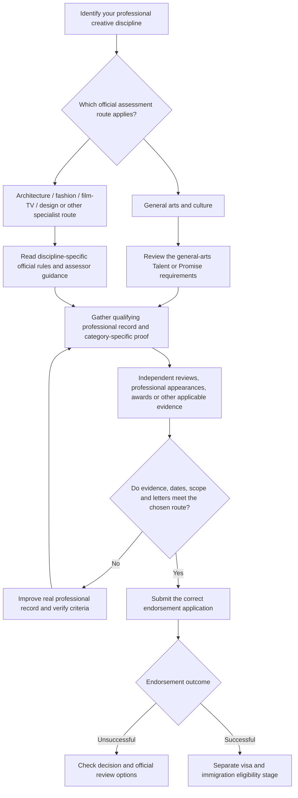

# UK Global Talent Visa — Arts & Culture Pathway

**Practical, discipline-specific, evidence-led guide with a detailed 24-month development plan**  
**Mettelo Resource Hub · Edition 1.0 · Updated 10 November 2026**  
Prepared by **Johnson Taiwo** · Mettelo — Built for What's Next

[← Global Talent resources](README.md) · [← Immigration resources](../README.md) · [← Resource Hub](../../README.md)  
[Arts checklist](arts-and-culture-checklist.md) · [Tracker instructions](tracker-guide.md)

> **Important:** This guide supports professional artistic development. Each discipline may have different endorsement requirements. The 24-month activities are optional and do not guarantee recognition or a visa.

## Visual decision architecture — arts and culture

The correct assessment route depends on your **specific creative discipline**. This map separates route selection, documentary evidence and the later visa stage.

**Reader note:** This is a route-selection workflow. Not every evidence category applies to every artistic discipline, and an appearance or review is not automatically qualifying evidence.

## Your first decision: which kind of creative professional are you?

| Your actual creative work | Read first | Take this action |
| --- | --- | --- |
| Music/composition | [Music strategy](#5-music--concrete-delivery-strategy) | Identify real programmes, venues, music critics and credited work |
| Painting/sculpture | [Visual-arts strategy](#6-painting-drawing-and-visual-arts) | Record juried exhibitions, relevant independent criticism and actual credits |
| Photography | [Contemporary visual practice](#7-photography-and-contemporary-visual-practice) | Verify whether the work is assessed as professional visual art versus commercial practice |
| Theatre, dance or choreography | [Performing-arts work](#8-dance-choreography-and-theatre) | Preserve production credits and legitimate professional programmes |
| Writing or poetry | [Literature and writing](#9-literature-poetry-and-creative-writing) | Confirm professional publication and literary review evidence |
| **Film, fashion, architecture or design** | [Specialist assessor comparison](#specialist-creative-routes--use-the-correct-official-evidence-rules) | Select the exact GOV.UK specialist pathway **before** using the general-arts evidence checklist |
| Starting with limited recognition | [First 90 days](#15-your-first-90-days) → [24-month strategies](#16-24-month-practical-development-plan) | Choose one practice, one legitimate professional selection channel and evidence log |

**Vocabulary:** *Professional appearance* means a genuine eligible artistic presentation, not any public upload; *independent critical recognition* means verifiable professional review of the work, not a paid advert or a press release; *recommendation* means a genuine letter from an eligible expert/organisation that has actually worked with you.

---

## Before anything else — understand the visa

### What is Global Talent for Arts & Culture?

The UK Global Talent visa allows recognised leaders and potential leaders in qualifying creative fields to work in the UK without a conventional employer sponsor. Under the permission granted, a successful holder can generally work as an employee, be self-employed or direct a business. It is intended for people with a **substantive professional artistic record**, not simply people who enjoy art, have an arts degree, have a large social-media following, or want to begin a creative career.

Most applicants first apply for an **endorsement**, in which specialist arts experts assess the quality and recognition of their professional work. The Home Office then considers the **separate visa application**, including immigration requirements. Certain qualifying international prizes can instead provide an endorsement-exempt route, but only prizes on the government's relevant list qualify for that bypass. See [GOV.UK overview](https://www.gov.uk/global-talent-arts-culture).

### Which creative fields are covered, and who assesses them?

| Field | Assessment pathway | What that means practically |
| --- | --- | --- |
| **Music** (composition, performing, relevant creation) | General arts assessment by **Arts Council England** | A professional performance/publication/review history is central; streaming popularity by itself is not the same as qualifying recognition. |
| **Combined arts, dance and choreography** | General arts assessment by **Arts Council England** | Credited productions, eligible critical reviews and significant professional appearances may matter. |
| **Theatre** (eligible professional theatrical work) | General arts assessment by **Arts Council England** | Document full production details, credited role and independent professional context. |
| **Literature** (novels, poetry, recognised writing fields) | General arts assessment by **Arts Council England** | Distinguish authored published work, professional literary awards and critical reviews from self-promotion. |
| **Visual arts**, including many professional art-photography practices | General arts assessment by **Arts Council England** | Curated exhibitions, media criticism, documented international professional presentation and qualifying prizes. |
| **Architecture** | Specialist **RIBA** assessment | Do not use this general-arts checklist as a substitute for architecture criteria. |
| **Fashion design** | Specialist **British Fashion Council** assessment | Different discipline-specific criteria. |
| **Design industry** | Specialist **Design Business Association** assessment | Specialist design criteria; verify scope. |
| **Film, television, animation, post-production, VFX** | Specialist **PACT** assessment, with different eligibility | Do not assume general arts exceptional-promise arrangements apply. |

The official [discipline list](https://www.gov.uk/government/publications/global-talent-endorsing-bodies/disciplines-covered-by-arts-council-england-or-its-associated-bodies) was updated **1 July 2026**. Some work, especially commercial photography, screenwriting, filmmaking or fashion, requires careful assessment of which specialist body actually applies.

### Specialist design-industry pathway — verified in November 2026

The UK now has a specific [Global Talent design-industry guidance page](https://www.gov.uk/global-talent-arts-culture/design-industry). **The Design Business Association (DBA)** assesses design applications on behalf of Arts Council England. Designers should use this route's own evidence requirements, not simply the combined arts examples elsewhere in this guide.

| What to check | DBA route's published guidance |
| --- | --- |
| Professional record | Regular work in design over the last five years; internationally published, distributed or exhibited work |
| Talent versus Promise | A **substantial** record in at least two countries for talent; a **developing** record in at least one country for promise |
| Letters | **Three** genuine recommendations; **two** from established expert organisations you have worked with, at least one UK-based; a third from another suitable organisation or person |
| Supporting documentation | Up to **ten** single evidence pieces, each up to **two A4 sides** and from the last **five years** |
| Categories | Evidence for at least **two of three**: significant independent critical media, qualifying international prizes, or professional design appearances/publications/exhibitions |
| Practical evidence | Named published design credits, credible design criticism by identifiable experts, real international recognition, actual client/commissioner records where relevant |

**Avoid common errors:** a commercial design portfolio, agency employment or international client list can demonstrate real work but is not automatically qualifying **independent** recognition. A grant or bursary does **not** automatically count as an international prize. A genuine prize is distinct from the specially listed **prestigious prize** exemption which can remove endorsement requirements.

**Action:** Before following any of the 24-month creative strategies, identify the **right professional field and its actual specialist assessor**; do not assume that an ACE general arts evidence set transfers unchanged to DBA, PACT, BFC or RIBA.

### Specialist creative routes — use the correct official evidence rules

**Important: the general-arts checklist in this resource does not determine requirements for every discipline.** As of 10 November 2026 the official sources below describe separate tests. Follow the appropriate dedicated GOV.UK page and supporting assessor instructions.

| Your creative profession | Official specialist route | What the assessor examines | Practical development and evidence strategy |
| --- | --- | --- | --- |
| **Architecture** | [RIBA — architecture](https://www.gov.uk/global-talent-arts-culture/architecture) | Talent/promise, genuine international professional practice; eligible media recognition, significant prizes and publications/exhibitions. **UK use of the title “architect” requires separate Architects Registration Board registration.** | Document credited designs, architectural practice, independent architectural reviews, juried exhibitions and real involvement confirmed by senior contributors. Verify professional title/registration separately. |
| **Fashion design** | [British Fashion Council — fashion](https://www.gov.uk/global-talent-arts-culture/fashion-design) | **Talent and Promise have different categories.** Talent may include international shows, distribution and sales; Promise can include qualifying fashion sponsorship/support, luxury retailer orders and industry recognition. | Preserve real fashion collection design credits, actual stockist orders/sales, dated show programmes, eligible industry support and verified reviews; do not substitute speculative sales or generic influencer coverage. |
| **Film, television, animation, VFX and post-production** | [PACT — film and television](https://www.gov.uk/global-talent-arts-culture/film-television) | **PACT assesses exceptional talent, not the ordinary arts exceptional-promise route.** Its award/nomination or notable-industry-recognition rules are specialist and may require qualifying work across different productions. | Verify exact credited production roles, recognised awards/nominations and production distribution/release records. Do not treat a student short film or festival entry as sufficient by itself. |
| **Professional design industry** | [Design Business Association — design](https://www.gov.uk/global-talent-arts-culture/design-industry) | Distinct design professional record; credible independent critical media, qualifying prizes and international publication/exhibitions | Collect authorised published work, demonstrable individual design contribution, named expert criticism and verified commissioner/organisation records. |
| **Music, dance, theatre, literature, visual art** | [Arts Council England — general arts](https://www.gov.uk/global-talent-arts-culture/combined-arts-dance-literature-music-theatre-or-visual-arts) | Three letters, professional recognition/track record and relevant qualifying evidence categories | Use the discipline strategies and 24-month tables later in this guide. Preserve independent critical responses and actual professional performances or exhibitions. |

#### Three mistakes to avoid

1. **A filmmaker cannot simply claim exceptional promise under the combined-arts route** when the professional work falls under PACT's specialist film and television assessment.
2. **Fashion Promise evidence may involve specific industry support or real retail orders**, so copying the general three-category arts table alone could miss the applicable route.
3. **Being endorsed as an architectural professional is not the same as registration to practise with the protected UK title “architect”.** Check [ARB registration](https://arb.org.uk/architect-information/applying-for-registration/) separately.

**Decision:** Check your exact practice against the [official endorsed discipline list](https://www.gov.uk/government/publications/global-talent-endorsing-bodies/disciplines-covered-by-arts-council-england-or-its-associated-bodies), select the assessor, then collect only the evidence relevant to that route.

### Exceptional Talent versus Exceptional Promise

| | Exceptional Talent — established leader | Exceptional Promise — potential leader |
| --- | --- | --- |
| Professional stage | Substantial professional achievements | Earlier career, **usually at least three years of professional experience** |
| Geographic record | A **substantial record in at least two countries**, one may be the country of residence | Developing professional record in **at least one country** |
| Work history | Regular professional engagement in the field in the last five years | Regular professional activity and recognised developing work |
| Qualifying evidence | At least **two** of eligible review/award/appearance categories, under leader thresholds | At least **two** categories under promise thresholds (shortlisting can qualify under the award category) |
| What it is not | A title you can choose because you are older or senior | A category for people with no professional artistic history |

For the legally operative wording, see [Appendix Global Talent, GTE 3.1–3.4](https://www.gov.uk/guidance/immigration-rules/immigration-rules-appendix-global-talent). The rules are separate for architecture, film/TV, fashion and design.

### How the application works

1. **Identify your actual discipline and category.** Choose the correct ACE or specialist route.
2. **Check artistic track record.** Map performed, published, distributed or exhibited work, dates, countries and external recognition.
3. **Develop real professional work if gaps exist.** Use the optional 24-month table, professional opportunities and genuine partnerships.
4. **Seek endorsement.** Provide a typed artistic CV, three qualifying recommendation letters and up to ten evidence items under the current rules.
5. **Apply for the visa.** Meet the separate Home Office requirements; endorsement is not the visa.

**Do not confuse training with recognition:** a photography certificate is useful for skill-building; an actual independently juried professional exhibition is a different event. A Spotify upload is evidence of distribution activity, but not necessarily proof of internationally significant sales or professional recognition. Performing at an informal event is not necessarily a qualifying professional appearance.

## Contents

1. [Official general-arts eligibility and evidence](#1-official-general-arts-eligibility-and-evidence)
2. [Which evidence categories to prioritise](#2-which-evidence-categories-to-prioritise)
3. [Disciplines and credible artistic career routes](#3-disciplines-and-credible-artistic-career-routes)
4. [Approaches reflected in successful creative careers](#4-approaches-reflected-in-successful-creative-careers)
5. [Music — concrete delivery strategy](#5-music--concrete-delivery-strategy)
6. [Painting, drawing and visual arts](#6-painting-drawing-and-visual-arts)
7. [Photography and contemporary visual practice](#7-photography-and-contemporary-visual-practice)
8. [Dance, choreography and theatre](#8-dance-choreography-and-theatre)
9. [Literature, poetry and creative writing](#9-literature-poetry-and-creative-writing)
10. [How to obtain genuine critical reviews](#10-how-to-obtain-genuine-critical-reviews)
11. [Exhibitions, performances, residencies and awards](#11-exhibitions-performances-residencies-and-awards)
12. [Creative collaborations and expert relationships](#12-creative-collaborations-and-expert-relationships)
13. [UK–Nigeria strategies and cross-border careers](#13-uknigeria-strategies-and-cross-border-careers)
14. [Practical opportunities directory](#14-practical-opportunities-directory)
15. [Your first 90 days](#15-your-first-90-days)
16. [24-month practical development plan](#16-24-month-practical-development-plan)
17. [Five outreach workflows](#17-five-outreach-workflows)
18. [Creative evidence register and documentary checks](#18-creative-evidence-register-and-documentary-checks)
19. [Recommendation letters and compliance](#19-recommendation-letters-and-compliance)
20. [Application and visa stages](#20-application-and-visa-stages)
21. [Common weak approaches and alternatives](#21-common-weak-approaches-and-alternatives)
22. [Official references and review notes](#22-official-references-and-review-notes)

---

## 1. Official general-arts eligibility and evidence

### Minimum documentary structure

For combined arts, dance, literature, music, theatre or visual arts assessed by ACE:

| Document | What official guidance requires | Practical handling |
| --- | --- | --- |
| CV | Typed professional arts/education history | Include verifiable credits, work, employers/commissioners and role; no unverified awards. |
| Recommendation letters | **Three**, up to **3 single A4 sides each** | Two from established relevant arts organisations (one **UK-based**); third established arts organisation or qualified expert individual, all with actual relevant artistic working relationships. |
| Supporting evidence | Up to **10 single pieces**, **2 A4 sides maximum each**, from the **last five years** | Select real independent documentation; do not fill the maximum with weak items. |
| Evidence categories | At least **two of three**: media reviews, eligible international prizes, qualifying professional appearances/exhibitions/distribution | Document precise category threshold, country, contributor credit, dates and independent significance. |

The main [GOV.UK general arts requirements](https://www.gov.uk/global-talent-arts-culture/combined-arts-dance-literature-music-theatre-or-visual-arts) and [Immigration Rules GTE 3](https://www.gov.uk/guidance/immigration-rules/immigration-rules-appendix-global-talent) are the controlling sources.

### Category A — critical media recognition

Provide **at least two reviews** of actual artistic work, by identifiable expert critics in internationally recognised and established outlets, with **critical evaluation** of quality rather than merely publicity. The record must show publication date, country, critic and your name or eligible proof of contribution. **Talent requires qualifying recognition from two countries**; promise has different one-or-more-country wording. Do not use a paid profile, promotional interview, social-media post, advertising feature or generic event notice as if it were independent criticism.

### Category B — internationally recognised awards

An eligible **international prize for excellence** requires real award records and credible adjudication. Under talent, winning (or making significant contribution to a win) may count; under promise, qualifying nominations or shortlists may also count. **A grant or bursary is not a prize** for this evidence category, even if the funding is prestigious. Likewise, winning some other prize does not automatically exempt you from endorsement: the separate government list of **endorsement-exempt eligible prizes** applies.

### Category C — professional appearances, exhibitions, publications or distribution

Provide evidence from independent national publications, broadcasts or distribution records establishing professional-level performances, exhibitions, publications or work distribution and the person's genuine contribution. **Talent requires a record in two countries**; promise may use a developing record from one or more. A family performance, personal rented exhibition, uncurated online upload or screenshots of account views should not be treated as qualifying without further official evidence.

### Why we focus on only two categories

Because the rules require at least **two of three**, a painter might reasonably build **critical reviews + curated exhibitions** rather than chase an award unrelated to their practice. A musician could pursue **reviews + professionally documented performances/distribution**. A writer might focus on **critical literary reviews + professionally published/distributed works**. These are strategy examples, not predictions of acceptance.

---

## 2. Which evidence categories to prioritise

| Profile | Stronger possible combination | Practical build approach | Avoid relying on |
| --- | --- | --- | --- |
| Musician or composer | Critical reviews + performances/distribution | Create a technically strong release, secure professionally billed concerts, seek real arts criticism and retain promoter/distributor records | Personal streaming graphs alone, self-produced 'award', marketing interview |
| Visual artist/painter | Critical reviews + curated exhibitions | Produce thematic body of work, seek independently selected exhibition, invite genuine critics and document catalogue | Paying to hang paintings and calling it a selected international show |
| Art photographer | Reviews + professional exhibitions; award where genuine | Prepare coherent sequence; submit to RPS professional juried exhibition; build gallery/curatorial relationships | Instagram engagement or photography-class certificate |
| Dance/choreography | Reviews + professionally programmed productions | Develop commissioned original choreography, participate in professional programme and document organiser/press | Rehearsal clips without credible professional stage context |
| Theatre | Reviews + professional productions; prize if real | Secure cast/creative credits, professional production and critic evaluation; work with recognised producing organisations | Amateur show billed as significant international theatre |
| Literature | Critical reviews + published/distributed works; qualifying prize | Secure editorial publication, professional festival/event context, independent critical assessment | Self-publishing a book and counting your own announcement as a review |

### Evidence ladder — from learning to potentially meaningful recognition

1. **Practice:** a draft, lesson, rehearsal, workshop or self-published work. Useful for learning; often not qualifying alone.
2. **Independent professional opportunity:** selected residency, externally curated show, paid artistic commission, professionally published/produced piece or credible programme. Stronger professional foundation, not automatically eligible evidence.
3. **Verified professional achievement:** credited professional work, independent programme, distribution/industry records and an actual quality evaluation.
4. **Potential endorsement evidence:** genuinely significant and admissible items in a qualifying category, with required dates, countries, critic/jury or professional context, corroborated by official guidance.

Do not assume stage 2 or 3 automatically meets stage 4. In particular, a **residency grant** or training award may strengthen your CV without counting as the international prize criterion.

---

## 3. Disciplines and credible artistic career routes

The following are preparation strategies, not official subcategories.

| Discipline | Main body of work | Who should independently assess/select it | Strong records worth preserving |
| --- | --- | --- | --- |
| Composition/music performance | Original recordings, live set, commissioned music | Arts reviewers, recognised festival/programme selectors, producer or commissioning organisation | Critic review, promoter programme, release/distribution data and genuine credits |
| Painting/drawing/sculpture | Curated coherent body of original work | Gallery curator, credible juried selection panel, recognised arts critic | Exhibition catalogue, gallery programme, signed artist credit and review |
| Art photography | Long-form photographic series or documentary practice | Juried photography exhibition, curator, critic | Selection record, exhibition programme, review and permitted reproduction |
| Dance/choreography | Finished stage work, choreography or professional creative role | Established dance company or professional venue/programmer | Cast/creative billing, programme, critic review, contracts |
| Theatre | Professionally produced theatrical work, dramaturgy, directing, acting | Established producing theatre, festival, dramaturg or critic | Production credits, critical reviews and regional/country distribution |
| Fiction/poetry/literature | Published original work or professionally presented work | Established publisher, editor, festival or literary reviewer | Publisher record, bylined critical review, festival invitation and distribution details |

---

## 4. Approaches reflected in successful creative careers

**Evidence integrity:** This section describes *publicly visible professional pathways* used by recognised creative practitioners and practical patterns in [Arts Council England's published applicant guidance](https://www.artscouncil.org.uk/sites/default/files/download-file/Guide%20for%20Global%20Talent%20applicants%20May%202021.pdf). It is **not** a verified dataset of successful visa applicants' submitted files. Actual endorsement files are normally private, and public biographies do not show which evidence was accepted. The approaches are legitimate career-building methods, not insider approval techniques.

| Professional pattern | How it becomes a practical strategy | Limits |
| --- | --- | --- |
| Work is **externally curated**, rather than solely self-displayed | Submit a cohesive series to relevant juried exhibition/residency; if selected, build a real working relationship and obtain public catalogue credit | A submission or self-funded exhibition does not prove recognised international appearance |
| Creative work is **independently reviewed**, rather than merely promoted | Complete a professional public presentation; provide critics an accurate media kit; preserve actual evaluative reviews | A paid article, advert or interview without evaluation is not qualifying criticism |
| Artists build **repeat collaborations** with recognised cultural institutions | Offer an original project with scope, artistic value, budget and rights; deliver it and stay in contact | A famous organisation's generic email acknowledgement is not a recommendation relationship |
| Practitioners develop **international track records** | Collaborate with distinct venues/organisations in different countries and preserve separate programmes and credits | Online availability does not necessarily prove professional engagement in another country |
| Creative professionals enter **independently judged awards** | Review formal entry criteria, submit original work, and preserve real selection/win outcomes | Grants and bursaries do not satisfy the prize category |
| Artists keep **professional provenance** | Retain signed agreements, programmes, credited records, review metadata and dates as work occurs | Reconstructed screenshots or unsupported impact claims are weak |

### Practical implication

The most sustainable strategy is to choose a discipline, create excellent original work, put it before legitimate selectors and audiences, develop meaningful collaborations, and document genuine independently issued outcomes. **Do not start by buying interviews, requesting letters from strangers or manufacturing international appearances.**

---

## 5. Music — concrete delivery strategy

**Route A: Original professional releases.** Develop a three-to-five-track body of work, documenting who wrote/composed/produced it, rights, studio process and artistic credits. Obtain an independent assessment from a legitimate producer or music editor. Release through an authorised distributor and retain actual metadata and country-level usage, but do not treat upload counts as significant sales or independent critical recognition.

**Route B: Professionally programmed performances.** Prepare a 20–30 minute live set and a simple EPK (music links, verified credits, biography, technical needs). Apply through actual festival, promoter and venue programming routes. For accepted dates retain original programme, ticket listing, organiser confirmation, venue/country and review. An unpaid informal open mic may be useful rehearsal, not equal to a selected professional festival slot.

**Route C: Commissioned collaborations.** Work with established musicians, ensembles, arts companies or cultural institutions; define composition/performer role, contracts and independent artistic review. Genuine work with a UK established organisation may develop the working relationship relevant to one recommendation letter, but **being contracted does not guarantee the organisation will recommend you**.

**Targeted UK support:** [PRS Foundation Open Fund for Music Creators](https://prsfoundation.com/funding-support/funding-music-creators/all-career-levels/the-open-fund-for-music-creators/) supports eligible **UK-based** music creators. Its published rules include an 18-month track-record requirement and other restrictions, so a Nigeria-resident creator should not assume eligibility. A **PRS grant is development funding, not the visa's international-prize evidence**. [PRS criteria](https://prsfoundation.com/funding-support/funding-music-creators/all-career-levels/the-open-fund-for-music-creators/prs-for-music-foundations-the-open-fund-criteria/).

**Nigerian/cross-border route:** Check [British Council Nigeria Creative Economy](https://www.britishcouncil.org.ng/programmes/arts/creative-economy) and [UK/Nigeria Season of Culture 2028](https://www.britishcouncil.org.ng/programmes/arts/uk-nigeria-season-culture-2028) for actual collaborative programme routes. Apply only to live eligible programmes; a mailing-list signup is not a performance.

**Example evidence bundle:** genuine credited programme (country, promoter, date, artistic role) + independent published critic review + accurate distribution records + actual UK arts organisation collaboration. This is an illustrative combination, not an approved applicant's file.

---

## 6. Painting, drawing and visual arts

**Strategy A — juried exhibition:** Prepare a cohesive 10–15 work series with full titles, medium, date, photographic reproduction rights, display requirements and a 250-word curatorial statement. Browse [Artquest opportunities](https://artquest.org.uk/opportunities/) and [a-n open calls](https://www.a-n.co.uk/jobs/). Select organisers based on genuine curatorial process, professional standing, eligibility and whether there will be independent public documentation. Submit before deadline with a portfolio tailored to the curatorial theme.

**Strategy B — artist residency:** Monitor [New Art Exchange RESIDE](https://nae.org.uk/current-opportunities/) and [Artquest residency calls](https://artquest.org.uk/opportunities/). Describe the work to be researched, why the place/mentor is relevant, the outcome, budget, accessibility and data/space requirements. If accepted, retain independently issued residency award, work created and programme evaluation. A residency is not itself proof of a qualifying **prize**.

**Strategy C — gallery collaboration:** Research gallery rosters and recent exhibitions before contacting a curator. Send a small relevant series, brief artistic concept, evidence of previous professional work and a precise proposal for participation or feedback. For a Nigerian artist wishing to work toward [ART X Lagos](https://www.artxlagos.com/faqs), note that **the fair says artists are shown through participating galleries** rather than through an unrestricted direct artist submission. Build genuine gallery/curator relationships; do not rely on an assumed direct submission route.

**Strategy D — serious criticism:** Following a credible curated exhibition, provide factual exhibition details, images cleared for use and context to an independent arts editor or critic. Keep the published review with byline and evaluative statements, not simply a poster or social-media repost.

**Example evidence bundle:** independently curated international exhibition record + bylined critic's review of the work + professional work chronology. Determine significance under the ACE standard rather than presuming it.

---

## 7. Photography and contemporary visual practice

**Strategy A — international juried photography:** The [Royal Photographic Society International Photography Exhibition 168](https://rps.org/exhibitions/ipe-168) advertised submissions through **15 December 2026** with finalisation on its published platform, with international eligibility. Verify the exact current cycle and fees before submission. Submit a coherent, technically strong single image or series, preserve submission ID and independent selection outcome. One free single-image entry was advertised for this edition; future terms may change.

**Strategy B — professional exhibition:** Work toward selected gallery/museum/public art exhibitions using [RPS Opportunities](https://rps.org/opportunities), [Artquest](https://artquest.org.uk/opportunities/) and [a-n](https://www.a-n.co.uk/jobs/). Compare curators and selection criteria; do not pay an unknown website to publish a profile and call it professional recognition.

**Strategy C — documentary or socially engaged project:** Develop a consent-aware, rights-cleared photographic series with a clear subject and intended audience. Seek an independent gallery, festival or arts editor to consider it, and avoid publishing images of people without the appropriate legal and ethical permissions.

**Strategy D — professional recognition:** Where selected, preserve exhibition catalogue, official listing, selectors' statements, credited artist name and independent critical assessment. A technical photography workshop certificate is useful learning but usually not the required proof of recognised work.

**Note on scope:** Fashion/commercial photography and screen work may overlap specialist routes. Check the [official scope list](https://www.gov.uk/government/publications/global-talent-endorsing-bodies/disciplines-covered-by-arts-council-england-or-its-associated-bodies) before assuming ACE general-arts assessment.

---

## 8. Dance, choreography and theatre

### Dance and choreography

**A — develop a finished choreographic work:** Create 10–20 minutes of original work with performers who consent to rehearsal/film, rehearsal logs, choreographer credits, risk/access planning and a professional technical description.

**B — enter actual professional programme:** [The Place's Artists' Noticeboard](https://theplace.org.uk/work-with-us/jobs-and-opportunities/artists-opportunities/) lists paid artist opportunities, auditions and open calls; check each item's geography and current status. [FABRIC Residencies](https://fabric.dance/fabric-residencies/) offer support for **UK-based** artists and announce calls through the mailing list. A residency eligibility restriction must be respected by artists still resident in Nigeria.

**C — build professional programme evidence:** Work with a producing dance organisation or curated festival, obtain performer/choreographer credit, programme, location and selection record. If a qualified critic reviews the production, keep the evaluation and accurate attribution.

### Theatre, acting and directing

**A — join a real professional production:** Audition or submit your directing, stage-management or dramaturgical portfolio via the theatre's legitimate casting/production route. Agree credits and permissions.

**B — develop new production:** Prepare finished script/staging concept, budget, cast, rehearsals, accessible performance materials and a credible producer or venue partner. Professional third-party selection matters more than self-produced posters.

**C — seek external review:** Invite accredited or demonstrably expert arts critics through editorial channels after an actual programme. Preserve reviews evaluating the performance or production and naming or credibly attributing your work.

**Watch the boundary:** A screen acting role or film production may fall within **PACT's specialist film/TV route** rather than ordinary theatre. Check [GOV.UK film/TV rules](https://www.gov.uk/global-talent-arts-culture/film-television) before deciding.

---

## 9. Literature, poetry and creative writing

**Strategy A — editorial publication:** Prepare a polished story, poetry sequence or manuscript sample. Identify reputable literary magazines, publishers or commissioned outlets that genuinely accept the genre. Read and obey their submission guidelines and acceptance windows. Record editor's acceptance, published work, copyright contract, publication date and critical response.

**Strategy B — properly eligible competition:** [New Writing North Northern Writers' Awards](https://newwritingnorth.com/northern-writers-awards/awards/) have category-specific submission windows; **applicants must live full-time in the North of England**. They are not an application route for Nigerian residents living in Nigeria. On **9 November 2026**, specific 2027 categories were open and others were due to open later; always consult the current category page and [eligibility](https://newwritingnorth.com/northern-writers-awards/eligibility/).

**Strategy C — professional literary event:** Pitch a specific extract, author conversation or reading to an actual literary festival organiser with a concise bio and demonstrated writing record. Record a genuine invited/selected programme appearance rather than organising your own livestream solely to claim significance.

**Strategy D — independent criticism:** Encourage genuine eligible reviews of the published work through editors/critics, not paid review services. Identify critic, date, publication, country and the evaluative passage.

**Important:** A literary award shortlist may be relevant under **exceptional promise** but is not automatically equivalent to a qualifying **international prize**. The venue, jury, award and rules matter.

---

## 10. How to obtain genuine critical reviews

Arts Council England distinguishes **critical evaluation** from publicity. A feature announcing your show, a paid interview, self-published LinkedIn article, advertorial or publicity press release should not be represented as a qualifying media review.

| Step | Exact practical action | Evidence consequence |
| --- | --- | --- |
| 1. Finish presentable work | Publish, exhibit or perform at a professional level; prepare verified context. | Critic has real work to assess. |
| 2. Identify actual critics | Look for bylined reviews of similar work in established arts/culture outlets; confirm critic's subject expertise. | Appropriate independent reviewer. |
| 3. Contact editorial team | Use the outlet's published editorial submissions/contact process with work, dates, artist credit, press kit and review access. Do not request a positive review. | Legitimate pitch record, not yet a review. |
| 4. Facilitate access | Where appropriate, provide critic access, work samples, rights-cleared materials or programme details. | Accurate context and opportunity for fair assessment. |
| 5. Check published result | Does it evaluate artistic quality, name you/eligible contribution, identify writer, publication, date and country? | Possible evidence; check ACE significance. |
| 6. Preserve ethically | Save a lawful copy or screenshot of published material with complete metadata; keep outlet URL and permission context. | Traceable documentation if admissible. |

**Do not purchase favourable reviews.** The [ACE applicant guide PDF](https://www.artscouncil.org.uk/sites/default/files/download-file/Guide%20for%20Global%20Talent%20applicants%20May%202021.pdf) expressly distinguishes critical coverage from paid/submitted promotional material. The older PDF is useful explanatory context, but the [current government rules](https://www.gov.uk/global-talent-arts-culture/combined-arts-dance-literature-music-theatre-or-visual-arts) prevail.

---

## 11. Exhibitions, performances, residencies and awards

### Apply in the right order

1. Find relevant **live** opportunity using a proper professional directory, organisational site or curator's actual invitation.
2. Read eligibility: discipline, current residence, age, career stage, status, application fee, travel, accessibility, copyright, project cost and selection method.
3. Prepare professional submission: artist statement/EPK/extract, proof of authorship, portfolio, independent experience, technical requirements, timeline and budget if needed.
4. Apply using only the programme's official process; save the precise submission and source rules.
5. If selected, confirm agreement, credits, delivery, publication and any formal public review.
6. If rejected, obtain permitted feedback and improve actual artistic work. **Rejection is not a visa evidence item.**

### How to assess an award

Ask: Is it truly an **international award for artistic excellence**? Who judges it? What is the category and public result? Does the artist actually win or meet the promise nomination/shortlist condition? What is the geography? Is it a **grant or bursary** (which does *not* count for the prize criterion)? Does the applicant's credited role demonstrably relate to the award?

### Opportunity type versus visa evidence

| Professional opportunity | May improve an artistic career | Automatically qualifies? |
| --- | --- | --- |
| Residency / grant / bursary | Yes | **No**; not an international prize under ACE rules |
| Curated professional exhibition | Yes | **No**; significance, documentation and country requirements matter |
| Professional concert or theatre production | Yes | **No**; must meet applicable professional/recognition threshold |
| Acknowledged bylined critical review | Potentially | **No**; critic, outlet, country and review quality are assessed |
| Formal international award win/qualifying shortlist | Potentially | **No**; separate evaluation, category and route rules apply |
| Online course / workshop / networking | Useful skill-building | Normally not the direct evidence required |

---

## 12. Creative collaborations and expert relationships

### A working relationship that could genuinely support a recommendation

**Month A:** Identify a credible producing arts organisation genuinely aligned with your actual discipline; study its previous programmes and published collaboration routes.

**Month B:** Offer an artistically worthwhile, modest scoped collaboration—for example, commissioned composition, selected group exhibition, a staged reading, choreography for a production or an independent publication.

**Delivery:** Agree ownership, rights, credit, fee, role, dates and technical/creative work. Actually produce the work; get independent feedback and a real public credit.

**After delivery:** Maintain a normal professional relationship and document what the curator, artistic director, editor or programme lead genuinely knows about your work.

**Only when applying:** Ask whether an eligible senior representative is willing to write an independent recommendation in line with the official rules. They should not invent activity or sign a generic AI-generated statement. The required letter addresses how they worked with you, your achievements, UK benefit and your contribution to UK cultural life.

### Why cold requests for letters fail

A famous artistic director who has never worked with you is not an acceptable substitute for a genuine collaboration. Two recommendations must come from established relevant **organisations**, including **one UK-based organisation**; the third may come from an appropriate established organisation or expert individual. Don't misclassify a course tutor, fan or arts influencer as an eligible organisation based only on a title.

### Electronic signing

The original Mettelo handbook contains an extended DocuSign process. Electronic signing software is **an optional document workflow** to coordinate authentic author-approved signatures; it does not validate the author's eligibility or make the content compliant. Follow the current official rules for signatures and originals, and obtain the author's genuine consent.

---

## 13. UK–Nigeria strategies and cross-border careers

### For an artist living in Nigeria

A Nigerian base does **not** prevent developing credible artistic work. Begin with real professional engagements in Nigeria, document your creative contribution and seek meaningful external presentation or recognition. For *exceptional talent*, a substantial record in **at least two countries** is required; a Nigerian show alone does not satisfy that requirement. For *exceptional promise*, the current rules permit a developing record in at least one country, subject to the other requirements.

**Practical route:** complete portfolio → work with recognised Nigerian curator/producer/publisher → seek professionally selected local engagement → develop a two-country collaboration with an actual international cultural partner → publish/distribute real work → obtain independent evaluation. Travel, work and participation permission remain separate questions.

### British Council UK/Nigeria Season of Culture 2028

The [British Council Season page](https://www.britishcouncil.org.ng/programmes/arts/uk-nigeria-season-culture-2028) describes a UK–Nigeria creative partnership programme and lists an expression-of-interest opportunity on **9 November 2026**. A possible approach is to prepare a one-page project idea with partner, artform, audiences, proposed outcomes, budget, timeline and benefit to both countries, then check its live official submission route. **An EOI submission is not selection, professional appearance or endorsement evidence**.

### ART X Lagos: how visual artists actually reach the fair

The [ART X Lagos FAQ](https://www.artxlagos.com/faqs) says it works with established galleries and displays artists represented by participating galleries. Therefore, **do not tell artists to send an unsolicited artist application to the fair**. Build a coherent portfolio, research legitimate gallery programmes and approach suitable galleries or curated art opportunities through their published processes. ART X also describes a separate prize programme, but **a future prize application window must be verified** rather than guessed.

### Different evidence outcomes require different records

A critic review from one country and selected exhibition in another are distinct **types** of evidence with category-specific rules; do not assume they automatically combine into a talent-level case without meeting the category thresholds. Always record exact venue, country, professional significance and artist credit.

---

## 14. Practical opportunities directory

**As checked 9 November 2026.** A directory link is a starting point, not a guarantee that an application is open, that you qualify, or that participation will meet a visa criterion. Programme-specific geography, funding, copyright and deadlines must be checked each time.

| Organisation / programme | Discipline and use | Who may apply / status caveat | Concrete approach | Verified resource |
| --- | --- | --- | --- | --- |
| **Artquest Opportunities** | Visual art, painting, photography, commissions, residencies | Listings update; each call has its own rules | Filter by practice, choose eligible call, prepare artist statement and portfolio | [Opportunities](https://artquest.org.uk/opportunities/) |
| **a-n / Artists Now** | Visual arts, exhibitions, studios, awards, paid commissions | Some content requires login/membership; geography varies | Filter opportunities, verify original organiser and apply through its form | [Opportunities](https://www.a-n.co.uk/jobs/) |
| **New Art Exchange (NAE)** | Contemporary visual art and curatorial projects | RESIDE 2027/28 open call listed 14 Oct–9 Dec 2026; check artist eligibility | Read relevant open-call pack, prepare concept and previous work | [Current opportunities](https://nae.org.uk/current-opportunities/) |
| **Royal Photographic Society (RPS)** | Photography exhibitions, awards, bursaries | IPE 168 submissions to 15 Dec 2026; international eligibility described | Review IPE rules, submit quality original work with rights and attribution | [RPS IPE 168](https://rps.org/exhibitions/ipe-168) |
| **The Place** | Dance and choreography | Weekly changing paid opportunities; geography varies | Filter actual artist notices and submit to genuine producing organisation | [Artists Noticeboard](https://theplace.org.uk/work-with-us/jobs-and-opportunities/artists-opportunities/) |
| **FABRIC Dance** | Dance creation and residencies | Programme supports **UK-based** artists; calls open periodically | Sign up for notification, submit original choreography proposal when eligible | [Residencies](https://fabric.dance/fabric-residencies/) |
| **PRS Foundation Open Fund** | Original music creation, recording, performance | **UK-based creators** meeting its detailed rules, generally 18+ months' track record | Check creator eligibility, write project with creation, audience and budget | [Open Fund](https://prsfoundation.com/funding-support/funding-music-creators/all-career-levels/the-open-fund-for-music-creators/) |
| **New Writing North** | Literature, fiction, poetry, creative writing | Northern Writers Awards require **full-time residence in North of England** | Read category, prepare anonymised extract where asked, submit via stated portal | [2027 Awards](https://newwritingnorth.com/northern-writers-awards/awards/) |
| **British Council Nigeria** | Creative development, cultural collaboration | Programme and age/residence restrictions vary | Explore open partnership and creative economy calls; prepare project brief | [Creative economy](https://www.britishcouncil.org.ng/programmes/arts/creative-economy) |
| **UK/Nigeria Season of Culture 2028** | Cross-border arts partnership | Expression of interest described on official page on 9 Nov 2026 | Prepare two-country concept and real partner scope, then follow official EOI | [Season of Culture](https://www.britishcouncil.org.ng/programmes/arts/uk-nigeria-season-culture-2028) |
| **ART X Lagos** | Curated commercial/visual arts | Artists shown via participating galleries; direct artist application is **not** the fair's stated normal model | Develop gallery relationships and check separate prize status independently | [Fair FAQ](https://www.artxlagos.com/faqs) |
| **Arts Council England** | Official endorsement and general sector | Endorsement rules, **not** an applicant-development grant guarantee | Read the applicable evidence categories, discipline and letter requirements | [Government route](https://www.gov.uk/global-talent-arts-culture/combined-arts-dance-literature-music-theatre-or-visual-arts) |

### A useful starting shortlist by circumstance

| Situation | Prioritise | Avoid |
| --- | --- | --- |
| Nigeria-resident painter | Artquest *international-eligible* calls, Nigerian gallery/curator partnerships, British Council cross-border programmes | UK-residency-only grants or assuming ART X direct entry |
| UK-based emerging musician | PRS Foundation if fully eligible, reputable independent promoters and actual professional selection | Using the grant as an international award |
| International art photographer | RPS IPE open-call process and suitable internationally eligible juried competitions | Generic paid profile sites |
| Northern England writer | New Writing North specific awards if eligible, publishers and professional readings | Applying when you do not meet full-time Northern residence |
| UK-based contemporary dancer | The Place paid notices and FABRIC open-call alerts | Calling an open class a professional performance |
| Nigeria-based dancer or writer | Nigerian professional programmes plus eligible international partnerships and credible publication | Assuming UK location-restricted opportunities accept overseas applicants |

---

## 15. Your first 90 days

| Period | Specific work to complete | Who to approach | What remains after the period |
| --- | --- | --- | --- |
| **Days 1–14** | Decide actual discipline and ACE/specialist route. List five years' credited artistic activity, publications, reviews, awards and countries. Mark evidence lacking external verification. Identify organisations with whom you **already worked**, especially any UK-based organisation. | Past producers, arts editors, gallery curators, professional collaborators; [official eligibility](https://www.gov.uk/global-talent-arts-culture/combined-arts-dance-literature-music-theatre-or-visual-arts). | Truthful chronology and mandatory-document gap analysis |
| **Days 15–30** | Build a coherent portfolio or EPK. Prepare three tailored opportunity submissions with eligibility, current deadlines, required work samples and legal rights. Submit only when a call is active. | [Artquest](https://artquest.org.uk/opportunities/), [RPS](https://rps.org/opportunities), [The Place](https://theplace.org.uk/work-with-us/jobs-and-opportunities/artists-opportunities/), [New Writing North](https://newwritingnorth.com/northern-writers-awards/awards/) according to discipline. | Curated portfolio, three verified targets, real submissions and receipts |
| **Days 31–60** | Develop actual artistic work and a proposal for collaboration or commission. Contact two or three relevant professional organisations or artists through published routes. Request artistic critique or a feasible project discussion, not a visa endorsement. | Established producers, professional curators, literary editors, commissioning organisations; [British Council Nigeria](https://www.britishcouncil.org.ng/programmes/arts/creative-economy) for relevant cross-border work. | Working creative project, professional response and revised portfolio |
| **Days 61–90** | Complete a selected work if any. Record genuine public credits, programme, audience and review independently; if nothing accepted, document feedback and improve work. Plan the next six months based on actual outcomes. | Actual organiser, curator, producer, qualified critic and collaborators. | Evidence ledger, honest acceptance/rejection log and months 4–6 priority plan |

**Do not fabricate three submissions, a collaboration or two-country records just to satisfy the schedule.** These are suggested actions, not thresholds.

---

## 16. 24-month practical development plan

This is a **career-development schedule**, not a government rule. Start in Month 1 whenever you begin, but skip work you have already achieved with credible supporting records. The activities identify different branches for musicians, visual artists/photographers, dancers, theatre professionals and writers. **Choose relevant actions rather than attempting everything.**

Each month sets out three different implementation options and indicates **where to find actual opportunities**, **how to approach the people involved**, and **what evidence to retain**. Organisational selection is competitive; merely applying, becoming a member or attending a workshop is not proof of endorsed artistic achievement.

### Phase 1 — Establish genuine professional artistic work (months 1–6)

| Month and specific objective | Action strategies — select those relevant to your artform | Who to approach and direct route | Records and evidence to retain |
| --- | --- | --- | --- |
| **01 — Choose correct route; inspect historic evidence** | **Music:** list releases, credited performances, professional reviews and organised festivals, with dates, countries and contracts. **Visual/photography:** list curated exhibitions, juried selections and independent critics. **Dance/theatre/literature:** list professional productions, programmes, publications and reviews. Separate amateur, self-hosted and professional work. | Check [ACE disciplines](https://www.gov.uk/government/publications/global-talent-endorsing-bodies/disciplines-covered-by-arts-council-england-or-its-associated-bodies), [arts rules](https://www.gov.uk/global-talent-arts-culture/combined-arts-dance-literature-music-theatre-or-visual-arts) and appropriate specialist body. Ask former producers, curators or publishers for missing programme credits. | Five-year activity chronology; 3-letter relationship map; media/award/appearance evidence gaps. |
| **02 — Build a professional, independently verifiable portfolio** | **Music:** record an original performance reel with official billing and credits. **Visual:** curate 12–20 original works, titles, medium, date and exhibition context. **Dance/theatre:** use permitted production footage and cast credits. **Writers:** prepare a finished excerpt and verified bibliography. Do not mistake a portfolio website for qualifying recognition. | Use [Artquest guidance](https://artquest.org.uk/) for visual practice, [Royal Photographic Society](https://rps.org/opportunities) for photography and [New Writing North](https://newwritingnorth.com/) for writers; seek critique from an established practitioner, not a purchased endorsement. | Portfolio with authorship/rights ledger, publication/production permissions and accurate CV. |
| **03 — Develop a coherent work for professional selection** | **A:** write one-page project description and artistic statement; **B:** produce finished examples (three songs, coherent image series, ten-minute performance excerpt or revised writing sample); **C:** obtain independent constructive critique and revise. Preserve the unsuccessful iterations honestly. | Ask a local curator, producer, arts centre or established writer for a short portfolio critique through their published contact route; browse [a-n opportunities](https://www.a-n.co.uk/jobs/) or [Artquest](https://artquest.org.uk/opportunities/) for fitting calls. | Finished work with dates, portfolio versions, independent feedback and clarified artistic credit. |
| **04 — Apply to a genuine juried professional opportunity** | **Visual:** choose an actual call aligned to medium and geography; submit portfolio, statement, budget and rights documents. **Photography:** consider [RPS IPE 168](https://rps.org/exhibitions/ipe-168) if still before its 15 December 2026 deadline or monitor a later edition. **Literature:** enter only the category matching your manuscript and residence. **Music/theatre/dance:** submit to verified professional programmes or auditions. | Check [Artquest live listings](https://artquest.org.uk/opportunities/), [RPS calls](https://rps.org/opportunities), [New Writing North awards](https://newwritingnorth.com/northern-writers-awards/awards/) and [The Place](https://theplace.org.uk/work-with-us/jobs-and-opportunities/artists-opportunities/). Observe location, age, fee and deadline restrictions. | Dated rules and actual submission; selection/jury outcome if accepted; never describe an application as an award. |
| **05 — Secure a substantive creative collaboration** | **A:** identify a real professional production or exhibition needing your discipline. **B:** propose a scoped contribution (music composition, original paintings, choreography, dramaturgy, photography series, literary reading) with a deliverable and agreed credit. **C:** document payments, rights, permissions and public-facing role after completion. | Approach producers and programme managers listed on [New Art Exchange](https://nae.org.uk/current-opportunities/), [The Place](https://theplace.org.uk/work-with-us/jobs-and-opportunities/artists-opportunities/), established Nigerian arts centres or actual producing organisations; use official call or programme contact. | Agreement, credited programme, final artistic output, organiser confirmation and evidence of professional engagement. |
| **06 — First half-year evidence review and route correction** | **A:** grade whether any performance/exhibition is recognised professionally, not merely attendance. **B:** assess whether critical commentary came from a qualifying critic and publication, not a paid advert. **C:** review whether the desired recommendation organisations have actually worked with you. Change approach where evidence weak. | Use [ACE published requirements](https://www.gov.uk/global-talent-arts-culture/combined-arts-dance-literature-music-theatre-or-visual-arts); request a professional portfolio critique from a curator, publisher, programme director or producer who has actually seen your work. | Gap register against two of media, awards, appearances/exhibitions; next six-month programme target. |

### Phase 2 — Obtain independent professional participation (months 7–12)

| Month and specific objective | Action strategies — select those relevant to your artform | Who to approach and direct route | Records and evidence to retain |
| --- | --- | --- | --- |
| **07 — Make a professional UK/Nigeria connection** | **A:** develop a two-country collaboration concept with genuine artists and complementary audiences. **B:** seek a programming partner rather than asking directly for a visa letter. **C:** prepare a budget and ownership plan; distinguish confirmed interest from an actual commissioned event. | Explore [British Council UK/Nigeria Season of Culture 2028](https://www.britishcouncil.org.ng/programmes/arts/uk-nigeria-season-culture-2028) expression of interest (check current window), or ask an established gallery, arts centre or festival how partnerships are selected. | Real partner correspondence, agreed scope if selected, country attribution and dated artistic work. |
| **08 — Pursue a substantive residency or commission** | **Visual:** submit project concept, artist statement, technical requirements and work samples to relevant residency. **Dance:** apply to a development residency if UK-based and eligible. **Music/writers:** use discipline-specific commissioning routes. **Fallback:** propose an independently curated collaborative show with an external organisation. | Monitor [New Art Exchange RESIDE](https://nae.org.uk/current-opportunities/), [Artquest residency filters](https://artquest.org.uk/opportunities/) and [FABRIC Dance](https://fabric.dance/fabric-residencies/). Confirm open calls and costs; not all welcome international applicants. | Application/selection evidence; if accepted: contract, original work, curator/producer assessment and public programme. |
| **09 — Strengthen professional reviews through actual artistic work** | **A:** present completed work in a credible public professional context. **B:** send a concise information pack to suitable arts critics/editors after publication or performance; offer facts and access, not a purchased favourable write-up. **C:** document exactly what was evaluated, including any negative review. | Study actual reviewers and editorial commissioning at reputable culture publications relevant to your discipline; check [ACE standards for reviews](https://www.gov.uk/global-talent-arts-culture/combined-arts-dance-literature-music-theatre-or-visual-arts). A [PUNCH](https://punchng.com/) general mention or promotional interview is not automatically a critical review. | Independent critic's byline, dated review evaluating quality, publication/country, attributable work; otherwise keep gap marked. |
| **10 — Seek a selected public performance or exhibition** | **Music:** secure a professionally programmed event rather than paying for a generic open mic. **Visual:** obtain externally curated exhibition selection, distinct from self-hired wall space. **Dance/theatre:** enter a professional festival or production casting. **Literature:** pitch a curated festival reading or publisher event, with official programme. | Use [a-n listings](https://www.a-n.co.uk/jobs/), [The Place](https://theplace.org.uk/work-with-us/jobs-and-opportunities/artists-opportunities/), [New Art Exchange](https://nae.org.uk/current-opportunities/) and discipline-specific festivals. Verify organisers, eligibility and financial terms. | Organiser selection record, credited catalogue/programme, dates, venue, country and independent press if earned. |
| **11 — Develop a defensible international arts track record** | **A:** if your career is Nigeria-based, seek a real collaboration or selected programme outside Nigeria; if UK-based, investigate cross-border partner work. **B:** resolve travel/rights/visas separately and avoid claiming a remote online event is an in-country appearance without checking its actual context. **C:** deliver original work and collect formal programme evidence. | Explore [British Council creative programmes](https://www.britishcouncil.org.ng/programmes/arts/creative-economy), [UK/Nigeria Season 2028](https://www.britishcouncil.org.ng/programmes/arts/uk-nigeria-season-culture-2028), or eligible cross-border residency calls via Artquest. | Actual professional work documented by country, promoter, date and personal artistic role; no invented international reach. |
| **12 — Year-one assessment against official endorsement rules** | **A:** choose talent versus promise based on professional career and country track record. **B:** check whether two of the three evidence categories are truly evidenced. **C:** check relationship with UK arts organisation and other recommendation authors, who must have worked with you artistically. | Re-read [ACE GTE3 rules](https://www.gov.uk/guidance/immigration-rules/immigration-rules-appendix-global-talent) and [GOV.UK documents](https://www.gov.uk/global-talent-arts-culture/combined-arts-dance-literature-music-theatre-or-visual-arts). Seek regulated advice for immigration status. | Year-one RAG assessment, genuine source links, evidence permission log and specific missing opportunities. |

### Phase 3 — Develop stronger professional recognition and international work (months 13–18)

| Month and specific objective | Action strategies — select those relevant to your artform | Who to approach and direct route | Records and evidence to retain |
| --- | --- | --- | --- |
| **13 — Create a stronger original artistic body of work** | **Music:** develop EP or commissioned new-music cycle with verified artistic role. **Visual/photography:** produce cohesive exhibition series with research and production records. **Dance/theatre:** develop new production/choreography with rehearsals and credits. **Writers:** complete and revise manuscript or commissioned piece with editor. | Partner with a legitimate composer, curator, director, publisher/editor or commissioning organisation; use programme applications and portfolio review, not requests for unearned praise. | Original material, artistic statement, progression record, collaborators and completed production. |
| **14 — Apply to a more selective programme with a stronger portfolio** | **A:** shortlist opportunities by eligibility, independent selection, discipline and potential public outcome. **B:** adapt portfolio, budget, rights statements and artistic case to each real call. **C:** submit and record the actual decision, requesting permitted feedback. | Check [New Art Exchange opportunities](https://nae.org.uk/current-opportunities/), [RPS](https://rps.org/opportunities), [FABRIC](https://fabric.dance/fabric-residencies/), [New Writing North](https://newwritingnorth.com/northern-writers-awards/awards/) and [Artquest](https://artquest.org.uk/opportunities/). | Selection evidence if awarded; otherwise improved submission pack and external critique. |
| **15 — Establish an eligible UK arts working relationship** | **A:** identify UK professional organisation whose artistic programme genuinely fits your work. **B:** deliver artistic collaboration, commissioned work, performance, exhibition or selected residency. **C:** document who reviewed, organised and publicly credited your actual contribution. Do not solicit endorsement as first contact. | Approach a UK gallery/arts centre, dance or music promoter, publisher or theatre company through public production contacts or an authentic call; avoid unrelated organisations that cannot speak to your actual discipline. | UK organisation's programme/contract and actual collaborative evidence; potential referee relationship only if genuinely developed. |
| **16 — Seek independent, evaluative critical response** | **A:** organise verifiable professional performance/exhibition/publication, with critic access. **B:** supply an accurate press kit to real critics/editors; do not influence review outcome. **C:** verify whether review evaluates the work, identifies you and is published by an appropriate outlet. | Find actual arts reviewers in relevant publications and contact the *editorial* commissioning route rather than ad-sales; review [ACE media requirements](https://www.gov.uk/global-talent-arts-culture/combined-arts-dance-literature-music-theatre-or-visual-arts). | Two authentic critical pieces where available, with signed/bylined critic, publication, date, country and work attribution. |
| **17 — Build professional evidence of distribution or sales** | **Music:** obtain authorised distributor reports, licensed performance logs and confirmed professional airplay where relevant. **Visual:** gather gallery-confirmed exhibit/sale history and distribution terms. **Literature:** collect actual publisher/rights records and independent distribution information. **Performance:** formal touring and programming records. | Speak to actual distributor, label, publisher, gallery registrar or programme producer; insist on lawful redaction and accurate geography/scale. Numbers alone are not sufficient without credible context. | Authenticated distribution/sales/programme records and exact artist credits, mapped to the correct ACE category. |
| **18 — Pursue an independently judged prize or shortlist** | **A:** identify actual credible international award in your discipline; check jury, eligibility, fee and previous winners. **B:** submit quality work with ownership and permissions. **C:** record only genuine win, nomination or shortlist outcomes, and verify whether it qualifies under talent/promise wording. | Investigate [RPS competition](https://rps.org/exhibitions/ipe-168), [New Writing North](https://newwritingnorth.com/northern-writers-awards/awards/) where Northern residence qualifies, and relevant discipline awards; [ART X Lagos](https://www.artxlagos.com/faqs) explains its prize but current next call must be independently confirmed. | Rules, jury credibility, official outcome, nominated work and personal contribution; **funding grants are not international prizes under ACE's prize category**. |

### Phase 4 — Verify evidence, qualified referees and application readiness (months 19–24)

| Month and specific objective | Action strategies — select those relevant to your artform | Who to approach and direct route | Records and evidence to retain |
| --- | --- | --- | --- |
| **19 — Build real international professional collaboration** | **A:** identify a production/exhibition/publication spanning relevant countries. **B:** negotiate scope, credits, rights, fees and timelines. **C:** deliver, preserve independently issued programmes or distribution data and avoid exaggerating cross-border significance. | Explore [British Council UK/Nigeria Season](https://www.britishcouncil.org.ng/programmes/arts/uk-nigeria-season-culture-2028) and eligible international arts networks; work directly with an established arts organisation rather than a visa-evidence agent. | Country-labelled programme, organisational contracts, professional credit and any independent public review. |
| **20 — Review three potential recommendation relationships** | **A:** identify two established arts organisations you actually worked with, one UK-based; **B:** verify a third suitable organisation or expert individual familiar with your artistic work; **C:** assess each writer's standing and ability to independently discuss your contribution and UK plans. | Use the actual programme directors, gallery leaders, producers, publishers or artistic directors from completed collaborations; [GOV.UK letters rules](https://www.gov.uk/global-talent-arts-culture/combined-arts-dance-literature-music-theatre-or-visual-arts) govern required content. | Relationship chronology, programme/credits, contacts and genuine author confirmation; do not create or backdate a collaboration. |
| **21 — Select ten or fewer strong supporting items** | **A:** map evidence to media recognition, awards, appearances/distribution; choose at least two qualifying categories. **B:** verify 5-year date and 2-A4-side maximum per item. **C:** reject PR profiles, social posts, grants-as-awards and unsupported performances that do not meet the published standard. | Use [ACE criteria](https://www.gov.uk/global-talent-arts-culture/combined-arts-dance-literature-music-theatre-or-visual-arts) and [GTE3](https://www.gov.uk/guidance/immigration-rules/immigration-rules-appendix-global-talent). Ask actual artists/venues to correct credits, not inflate importance. | Private document index including author, date, country, legal permission, category and verifiable public source. |
| **22 — Prepare compliant CV and genuine recommendation letters** | **A:** write factual typed artistic CV with verified professional credits, published/performed works, education and dates. **B:** provide actual collaborators with factual project identifiers to check; let each independently author a relevant Global Talent letter. **C:** check senior signature, organisational letterhead/address, writer credentials and up-to-three-page format. | Three real arts organisations/experts who worked with you; at least one qualifying UK arts organisation. Do not send generic AI-generated endorsements for signatures or rely on DocuSign as a magic acceptance test. | Final verified artistic CV, letter authorship/credentials log, compliant authentic signed letters if provided. |
| **23 — Run final go/no-go review and immigration checks** | **A:** apply the right talent/promise country and career thresholds; **B:** ensure two genuinely supported evidence categories and required letter relationships; **C:** check current visa status and any consequences of timing. If weak, extend development rather than manufacture material. | Verify [ACE official guide](https://www.gov.uk/global-talent-arts-culture/combined-arts-dance-literature-music-theatre-or-visual-arts), [GOV.UK overview](https://www.gov.uk/global-talent-arts-culture), and seek regulated immigration advice for personal legal circumstances. | Signed-off internal evidence gap register, document limit checks and application decision. |
| **24 — Submit only if the record is genuinely ready** | **A:** submit the appropriate endorsement application with current official form and correct discipline. **B:** retain acknowledgement and respond only with accurate clarification if requested. **C:** apply for the visa separately using the current official requirements; if not ready, make a continued project and recognition plan. | [Official endorsement and visa guidance](https://www.gov.uk/global-talent-arts-culture) is the starting point. No arts organisation, agent or programme can promise Arts Council England endorsement. | Actual application/payment records only when submitted, or truthful revised timetable and next art-production objectives. |

### Honest progress checks

| Point | What to check | If still missing |
| --- | --- | --- |
| Month 3 | A real artistic portfolio and identified professional, genuinely selectable opportunity | Complete original work and select realistic programmes |
| Month 6 | At least some independent professional critique, project response or actual artistic selection | Improve quality and eligibility of submissions; request real review |
| Month 12 | Professional engagement over time, real work attribution, at least one convincing category prospect | Seek proper professionally programmed work and stronger reviews |
| Month 18 | Does the actual record potentially support **two** categories, and requisite countries for talent? | Concentrate on missing category/country instead of generic exposure |
| Month 24 | Are three letters from qualifying people/organisations grounded in actual artistic work and evidence admissible? | Extend the plan rather than create unsupported letters or apply prematurely |

---

## 17. Five outreach workflows

### A. Approach a gallery curator or programme director

**Before contact:** Read the gallery's recent programme and note exactly how your medium/subject relates. Prepare a link to 8–12 finished works, factual biography, rights and a concise curatorial concept.

**Message structure:** Identify the specific programme, explain one artistic reason your work fits, offer a portfolio link and ask whether the curator accepts proposals or recommends the formal call. Do not attach large unsolicited files or request a “visa letter”.

**If accepted:** Clarify juried selection, programme, physical/online venue, contracts, country, credits, artist fee and who controls public promotion. **If rejected:** ask for permitted feedback; find a more aligned gallery without exaggerating acceptance.

**Evidence if it occurs:** Official catalogue, venue listing, curator credit/selection and, if independently earned, critic review.

### B. Apply for a professional residency

Open an actual live call from [NAE](https://nae.org.uk/current-opportunities/), [Artquest](https://artquest.org.uk/opportunities/) or [FABRIC](https://fabric.dance/fabric-residencies/). Confirm residence and discipline rules; write why the institution's expertise or facilities matter, the artistic question, what will be produced, timetable, fees, accessibility and budget. Submit by the real deadline.

If selected, complete the programme and obtain genuine production/public records. **A residency is career experience, not automatically an international prize or significant exhibition.**

### C. Pitch an original music or performance project

Approach a genuine venue, promoter, professional festival or producing company using its public programming contact. Provide recorded examples, relevant programme credits, an accurate technical rider, audience fit, fee request and proposed time. For a musician in the UK, investigate [PRS Foundation](https://prsfoundation.com/funding-support/funding-music-creators/all-career-levels/the-open-fund-for-music-creators/) only if eligible for its UK-based creator conditions.

If selected, use written contracts, retain public programme and promoter confirmation. An accepted professional show is not automatically internationally significant.

### D. Seek legitimate independent arts criticism

Identify a critic who publishes genuine **reviews**, not interviews or promotional features, in a relevant established outlet. Supply dates, media pack and access to the real work to the **editorial** desk. Do not pay or influence a favourable evaluation. Save the actual bylined review, critic identity, country, date and text about artistic quality. Without a review, record the gap honestly.

### E. Develop a UK organisation relationship for letters

Find a suitable UK arts organisation whose work actually aligns with the applicant. Deliver a meaningful collaboration, commissioned piece, curated exhibition or professional production. Make sure the named senior member knows the contribution directly; keep time, project context and legitimate output records. **Only after genuine work** assess whether that organisation may provide one of the required independent recommendation letters. Never ask a stranger to sign a prewritten letter.

---

## 18. Creative evidence register and documentary checks

Maintain a **private** evidence register, not filled-in applicant records in a public Mettelo repository.

| Ref | Criterion | Artwork / event | Country and date | Independent source / reviewer | Your actual credited role | Evidence link and rights | Quality/status |
| --- | --- | --- | --- | --- | --- | --- | --- |
| AR-01 | Media recognition | [Work reviewed] | [Country/date] | [Named critic/outlet] | [Exact role] | [Private record] | [Missing/verified] |
| AR-02 | Media recognition | [Second genuine review] | [Country/date] | [Named critic/outlet] | [Exact role] | [Private record] | [Missing/verified] |
| EX-01 | Appearance/exhibition | [Real programme] | [Country/date] | [Organiser] | [Role] | [Programme] | [Missing/verified] |
| EX-02 | Appearance/exhibition | [Second real programme] | [Country/date] | [Organiser] | [Role] | [Programme] | [Missing/verified] |
| AW-01 | Award (if claimed) | [Actual award and category] | [Country/date] | [Real awarding body] | [Win/credited contribution] | [Official notice] | [Missing/verified] |

### Check every potential piece

- Is it within the relevant five years and the **two-A4-side** limit?
- Does it actually show the date, country, artist name/role and genuine third-party source?
- For a media review, is the article about **artistic quality**, by a verifiable critic in an appropriate outlet?
- For an award, is it a qualifying international **prize** rather than a grant, fellowship or paid badge?
- For a professional appearance, is the organiser/venue/context credibly professional and the significance documented?
- Do at least two permitted categories satisfy the respective exceptional talent or promise thresholds?
- Are confidential agreements, images, unpublished manuscript extracts and contacts appropriately protected?

### Keep evidence separate from marketing

Your personal website, Instagram, media kit and biography help people discover your work. They do not by themselves demonstrate independent quality, reviewer standing, international professional significance or the official evidence threshold.

---

## 19. Recommendation letters and compliance

The general-arts route requires **three authentic recommendation letters**. **Two must come from established arts and cultural organisations** that are acknowledged experts and have worked with you artistically, **one of these based in the UK**. The third can be an established arts organisation or a recognised expert individual who has worked with you in a relevant artistic capacity.

| Requirement | Practical check |
| --- | --- |
| Genuinely relevant artistic relationship | The organisation/individual collaborated with you in your actual discipline and can describe real work. |
| Specific to Global Talent | It is prepared for this application, not re-used from a grant or training programme. |
| Author's knowledge | Describes your actual achievements, leadership/potential, future plans and contribution to UK cultural life. |
| Organisational authority | Relevant senior signatory, organisational letterhead/logo/registered address where required, genuine contact and credentials. |
| Format | Dated, signed, maximum **three single A4 sides** per letter excluding permitted credential/contact information. |
| Authenticity | Independently truthful author; no invented work, backdating or purchase of signatures. |

**An artistic adviser you have never worked with does not solve the letter requirement.** A generic social-media influencer profile is not a substitute for an established arts organisation. Electronic signatures may assist legitimate coordination where accepted, but they cannot replace authentic authorship or current compliance requirements.

Read [official letter requirements](https://www.gov.uk/global-talent-arts-culture/combined-arts-dance-literature-music-theatre-or-visual-arts).

---

## 20. Application and visa stages

**Stage 1 — decide pathway:** Confirm general ACE route versus specialist RIBA/BFC/DBA/PACT and leader versus potential leader. Follow the correct [official entry route](https://www.gov.uk/global-talent-arts-culture).

**Stage 2 — prepare documents:** Typed arts CV, three qualifying letters, and up to ten supporting items each within the two-page and five-year limits. Submit accurate, non-duplicated evidence for at least two permitted categories according to your category's geographic/significance requirements.

**Stage 3 — endorsement:** Complete the current application, pay the applicable fee and follow official upload and submission directions. Endorsement normally takes up to eight weeks according to current guidance, but times can change. Where a person has an accepted eligible prize, check whether endorsement exemption actually applies.

**Stage 4 — visa:** Submit the appropriate Home Office visa application. You may be able to apply at the same time as endorsement or afterwards depending on the rules and your circumstances. **Do not assume endorsement alone extends permission to stay.** Check in-country application timing, existing permission, dependants, costs and Immigration Health Surcharge; obtain regulated advice where consequences are substantial.

**Stage 5 — ongoing responsibilities:** Retain approval and visa records, respect conditions and monitor eligibility for extension/settlement under the rules then applying.

---

## 21. Common weak approaches and alternatives

| Weak approach | Concrete better alternative |
| --- | --- |
| “I have thousands of social followers.” | Deliver independently curated/produced work and obtain actual professional records and criticism. |
| “My art appeared in an online magazine.” | Check whether it is a **bylined critical review** in an established outlet evaluating the artistic work. |
| “I paid a magazine to publish my profile.” | Disclose promotion accurately; pursue real independent editorial review after professional work. |
| “I won a residency grant.” | Treat it as development funding; seek a qualifying international prize separately if using awards category. |
| “I exhibited work in two countries via a personal website.” | Seek genuine professional programming and verified country-specific exhibition records. |
| “A UK gallery followed me on Instagram.” | Undertake an actual artistic collaboration with an eligible UK organisation before considering a letter. |
| “I received an email inviting me to send work.” | Keep the email as a prospect only; do not claim programme acceptance or professional appearance. |
| “I am a screen actor, so I will use the theatre checklist.” | Confirm whether film/TV work must follow **PACT** specialist assessment. |
| “I will complete the 24 months and then I qualify.” | Assess real eligibility at milestones; 24 months is only a suggested development timeline. |
| “An agency sells recommendation letters.” | Avoid fabrication; only actual eligible artistic collaborators can independently recommend you. |

---

## 22. Official references and review notes

### Official rules and professional sources reviewed 9 November 2026

1. [GOV.UK Arts & Culture overview](https://www.gov.uk/global-talent-arts-culture).
2. [GOV.UK combined arts, dance, literature, music, theatre and visual arts](https://www.gov.uk/global-talent-arts-culture/combined-arts-dance-literature-music-theatre-or-visual-arts).
3. [Immigration Rules Appendix Global Talent, GTE3](https://www.gov.uk/guidance/immigration-rules/immigration-rules-appendix-global-talent).
4. [Official arts disciplines and specialist assessors, updated 1 July 2026](https://www.gov.uk/government/publications/global-talent-endorsing-bodies/disciplines-covered-by-arts-council-england-or-its-associated-bodies).
5. [ACE historic applicant guidance (May 2021; explanatory only)](https://www.artscouncil.org.uk/sites/default/files/download-file/Guide%20for%20Global%20Talent%20applicants%20May%202021.pdf).
6. [Artquest opportunities](https://artquest.org.uk/opportunities/); [a-n Artists Now](https://www.a-n.co.uk/jobs/).
7. [New Art Exchange calls](https://nae.org.uk/current-opportunities/).
8. [Royal Photographic Society IPE](https://rps.org/exhibitions/ipe-168).
9. [The Place's dance opportunities](https://theplace.org.uk/work-with-us/jobs-and-opportunities/artists-opportunities/); [FABRIC residencies](https://fabric.dance/fabric-residencies/).
10. [PRS Foundation Open Fund and rules](https://prsfoundation.com/funding-support/funding-music-creators/all-career-levels/the-open-fund-for-music-creators/).
11. [New Writing North Awards](https://newwritingnorth.com/northern-writers-awards/awards/) and [eligibility](https://newwritingnorth.com/northern-writers-awards/eligibility/).
12. [British Council Nigeria Creative Economy](https://www.britishcouncil.org.ng/programmes/arts/creative-economy) and [UK/Nigeria Season of Culture 2028](https://www.britishcouncil.org.ng/programmes/arts/uk-nigeria-season-culture-2028).
13. [ART X Lagos official participation FAQ](https://www.artxlagos.com/faqs).

### Honest publication status

**Mettelo editorial edition 1.0, updated 10 November 2026.** The main government eligibility and general arts evidence requirements have been checked against current official public sources. The professional opportunity pages were checked for their stated programme structures and geography. **Future calls, awards, deadlines, fees and availability must be rechecked each time.** Claims that any individual creative activity *will* be accepted by Arts Council England would be misleading.

This is a complete educational resource. Recheck specialist rules and currently available opportunities before relying on it; a separate immigration professional review has not been commissioned.

**Prepared by Johnson Taiwo · Mettelo — Built for What's Next.**

---

### Find your way around

[← Global Talent pathways](README.md) · [⭐ Start here](../../START_HERE.md) · [All resources](../../RESOURCE_INDEX.md) · [🏠 Home](../../README.md)
