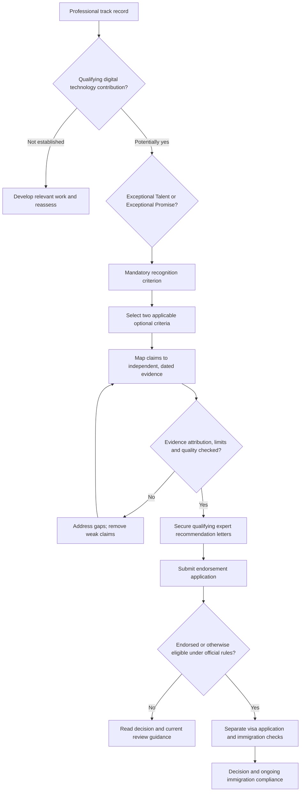

# UK Global Talent Visa — Digital Technology Pathway

**A practical, evidence-led 24-month development and application handbook**  
**Mettelo Resource Hub · Edition 1.0 · Updated 10 November 2026**  
Prepared by **Johnson Taiwo**, Mettelo

[← Global Talent resources](README.md) · [← Immigration guides](../README.md) · [← Resource Hub](../../README.md)  
[Technology checklist](technology-checklist.md) · [Tracker guide](tracker-guide.md)

> **Important:** This guide is a practical *career and evidence-development plan*, not a legal eligibility determination or a promise of endorsement. A two-year period is **not** an official application requirement. Some people already have sufficient evidence; others may need considerably longer. This guide includes practical workflows, verified public references and a month-by-month development plan.

## Visual decision architecture — digital technology

This diagram is a **planning map**, not an automatic eligibility decision. Check the current official requirements and endorsing-body guidance before relying on any evidence category.



**How to use this architecture:** Treat each box as a review checkpoint. The criteria and documentary limits are explained in the sections below; practical projects or a 24-month development plan do not replace the official requirements.


## Which parts should you read first?

| Your situation | First useful sections | A realistic first output |
| --- | --- | --- |
| **Complete beginner to Global Talent** | [Visa explanation](#start-here--what-is-the-global-talent-visa-for-digital-technology) → [Official rules](#1-understand-the-actual-rules) | Clear understanding of what recognition and evidence mean |
| **Data analyst, scientist, engineer or developer** | [Professional route selection](#2-choose-the-right-professional-pathway) → [Evidence mapping](#3-map-evidence-to-the-criteria) | Real contribution inventory and gaps |
| **Founder or product builder** | [Technology product playbook](#5-build-and-validate-a-meaningful-technology-product) → [Referees](#8-develop-real-relationships-with-potential-referees) | Verified product work, customers and recognition strategy |
| **Little/no independent recognition** | [Evidence-building strategies](#4-choose-one-practical-evidence-building-strategy) → [24-month action options](#10-your-detailed-24-month-implementation-plan) | One concrete project and authentic external-review plan |
| **Evidence already strong** | [Documents and restrictions](#14-application-document-process-and-submission) → [Readiness checklist](#16-common-failure-points-and-review-checklist) | A truthful evidence pack mapped to actual criteria |

**Vocabulary:** *Endorsement* = specialist recognition assessment; *visa* = separate Home Office immigration decision; *exceptional promise* = potential leadership at an appropriately early career stage, **not** a weaker-document shortcut; *optional criteria* = specific qualifying contribution areas, **not** optional evidence you may simply omit.

---

## Official-rule verification checkpoint — 10 November 2026

This guide's planning activities are separate from the official endorsement criteria. The following document requirements were cross-checked directly against [GOV.UK's Digital Technology documents page](https://www.gov.uk/global-talent-digital-technology/documents-you-need-to-apply-endorsement):

| Requirement | Verified official detail | Your actual check |
| --- | --- | --- |
| CV | **Up to three A4 sides**, including relevant publication history | Is the current version within this limit and truthful? |
| Recommendation authors | **Three established digital-technology experts**, each of whom has known **your work for at least 12 months** | Can each person independently describe distinct real achievements? |
| Recommendations | Each up to **three single-sided A4 pages**, excluding author credentials/contact details; signed, dated and specifically for Global Talent | Has each author supplied required contact information and supporting credentials? |
| Recognition evidence | **At least two documents** for exceptional talent/promise recognition | Is the independent recognition evidenced within the relevant period? |
| Additional criteria | **At least two documents per selected optional criterion**, covering **two** appropriate categories | Do the four documents really demonstrate two criteria? |
| Evidence maximum | **Ten documents in total**, each up to **three A4 sides**; **no single evidence item reused** for more than one criterion | Does the index uniquely assign each document? |
| Founders / senior executives | Additional proof of connection to a relevant technology business where required | Is company documentation real and within the specified period? |
| Visa stage | Home Office endorsement decision is separate; endorsed applicants generally must apply for visa **within three months** | Check actual endorsement date and permission before proceeding |

**Important for existing UK visa holders:** An **endorsement-only** application does not itself extend immigration permission. GOV.UK distinguishes applying for the visa as well as endorsement from applying for endorsement alone. If your permission is near expiry, seek appropriate regulated advice before making assumptions.

**Evidence quality test:** The document count is a *submission format*, not a points score. Having ten pages or ten items without credible independent recognition does not establish eligibility.

---

## Start here — what is the Global Talent visa for digital technology?

### What is this visa?

The UK's **Global Talent visa** is an immigration route for people who are already recognised as leaders in a field, or who can show strong potential to become leaders. **Digital technology** is one of its fields. Examples include artificial intelligence, software engineering, cybersecurity, financial technology, data technology and digital products. The route is intended to attract people who can make an important contribution to the UK's technology sector. It is not a general training visa or a visa awarded simply for knowing Python, obtaining certificates or completing online courses.

Unlike many employer-sponsored routes, you **do not need a UK job offer** to apply. With the appropriate permission you can generally work as an employee, be self-employed, run a business or change jobs without obtaining a new sponsor. It normally involves an assessment of your achievements by **Tech Nation** (endorsement), followed by a separate immigration application to the **Home Office**. A qualifying prestigious prize can provide an alternative to endorsement in certain circumstances. The rules also cover family members, renewal and possible settlement. Read the [official digital technology overview](https://www.gov.uk/global-talent-digital-technology) before making plans.

### Who is this guide for?

This guide is for data scientists, analysts with genuinely relevant technology contributions, software and data engineers, AI/ML professionals, technical founders, digital product leaders and eligible commercial professionals who want to build a strong, truthful professional record. It is especially useful for people based in **Nigeria, the UK or elsewhere** who are planning their next two years of work. Nationality by itself is not the qualifying criterion.

A person doing routine reporting for a non-technology organisation may need to examine whether their role and achievements fit Tech Nation's digital-technology scope. An impressive job title, a senior grade, a master's degree or years of experience alone does not settle eligibility. Conversely, someone at an early stage of their **technology career** may have relevant exceptional-promise evidence without already being a highly experienced technology leader.

### What is exceptional talent versus exceptional promise?

| Question | Exceptional talent | Exceptional promise |
| --- | --- | --- |
| Broad meaning | Already recognised as a **leader** in digital technology | Recognised as having the potential to become a **leader**; must be at an early stage of the technology career |
| Evidence focus | Established, demonstrably substantial recognition and contributions | Promising but still credible recognition and contributions relative to career stage |
| Optional requirements | Evidence for **two** of the four qualifying contribution areas | Evidence for **two** qualifying contribution areas, with category-specific wording |
| Settlement in general | Potential eligibility after **3 years**, subject to all settlement conditions | Potential eligibility after **5 years**, subject to all settlement conditions |

The actual criteria are those in [Immigration Rules Appendix Global Talent, GTE 7](https://www.gov.uk/guidance/immigration-rules/immigration-rules-appendix-global-talent), not the simplified explanation above. Do not choose exceptional promise merely because talent evidence is not yet strong.

### Understand the journey in five steps

| Step | What happens | What you should do |
| --- | --- | --- |
| **1 — Check fit** | Determine whether the digital technology route and talent/promise category apply | Read the official criteria, identify your actual technical or product contribution and record gaps |
| **2 — Build credible achievement** | Deliver useful technology work and gain real external recognition where relevant | Use the optional 24-month development plan, but do not mistake its activities for visa requirements |
| **3 — Seek endorsement** | Tech Nation assesses the submitted career, recommendations and evidence | Collect only admissible, independently checkable work; follow current document and AI/authorship instructions |
| **4 — Apply for the visa** | The Home Office separately considers immigration requirements | Check immigration status, identity and any required documents, fees and timing |
| **5 — Work and maintain records** | Permission allows qualifying activities, subject to conditions | Preserve evidence for extension/settlement and comply with the actual permission granted |

**Example for a newcomer:** A data engineer with only a course certificate and a copied project has evidence of learning, but not necessarily recognition or qualifying contribution. A stronger professional record would involve developing an original or substantial solution, proving that someone independent used or assessed it, and keeping real records of their own technical decisions. Even that is **not automatically sufficient** for endorsement.

### Why a 24-month plan?

The month-by-month table in this resource is **Mettelo's suggested career-development schedule**, not a government requirement. You may already qualify, or the work may take longer than two years. The main objective is to build and verify meaningful achievements before considering an endorsement application.

**Read first:** [Global Talent overview](https://www.gov.uk/global-talent-digital-technology) · [Eligibility](https://www.gov.uk/global-talent-digital-technology/eligibility) · [Documents](https://www.gov.uk/global-talent-digital-technology/documents-you-need-to-apply-endorsement) · [Tech Nation applicant guidance](https://technation-globaltalentvisa-guide.notion.site/e645304dc1ba4f77a1f095d224a8a7b9).

---

## Contents

**New to this route?** [Start here: what is this visa?](#start-here--what-is-the-global-talent-visa-for-digital-technology)

1. [Understand the actual rules](#1-understand-the-actual-rules)
2. [Choose the right professional pathway](#2-choose-the-right-professional-pathway)
3. [Map evidence to the criteria](#3-map-evidence-to-the-criteria)
   - [Successful applicant evidence patterns](#practical-evidence-patterns-observed-in-successful-applicants)
4. [Choose one practical evidence-building strategy](#4-choose-one-practical-evidence-building-strategy)
5. [Build and validate a meaningful technology product](#5-build-and-validate-a-meaningful-technology-product)
6. [Make open-source contributions that matter](#6-make-open-source-contributions-that-matter)
7. [Build professional recognition through genuine external activity](#7-build-professional-recognition-through-genuine-external-activity)
8. [Develop real relationships with potential referees](#8-develop-real-relationships-with-potential-referees)
9. [Publish credible technical work and research](#9-publish-credible-technical-work-and-research)
10. [Your detailed 24-month implementation plan](#10-your-detailed-24-month-implementation-plan)
11. [First 90 days: precise actions](#11-first-90-days-precise-actions)
12. [Illustrative evidence portfolios for three profiles](#12-illustrative-evidence-portfolios-for-three-profiles)
13. [Evidence register and quality controls](#13-evidence-register-and-quality-controls)
14. [Application-document process and submission](#14-application-document-process-and-submission)
15. [Practical link directory](#15-practical-link-directory)
16. [Common failure points and review checklist](#16-common-failure-points-and-review-checklist)
17. [Sources, review status and cautions](#17-sources-review-status-and-cautions)

---

## 1. Understand the actual rules

### The official requirements, not the Mettelo planning targets

Digital technology applicants normally seek **exceptional talent (recognised leader)** or **exceptional promise (potential leader)**. The endorsing body is **Tech Nation**. Exceptional promise requires an early-stage technology career; it is not automatically available simply because your evidence is weak. A substantial career in a different sector may be compatible with an early-stage technology career. Technical and business applicants are both considered.

You must demonstrate **recognition in digital technology within the past five years**, alongside evidence for **two of four additional areas**: innovation, advancement of the digital technology field beyond your occupation, significant contribution to a product-led digital technology business, or qualifying academic contribution. Talent and promise have distinct wording; use the category actually applicable to you. **This five-year criterion concerns recognised achievement, not a rule that everyone must build a portfolio for five years.**

Relevant official sources:

- [GOV.UK eligibility and leader/potential-leader criteria](https://www.gov.uk/global-talent-digital-technology/eligibility).
- [Immigration Rules Appendix Global Talent, GTE 7.1–7.5](https://www.gov.uk/guidance/immigration-rules/immigration-rules-appendix-global-talent).
- [GOV.UK technical and business fields assessed by Tech Nation](https://www.gov.uk/government/publications/global-talent-endorsing-bodies/technical-or-business-skills-covered-by-tech-nation).

### Current documentary requirements: verify again on application day

| Item | Official requirement | Practical interpretation |
| --- | --- | --- |
| CV | Typed; **up to 3 A4 sides** including career and relevant publication history | Keep genuine dates, roles, product experience and publications; do not manufacture digital-sector seniority. |
| Expert letters | **3**, from different established technology experts; each has known your work **at least 12 months** | The author must truly know your work and provide different credible examples. Verify the author’s status and evidence. |
| Letters' form | Up to **3 single A4 sides each**, excluding contact/credential materials; date, signature, contact and relevant organisation information | Check the present instructions; letters drafted by the applicant for signature are not acceptable where prohibited by the endorsing-body rules. |
| Recognition evidence | **At least 2 pieces** of evidence of talent/promise recognition | Recognition must be meaningfully attributable and relevant; personal LinkedIn posts are not automatically independent recognition. |
| Additional criteria | **At least 2 pieces each** for **2 different qualifying areas** | Map to one area per item; do not reuse one document to satisfy multiple criteria. |
| Evidence-document cap | **Maximum 10 documents**, each **up to 3 A4 sides** | This is a cap, not a target to fill with weak material. CV and letters do not count towards ten. |
| Business records | Conditional documentation for relevant founders/senior executives and business/share history | Record incorporation, trading, product-led activity, dates and ownership truthfully. |

See the [current official document checklist](https://www.gov.uk/global-talent-digital-technology/documents-you-need-to-apply-endorsement). Government guidance and Tech Nation are the authorities for application requirements, not the milestones in this Mettelo plan.

### Important restrictions on evidence and AI

The [Tech Nation detailed application guide](https://technation-globaltalentvisa-guide.notion.site/e645304dc1ba4f77a1f095d224a8a7b9) gives instructions concerning applicant-authored evidence, statements and recommendations, including restrictions on AI and templates. **Do not use this guide or any AI system to manufacture application statements, letters or evidence.** Use it to decide how to do genuine work and organise records. Before you submit, open the live Tech Nation guide and follow the then-current wording exactly.

A public URL alone is not necessarily accepted as an evidence document: current Home Office guidance may require an actual captured page displaying its link. Preserve dated primary records, authorised screenshots and relevant context rather than assuming reviewers will browse websites.

### Costs, visa timing and legal status

The endorsement and the immigration application are **different stages**. The official application guidance says a successful applicant must apply for the visa **within three months of receiving the endorsement letter** and that endorsement does not automatically grant a visa. **Applying for endorsement alone does not extend existing UK permission.** People approaching the expiry of their visa should seek appropriate regulated advice promptly. Fees and healthcare-surcharge amounts can change: check the [live GOV.UK overview](https://www.gov.uk/global-talent-digital-technology) before paying.

---

## 2. Choose the right professional pathway

The original Mettelo handbook identified analyst/data scientist, engineer/developer, product/commercial professional and founder starting points. The following expanded decision framework turns those into practical choices.

| Your real starting point | Choose a defensible workstream | First convincing deliverable | What is weak or misleading |
| --- | --- | --- | --- |
| Data analyst / BI professional | Make a reusable, technically non-trivial data validation, analytics or decision product with users beyond yourself | Working product with defined data quality, test suite, adoption and a documented personal contribution | A generic dashboard copied from a course, without ownership, original decisions or external significance |
| Data scientist / ML engineer | Solve a tested ML/AI problem and demonstrate robustness, reproducibility, deployment and useful outcomes | Baseline comparison, error analysis, reproducible pipeline, independent technical assessment and use cases | Notebook screenshots, leaderboard rank without context, unsupported accuracy claims |
| Data engineer / software engineer | Build production-relevant infrastructure, a developer tool or genuinely consequential accepted open-source work | Live versioned package/service, automated tests, design decisions and external reviewer or maintainer feedback | A large list of technologies without clear personal technical decisions |
| Technical product manager / commercial professional | Lead a measurable digital product initiative and establish attributable product/commercial impact | Product specification, decisions, users, adoption, retention or revenue evidence where allowed | Branding or marketing work that does not demonstrate a digital product/business contribution |
| Founder | Validate, build, release and improve a product-led digital technology business | Source code/product record, founder/ownership proof, users, commercial results, independent validation | Company incorporation alone, landing-page signups mistaken for product users |
| Research-oriented practitioner | Do substantive technical research and obtain genuine expert/publication assessment | Method, results, replication artefacts, published/endorsed research if achieved | Self-published claims treated as peer-reviewed publication |

**Selection exercise:** Write: “My strongest demonstrable contribution is [specific work], my exact part was [decisions and outputs], the independently checkable result is [fact], and the target criterion may be [specific criterion].” If you cannot complete the sentence accurately, the first priority is meaningful work and records, not writing an endorsement story.

---

## 3. Map evidence to the criteria

Use the official criteria first, then decide which actual projects can support them. **Two optional criteria are required; four are not.** It is generally better to develop two coherent areas than to scatter activity across every possible category.

| Assessment area | Examples that may be relevant **when genuinely strong** | Practical work to undertake | Proof to preserve |
| --- | --- | --- | --- |
| **Mandatory recognition** | Respected independent coverage of technology achievements; recognised expert acknowledgement; meaningful sector distinction | Deliver work worth external attention, request rigorous independent review, present at credible professional venues | Selected/issued recognition with dates, author/editor identity, exact acknowledgement and attribution |
| **Innovation** | Genuine product innovation in a product-led technology business or new digital field | Compare alternatives, build original functionality, document prototype decisions and testing | Architecture/design history, source records, technical comparison and independent assessment |
| **Beyond occupation** | Relevant non-work open source, mentoring, public technical contribution to advance the field | Sustained maintenance, expert mentoring, community projects, externally accepted work | Merge history and independent reviewer comments; organiser/beneficiary records and concrete outcomes |
| **Significant product-led contribution** | Important technical or commercial work in a genuinely product-led digital technology business | Own meaningful features, reliability/scale improvements, user outcomes and product decisions | Verified metrics, release history, permissible internal records, stakeholder confirmation |
| **Academic contribution** | Real academic research published or endorsed by recognised expert | Conduct rigorous reproducible research with appropriate collaborator/reviewer | Publication/acceptance, expert endorsement, research methodology and actual contribution |

A single blog, GitHub star count, paid news placement, attendance certificate or mentor badge **does not automatically meet a criterion**. Do not promise that any activity below will be accepted by Tech Nation.

### The evidence-selection test

For every potential document, answer all six questions: (1) what exact criterion? (2) what did I personally do? (3) what independent record confirms it? (4) when did it happen? (5) what makes the achievement significant beyond routine duties? (6) can it be shared legally and honestly? Retain items only when the answers are substantive.

---

## Practical evidence patterns observed in successful applicants

**Where these examples come from:** The [Tech Nation Global Talent Ambassador success stories](https://technation.io/global-talent-success-stories/) report professional achievements and advice from people who successfully secured the visa. The [Home Office's evaluation of Global Talent visa holders](https://www.gov.uk/government/publications/global-talent-visa-evaluation-wave-2-report/global-talent-visa-evaluation-wave-2-report) also records applicants' experiences gathering letters, using work evidence and obtaining guidance. The **patterns below are anonymised summaries**, not reconstructions of anyone's confidential application dossier. Public success stories rarely reveal which specific documents an assessor accepted, so no activity here should be described as a proven approval tactic.

### Pattern 1 — A substantial product contribution at work

**What successful holders reported:** Some described designing and shipping digital products used at meaningful scale, improving a product's capabilities or addressing expensive technical problems. Their public stories emphasised work actually delivered, not simply their employers' reputation.

**A practical approach to adopt:**
1. Select a specific product or system where you have genuine technical/commercial responsibility; verify the organisation qualifies as a product-led digital technology business if using that optional criterion.
2. Document the before-state: users, reliability, error rate, cost or other appropriate measure.
3. Record your design decisions, exact ownership, releases and verification: approved architecture notes, issues, pull requests, tests, deployment records or product reviews.
4. Ask an authorised technical/product leader to review a **fact summary** of what you contributed and confirm permitted metrics; keep confidential artefacts private.
5. If the product outcome is verifiable and significant, assess it against the correct optional criterion. Separately identify any real independent recognition needed for the mandatory criterion.

**Possible records:** Dated product brief, release evidence, permitted metric extract, independent senior review. **Weak substitute:** employment contract plus an assertion that the company is famous.

### Pattern 2 — Open-source work with independent peer acknowledgement

**Why this matters:** GOV.UK explicitly identifies open-source contribution **acknowledged by peers as advancing the field** as a possible form of evidence; merely opening a repository does not prove it.

**A practical approach to adopt:**
1. Choose a real package used by others and find an issue affecting users.
2. Reproduce the problem, agree an approach with maintainers, implement and test a substantial fix.
3. Get it reviewed and merged; then maintain the feature, handle bugs, and document adoption when legitimately measurable.
4. Preserve issue/PR links, independent maintainer comments, release notes and confirmed adoption. Explain why your contribution mattered beyond routine editing.
5. Record how any work genuinely undertaken **outside your paid occupation** differs from ordinary employment duties if claiming beyond-occupation advancement.

**Possible records:** Public accepted PR and discussion, maintainer review, user or release reference. **Weak substitute:** green contribution squares, star counts or a cloned tutorial repository.

### Pattern 3 — Independent external speaking and professional recognition

**What successful holders reported:** Public profiles describe presenting expert knowledge, community engagement and professional visibility as parts of established technology careers. These are not all identical forms of acceptance evidence.

**A practical approach to adopt:**
1. Begin with a verifiable technical achievement: a real product, tested method or case study.
2. Submit an abstract to a relevant professional organiser using published speaker rules rather than declaring yourself a keynote speaker.
3. If selected, deliver the content, answer technical questions, and record the organiser's official programme, your actual presentation and independently verifiable audience reach where possible.
4. Continue building substantive work rather than chasing low-quality stage appearances.

**Possible records:** Selection communication, official speaker page, recording, presentation materials and organiser confirmation. **Weak substitute:** self-produced event poster or attendance certificate.

### Pattern 4 — Founder activity backed by product and commercial records

**What successful holders reported:** Tech Nation's ambassador profiles include founders with actual product development, partnerships, commercial operations, entrepreneurial recognition and, in some cases, outside awards or acceleration recognition.

**A practical approach to adopt:**
1. Verify the customer problem and product originality with interviews and competitor evidence.
2. Build a working release, pilot it with consent and record genuine returning users and business activity.
3. Separate sign-ups from active users; separate forecasts from realised revenue; separate Nigeria results from UK results.
4. Preserve incorporation/ownership, product release, sales, relevant financial statements, independent customer verification and genuine recognition.
5. Look for legitimate accelerators or awards suited to the business, but verify eligibility and competitiveness; **participation or an award application alone is not endorsement evidence**.

**Possible records:** Dated product release and usage, customer statements, permissible business accounts, genuine recognised award. **Weak substitute:** certificate of incorporation plus a landing page.

### Pattern 5 — Sustained volunteering and mentoring with actual outcomes

**What successful holders reported:** Some profiles mention long-term voluntary technical teaching or mentoring alongside substantial professional technology work. The successful application cannot be attributed to mentorship alone.

**A practical approach to adopt:**
1. Join or form a genuine technical mentoring programme with clear participant needs and consent.
2. Deliver recurring sessions where participants actually complete tasks or projects and receive feedback.
3. Track permitted anonymised completion, work quality, improvement and organiser/participant confirmation.
4. Show how the activity contributed to the technology community beyond your immediate occupation; distinguish volunteering from paid work.

**Possible records:** Independent programme confirmation, dated curriculum, participant work and follow-up outcomes. **Weak substitute:** large WhatsApp membership counts or certificates issued by your own community.

### Pattern 6 — Referees developed through genuine work and sufficient time

**What successful holders and official research show:** Gathering credible recommendation letters may take months. Applicants have sought advice through former colleagues, work teams, technology networks, visa-holder communities and appropriately qualified professional advisers. Tech Nation requires each expert to have known the applicant's work for **at least 12 months**.

**A practical approach to adopt:**
1. Identify experts already familiar with substantial work, not merely well-known strangers.
2. Collaborate or be evaluated on real work over a meaningful period; keep dated exchanges and actual decisions.
3. Confirm the expert's standing and knowledge against current official rules.
4. Seek genuinely authored, different recommendations when ready. Follow Tech Nation's precise prohibition on applicant- or AI-generated application letters.
5. Do not acquire a false letter, backdate contact or pay for a purported expert's signature.

**Possible records:** Work history, authentic review, documented relationship chronology and compliant referee credentials. **Weak substitute:** generic recommendation signed by someone who only met you recently.

### What these successful-applicant stories **do not** establish

They do **not** prove that a particular Github project, accelerator, talk, publication, patent, blog or number of followers will be accepted. Public biographies are usually selective and do not expose the actual endorsement assessment. The practical lesson is to **develop meaningful work, secure authentic independent verification, then match the result to the official criteria**.

**Sources to study:** [Tech Nation's first-hand ambassador accounts](https://technation.io/global-talent-success-stories/) · [Home Office evaluation of successful visa holders](https://www.gov.uk/government/publications/global-talent-visa-evaluation-wave-2-report/global-talent-visa-evaluation-wave-2-report) · [Official document evidence examples](https://www.gov.uk/global-talent-digital-technology/documents-you-need-to-apply-endorsement).

---

## 4. Choose one practical evidence-building strategy

Do not attempt every route below. Pick the combination that best matches your work, time, permission and professional strengths.

### Strategy A — product builder (recommended for founders and experienced engineers)

**Example idea:** A reusable open-source data quality and pipeline-monitoring product for small organisations. It ingests approved public or synthetic datasets, detects schema drift, validates totals and provides meaningful incident records. This is **an example project**, not a guarantee of genuine innovation; investigate whether the feature is already common.

**How to execute:** Interview real users about failure modes → write a requirements and competitor brief → prototype one high-value check → deploy an authorised pilot → measure failure detection, false positives and adoption → publish a tested package or product → seek independent technical evaluation. If the product genuinely earns external use, keep specific attribution and adoption evidence.

**Recommended starting links:** [GitHub Issues](https://docs.github.com/en/issues/tracking-your-work-with-issues/about-issues), [GitHub releases](https://docs.github.com/en/repositories/releasing-projects-on-github/about-releases), [Companies House](https://find-and-update.company-information.service.gov.uk/), [GOV.UK data protection](https://www.gov.uk/data-protection).

### Strategy B — open-source contributor (recommended for developers, data engineers and ML engineers)

Choose **one project you actually use**, learn its contribution guidelines and solve a real maintenance problem. Your sequence: reproduce a bug → discuss scope with maintainer → add failing test → implement correction → obtain PR review → respond to feedback → merge → help maintain the fix. Repeat where useful, then tackle a substantive issue. Quality of accepted changes and external acknowledgement matters more than PR counts.

**Where to begin:** [GitHub's official contribution guide](https://docs.github.com/en/get-started/exploring-projects-on-github/finding-ways-to-contribute-to-open-source-on-github), [GitHub good first issue search](https://github.com/issues?q=is%3Aopen+label%3A%22good+first+issue%22), [GitHub open-source guide](https://opensource.guide/how-to-contribute/). Verify whether any issue is still open before volunteering.

### Strategy C — technical communicator and community builder (recommended for established practitioners)

Do **real technical work first**, then teach its limitations and decisions. Start with a five-minute practical talk at a meetup and develop a detailed case study. Build an authentic series where participants complete tested tasks; record delivery, peer review and approved outcomes. Aim for independent organisers and audiences as well as your own network. Running your own small webinar is useful practice but should not be mislabelled independent recognition.

**Concrete route:** [PyData London speaking FAQ](https://london.pydata.org/faq/) describes contacting the organisers through Meetup with talk title and abstract; [PyData events](https://pydata.org/all-events/) lists its activities. Speak because you have useful evidence to share, not to collect arbitrary event badges.

### Strategy D — technical research (recommended where research skill and real expert scrutiny exist)

Pick a reproducible engineering/AI research question, such as how drift detection behaves under missingness and delayed data. Create baseline models, evaluation data, methods and code; discuss a credible collaboration with an appropriate researcher; seek an actual peer-reviewed or expert-endorsed route. A public preprint is useful dissemination but **does not automatically equal peer-reviewed publication or accepted evidence**.

**Where to begin:** [Zenodo](https://zenodo.org/) for appropriately licensed research releases, [PyData](https://pydata.org/) for technical community contacts, and an academic department or research collaborator in the relevant speciality.

---

## 5. Build and validate a meaningful technology product

### A practical eight-stage delivery playbook

| Stage | Exact actions | Deliverable | Independent check |
| --- | --- | --- | --- |
| Discovery | Speak to real users about recent tasks, alternatives, costs, workarounds and failure impact; distinguish buyer from user. | Anonymised interview findings and problem definition | User or sector partner checks your interpretation |
| Competitor analysis | Compare three to five direct and indirect alternatives, including manual workflows. Identify real product differences, not marketing claims. | Dated comparison table and falsifiable distinctiveness claim | Expert challenges whether feature is genuinely new |
| Design | Draw input → validation → storage → product/API → user flow; choose acceptable data permissions and access control. | Architecture diagram, threat/privacy notes, technical decision records | Engineer reviews critical assumptions |
| MVP | Build one complete end-to-end use case; test errors as well as the happy path. | Tagged release, setup instructions, demo/test data | Independent user can run it |
| Quality | Add unit, integration and acceptance checks; document missing values, late arrivals, retries, backfills and failure recovery where relevant. | Test results, reproducibility guide and known limitations | Reviewer checks tests and failure handling |
| User trial | Run a defined trial, record baseline and end state, consent, errors, adoption and unexpected failures. | Pilot record or approved client outcome report | Trial owner checks what happened |
| Product iteration | Fix issues by risk and expected value; explain what was changed after feedback and why. | v2 changelog and before/after comparison | Reviewer verifies improvements |
| Sustained use | Maintain support channel and appropriate telemetry; track real recurring use, not page views alone. | Permissible usage/retention and maintenance records | External organisation or users corroborate actual use |

**Worked example — all numbers hypothetical:** An internal prototype might find 45 of 50 intentionally seeded data errors, while the previous method finds 30. The useful proof is the test design, what errors were missed, whether the comparison is fair, the actual implementation and whether others can reproduce it. **Do not quote these figures as personal outcomes.**

### Architecture example (for a data product)

```text
Approved public / consented data
          ↓
Validated ingestion (schema, duplicate, missing-value checks)
          ↓
Versioned storage / transformation
          ↓
Quality rules + tests + failure alerts
          ↓
API, dashboard or reusable Python package
          ↓
Users → support feedback → prioritised improvement
```

Where to learn (learning alone is **not visa evidence**): [DataTalks.Club Data Engineering Zoomcamp](https://github.com/DataTalksClub/data-engineering-zoomcamp) offers an end-to-end practical course and final project; use it to build capability, then develop a distinctive independently assessed application rather than submitting copied course work.

### Project README checklist

Describe: target users; problem and why alternatives fail; installation; architecture; personal technical contribution; dataset permission; tests; measurable results; limitations; licence; contributors; live version and change history. Remove restricted partner/client data and production credentials.

---

## 6. Make open-source contributions that matter

### An exact newcomer-to-maintainer sequence

1. **Select one actual dependency or tool** relevant to your specialism (for example a Python data validation library) and read its `CONTRIBUTING.md`, licence and tests.
2. **Find a genuine problem.** Use the repository's Issues and `help wanted`/ `good first issue` labels; confirm nobody is already working on it. Beginner labels signal accessibility, **not** criterion eligibility.
3. **Communicate first.** Describe the reproducible failure and ask if a proposed fix fits the project's direction.
4. **Create a branch and failing test**, then implement the correction and run the project's own validation commands.
5. **Submit a focussed PR** describing problem, rationale, tests, limitations and relevant dependency/security effects.
6. **Respond to technical critique**, revise honestly and obtain the maintainers’ actual acceptance.
7. **Record genuine outcome**: affected versions, users if documented, issue/PR link, actual reviewer acknowledgement and role; avoid claiming every merge advanced the field.
8. **Keep helping** after merge through triage, review, testing and documentation; stop or change projects when the contribution no longer delivers meaningful value.

**Evidence grading example:**

| Weak record | Stronger record |
| --- | --- |
| Screenshot of 40 GitHub green contribution squares | Merged PR solving nontrivial issue, reproducible tests, maintainer's technical review and verifiable result |
| New repository with 1,000 stars but unclear user value | Used package with documented adoption and independently assessed contribution |
| Self-created community badge | Sustained technical contribution with real organiser and participant confirmation |

Start: [GitHub contributions](https://docs.github.com/en/get-started/exploring-projects-on-github/contributing-to-open-source), [open-source guidance](https://opensource.guide/how-to-contribute/).

---

## 7. Build professional recognition through genuine external activity

### Technical speaking: a five-step route

**Step 1 — Choose one defensible topic.** For example: “Five reliability checks we added to a public-data pipeline and what failed in testing.” Your content should contain a real diagram, decisions and reproducible tests.

**Step 2 — Prepare a concise proposal.** Title, intended audience, problem, three learning outcomes, evidence of a working demonstration and limits of what you will claim.

**Step 3 — Select appropriate organisers.** Read [PyData London talk instructions](https://london.pydata.org/faq/). For broader data events browse [PyData events](https://pydata.org/all-events/) and the [PyData Global 2026 event](https://pydata.org/global2026/). Applications, selections and deadlines vary; **no opportunity is guaranteed open**.

**Step 4 — Present and preserve proof.** Keep accepted proposal, official schedule naming you, slide/deck link, recording if permitted, audience questions and independent feedback. Make clear if you were invited, competitively selected, a panel member or self-hosting.

**Step 5 — Publish a useful follow-up.** Include code, setup, learned lessons, corrections and limitations. A promotional recap with no technical value is not a substitute.

### Media: how to seek coverage without misleading people

Write a one-page factual story brief: real innovation, whose problem it addresses, verifiable result, customer/participant permission, demo link and why the story matters **now**. Approach relevant editors or specialised technology journalists who cover that subject; use their current published contact/submission rules. Do not pay for an advertisement and call it independent editorial validation. Independent coverage may be valuable, but approval depends on content and the selected criterion. Declined pitches are normal.

### Mentorship and community contribution

Prefer a credible established programme or meaningful community project. Agree goals, frequency and actual learning/problem-solving outputs. Collect consented participant feedback or independently confirmed organiser records. Your own attendance register alone is a weaker record. The distinction between paid job duties and work outside the occupation matters for that criterion.

---

## 8. Develop real relationships with potential referees

### Build the relationship before requesting a letter

Three letters must come from eligible experts who have actually known your **work for at least 12 months**. A LinkedIn connection formed a month before application is not enough. A manager, client, partner or independent technical expert may know you well, but their status and direct knowledge must satisfy the rules.

**Practical sequence:**

- **Months 1–6:** Identify potential experts through real projects, professional review, research or community collaboration. Record when they first became familiar with your work, not merely when you first followed them online.
- **Months 7–12:** Work together in a legitimate capacity — reviewed product delivery, partnership, technically substantive collaboration or independent expert scrutiny. Keep approvals and dates.
- **Months 13–18:** Ask whether they would be comfortable commenting **independently** on actual work. If not, respect the decision and continue genuine professional engagement.
- **Months 19–22:** Check the expert's standing and current documentary requirements. Provide accurate references to real projects for factual checking only; respect the endorsing body's authorship restrictions.
- **Application stage:** Authors prepare, date and sign their own compliant letters. Each must independently describe a different credible perspective on your contribution and UK potential. Confirm their contact information and credentials according to current rules.

### Example of a defensible relationship record

| Expert | What they genuinely know | Earliest direct work familiarity | Possible evidence |
| --- | --- | --- | --- |
| Technical leader on a product | Observed design, technical decisions and delivery | Actual dated collaboration | PRs, product decision logs, signed-off release |
| Independent open-source maintainer | Reviewed sustained external contribution | First recorded substantive review | Discussion, PR, release attribution |
| Research or innovation lead | Personally assessed your research or product method | Initial research collaboration | Correspondence, review, project record |

**Do not ask an unfamiliar prominent person to sign a prepared generic endorsement.** Being professionally senior does not override the knowledge requirement.

---

## 9. Publish credible technical work and research

### Technical case study format

1. **Problem and context:** What real constraint existed? Who was affected?
2. **Personal ownership:** Which design choices, code and testing were yours?
3. **Alternatives:** What did you consider, why was an alternative rejected?
4. **Architecture:** Data flow, technology, deployment and integration boundaries.
5. **Testing:** Baseline, reproducible process, failure cases, risks and privacy.
6. **Result:** Actual measured or confirmed qualitative outcome and time period.
7. **Limitations:** What remains uncertain; what went wrong.
8. **External corroboration:** Reviewer, user, customer, maintainer or accepted technical venue.

### Research route: practical small project

**Illustrative question:** “How sensitive are simple anomaly detectors to delayed records and missingness in a public dataset?” Acquire licensed data, define tests and baseline, publish code and methods, report uncertainty, seek review from an appropriate expert. An accepted research publication is different from a personal blog or preprint. Use [Zenodo](https://zenodo.org/) appropriately for archiving a released artefact, not as a claim of peer review.

### Avoid these claims

- “Published academic research” where a paper was only posted on your blog.
- “Industry-recognised innovation” supported only by your own landing page.
- “Thousands of users” where those were newsletter sign-ups, trial registrations or one-off views.
- “My product reduced operating costs” without an attributable measured comparison.

---

## 10. Your detailed 24-month implementation plan

> **How to read the table:** This is an actionable menu, **not a visa checklist**. Each month offers three distinct strategies: choose the activities relevant to your role instead of doing all three. The suggested numbers of users, talks, papers and contributions are Mettelo planning suggestions, not Tech Nation acceptance thresholds. An external organisation appearing in a row is a genuine place to look, **not a partner already committed to helping**. Check acceptance windows, restrictions and capacity before contacting it. If you already have credible evidence, skip redundant stages and conduct an eligibility audit.

### No evidence at all? Start with the right branch

| Starting situation | First useful action | Organisation or person to contact | What **not** to assume |
| --- | --- | --- | --- |
| No technical portfolio | Complete a skills-building project, then solve a different authentic user problem | [DataTalks.Club Zoomcamp](https://datatalksclub.github.io/docs/courses/data-engineering-zoomcamp/) and its Slack learning community | A course certificate or cloned project establishes recognition |
| No users or employer product | Find a real problem and offer scoped volunteer work or a prototype pilot | [Omdena](https://www.omdena.com/projects), [DataKind Global](https://www.datakind.org/join-us/volunteer/), relevant charity or SME | A project application means you were selected |
| No external technical recognition | Help maintain someone else's technology and request honest technical critique | [Apache Airflow contributors](https://github.com/apache/airflow/blob/main/contributing-docs/README.rst), [The Turing Way](https://book.the-turing-way.org/community-handbook/contributing/) | A single tiny PR or a star count demonstrates leadership |
| No speaking history | Submit a precise technical talk based on actual implementation | [PyData London](https://london.pydata.org/submit-a-talk/), [other PyData events](https://pydata.org/all-events/) | An unselected abstract is an invited speaker achievement |
| No expert referees | Do genuine work with reputable experts and document when they first directly knew your contributions | Actual lead engineer, product head, open-source maintainer or research collaborator | A cold-connected senior person can attest to 12 months' work |
| No independent press or awards | Complete something substantively useful; seek real editorial or professional review | Topic-relevant publication editorial desk or legitimate professional award organiser | Paid publicity is independent recognition |

### Phase 1 — Build a concrete technical foundation (months 1–6)

| Month and practical target | **Three specific action strategies — choose by relevance** | **Who to approach, how, and fallback** | **Evidence to retain** |
| --- | --- | --- | --- |
| **01 — Establish pathway fit and independent baselines** | 1. **A — Rules first:** Read [GOV.UK criteria](https://www.gov.uk/global-talent-digital-technology/eligibility) and [Tech Nation](https://technation.io/global-talent-visa/); decide whether your actual work is technical or business and assess talent versus promise without assuming either.<br><br>2. **B — Evidence audit:** Export dated GitHub activity, product releases, permitted work reviews, publications and speaking history from the past five years; assign potential criteria and mark gaps.<br><br>3. **C — Market test:** Search [Companies House](https://find-and-update.company-information.service.gov.uk/) and three competing products; pick one area where you can genuinely contribute. | **Who/where:** Ask a real former project lead or product manager for dates and permissible results; use your GitHub repositories and official criteria pages. **No professional network?** Begin by joining [DataTalks.Club](https://datatalks.club/) and one relevant GitHub project community. | Private claim-to-criterion map; a documented problem choice; list of red gaps. Do not label course completions as independent recognition. |
| **02 — Talk to people experiencing a real problem** | 1. **A — Users:** Find 8–12 potential users through professional LinkedIn groups, the [DataTalks.Club Slack](https://datatalksclub.github.io/docs/courses/data-engineering-zoomcamp/getting-started/) and existing relevant community channels; ask about recent failures, current tools and costs, not whether they 'like your idea'.<br><br>2. **B — Organisations:** Offer an exploratory conversation to a small digital company, data team or charity; for social-impact work check [DataKind Global](https://www.datakind.org/join-us/volunteer/) and [Omdena project listings](https://www.omdena.com/projects). Do not imply either has accepted your proposal.<br><br>3. **C — Alternative:** If no one replies, analyse a real public dataset and publish a non-sensitive failure/quality analysis, then use it to ask three informed practitioners for critique. | **Contact method:** Use the organisations' published volunteer/project forms, Slack channels, or a concise LinkedIn message describing one concrete problem and a 20-minute research request. Never scrape personal contact information. | Consent-aware discovery log, interview findings, competitor matrix and three testable problem statements. |
| **03 — Get a prototype into someone else's hands** | 1. **A — Data engineering:** Build a mini end-to-end pipeline from a permitted dataset; [DataTalks DE Zoomcamp project rubric](https://datatalksclub.github.io/docs/courses/data-engineering-zoomcamp/project/) provides a quality checklist, but use a different original use case.<br><br>2. **B — AI/ML:** Publish a baseline plus a repeatable evaluation on [Hugging Face](https://huggingface.co/docs/hub/en/eval-results); do not claim benchmark superiority without independent reproduction.<br><br>3. **C — Founder/product:** Build only the highest-value feature, with a one-page PRD, user journey, data permissions, tests and a public demo using synthetic data. | **Who/where:** Seek peer review in the DataTalks community, a [GitHub Discussion](https://docs.github.com/en/discussions), or an Omdena team if legitimately accepted. **No reviewer?** Ask a community moderator whether a peer review is appropriate. | Public or permitted private repository, architecture, reproducible demo, baseline tests and external comments if obtained. |
| **04 — Secure substantive feedback, not applause** | 1. **A — Run a pilot:** Give 3–5 willing users a defined task; record baseline, time, errors and usability observations with permission.<br><br>2. **B — Ask a specialist:** Present specific validation logic or error analysis to an engineer in [Apache Airflow's contributor community](https://github.com/apache/airflow/blob/main/contributing-docs/README.rst) or relevant domain forum; follow its community rules.<br><br>3. **C — Test alternatives:** Repeat the same task using one credible existing tool and explain where your solution fails, improves or offers no advantage. | **Approach:** Ask for critique of a single issue, a 10-minute demo or a pull request—not a visa recommendation. If no pilot access, release a transparent synthetic benchmark and document its limitations. | Dated feedback, reproduction steps, accepted/rejected changes and comparison report. |
| **05 — Turn the prototype into a dependable release** | 1. **A — Engineering:** Add null, duplicate, schema, reconciliation, backfill, retry and failure-handling checks where they apply; record actual results.<br><br>2. **B — Access/ethics:** Check data rights, source licences and privacy; see [UK data protection guidance](https://www.gov.uk/data-protection).<br><br>3. **C — Independent test:** Ask a technical peer to install/run the project from the README; address their bug reports through issues and PRs. | **Who/where:** Invite a DataTalks peer, work-authorised engineer or open-source collaborator; share a test repo, not credentials or client extracts. If nobody volunteers, add an automated clean-install workflow and disclose that it is self-tested. | Release v0.1, coverage or validation report, change log, reviewer issues and clearly described limitations. |
| **06 — Decide whether to continue, pivot or join a real project** | 1. **A — Audit:** Compare product value and third-party feedback against mandatory recognition and the two prospective optional areas; do not force a mapping.<br><br>2. **B — External project route:** Apply for an appropriately scoped project through [Omdena](https://www.omdena.com/projects); the site offers actual application routes and project types.<br><br>3. **C — Volunteer route:** Create a [DataKind volunteer profile](https://www.datakind.org/join-us/volunteer/) for remote opportunities where skills fit; UK [DataKind UK's form is currently paused](https://www.datakind.org.uk/volunteer/), so use its newsletter instead. | **Approach:** Pitch your demonstrated capability and availability, ask about the work and ownership, and accept that acceptance depends on the organisation. If no placement opens, continue your product pilot. | Six-month evidence audit, chosen main path and documented applications/replies—do not label an application as participation. |

### Phase 2 — Make external contributions and be reviewed (months 7–12)

| Month and practical target | **Three specific action strategies — choose by relevance** | **Who to approach, how, and fallback** | **Evidence to retain** |
| --- | --- | --- | --- |
| **07 — Contribute to an established open-source product** | 1. **A — Airflow path:** Read [Apache Airflow's guide](https://github.com/apache/airflow/blob/main/contributing-docs/README.rst), reproduce a current issue, discuss scope, create a test and submit a focused PR.<br><br>2. **B — Research tooling path:** Follow [The Turing Way's contribution workflow](https://book.the-turing-way.org/community-handbook/contributing-chapters/contributing-workflow/) for a substantive reproducibility or methodology improvement.<br><br>3. **C — Alternative:** For newcomers eligible for a mentored programme, inspect [Google Summer of Code](https://summerofcode.withgoogle.com/) or [Outreachy eligibility](https://www.outreachy.org/apply/eligibility/) before the next intake. Participation is competitive and not automatic. | **Who/where:** Contact maintainers in repository Issues/Discussions rather than cold-emailing unrelated executives. **No response?** Select another active issue or document a verified reproducible bug. | Issue, PR, tests, maintainer discussion and actual merge/rejection outcome. |
| **08 — Move from a single PR to a sustained contribution** | 1. **A — Follow through:** Respond to reviewer requests, update tests, triage a related issue and check release-note impact.<br><br>2. **B — AI route:** Contribute a reproducible evaluation or model-card improvement via [Hugging Face community PR workflow](https://huggingface.co/docs/hub/en/eval-results).<br><br>3. **C — Evidence route:** Capture authorised review records and exact code lines, making clear whether you authored, reviewed or merely suggested a change. | **Where:** [Airflow](https://github.com/apache/airflow), [The Turing Way](https://github.com/the-turing-way/the-turing-way) or the domain library you actually use. Do not contribute to many repositories solely to inflate counts. | Maintainer feedback, accepted contributions where achieved, release references and a self-audited impact record. |
| **09 — Publish a case study that a professional can verify** | 1. **A — Write:** Explain the problem, alternatives, architecture, failed tests, personal decisions and reproducibility using source links, not a celebratory CV narrative.<br><br>2. **B — Share:** Offer the article to [DataTalks.Club](https://datatalks.club/) community editors or a relevant project blog according to their current contribution policy.<br><br>3. **C — Independent verification:** Ask an engineer or actual user to check whether the implementation and outcomes are described accurately before posting. | **Approach:** Send a short 120-word abstract with link to working code and the technical lesson. If not selected for an external publication, publish on your repo and continue pursuing genuine third-party review. | Case study with correct author attribution, code, tests, editor correspondence and factual review. |
| **10 — Start a credible speaking track** | 1. **A — PyData London:** Use its [talk proposal page](https://london.pydata.org/submit-a-talk/) for a 5-minute lightning talk or 25-minute technical talk; supply specific takeaways, no product pitch.<br><br>2. **B — Data community:** Propose a tested engineering lesson to DataTalks or a relevant specialist meetup via its published organisers.<br><br>3. **C — Rehearse:** Run a free community practice talk, collect questions and refine the actual demonstration. | **Contact:** PyData London's submission form or the [Meetup organiser contact route](https://london.pydata.org/contact-us/). Do not invent an invitation or assume the next event has a speaker slot. | Submitted abstract, acceptance if earned, official speaker page, slides and recording if allowed. |
| **11 — Deliver external service or mentoring work** | 1. **A — DataKind Global:** Keep a current [volunteer profile](https://www.datakind.org/join-us/volunteer/) and respond to a specific suitable project opening.<br><br>2. **B — Omdena:** Apply to a [collaborative AI project](https://www.omdena.com/projects) with a clear role in validation, deployment or evaluation.<br><br>3. **C — Independent mentorship:** Offer a bounded project-review clinic through an established community; document work actually reviewed and outcomes, not member counts. | **Contact:** Apply through the actual programme forms and scope a real task. DataKind UK currently says recruitment is paused; subscribe to its [volunteer newsletter](https://www.datakind.org.uk/volunteer/) instead of claiming an active vacancy. | Agreed scope, accepted participation (if selected), dated code/feedback and independent organiser verification. |
| **12 — Audit whether your activity could count** | 1. **A — Mandatory criterion:** Identify external independent recognition genuinely connected to digital-technology work, or mark 'not yet demonstrated'.<br><br>2. **B — Optional criteria:** Separately check innovation, product-led contribution, beyond-work advancement or research; choose the best two supported by actual records.<br><br>3. **C — Improve weak evidence:** Re-read [GOV.UK document requirements](https://www.gov.uk/global-talent-digital-technology/documents-you-need-to-apply-endorsement) and [Tech Nation guidance](https://technation.io/global-talent-visa/); do not claim certificates or ordinary teaching are enough. | **Who:** Ask a qualified regulated adviser for immigration questions or an experienced technical reviewer for technical significance. Avoid anyone selling guaranteed letters/endorsement. | Criterion-by-criterion year-one evidence register, provenance, gaps and realistic second-year priorities. |

### Phase 3 — Demonstrate stronger external impact (months 13–18)

| Month and practical target | **Three specific action strategies — choose by relevance** | **Who to approach, how, and fallback** | **Evidence to retain** |
| --- | --- | --- | --- |
| **13 — Deliver genuinely substantial iteration or new feature** | 1. **A — Product:** Select the highest-impact issue from recorded users and implement a measurable improvement.<br><br>2. **B — Technical comparison:** Benchmark against three realistic alternatives, include negative results and edge cases.<br><br>3. **C — Review:** Invite a maintainer, customer engineering lead or independent practitioner to reproduce and critique the release. | **Where:** Use your existing product users, [GitHub Project issues](https://docs.github.com/en/issues/planning-and-tracking-with-projects) or the active open-source repository—not speculative claims about market adoption. | v2 release, before/after data, independent reproducibility check and personal decision record. |
| **14 — Try for external professional assessment** | 1. **A — Peer review:** Invite a PyData or DataTalks practitioner to challenge an openly published technical case study.<br><br>2. **B — Applied project review:** Offer a relevant innovation demo to an Omdena team or approved data-for-good partner, subject to project fit.<br><br>3. **C — Publishing review:** Submit a deeper tutorial or experiment to an external technical blog with editorial assessment. | **How to contact:** Use public event community channels, published editorial policies and existing collaborative relationships. Ask for objective critique, not a 'visa endorsement'. | Reviewer comments, invitation/selection if genuine, accepted technical article or documented rejection and improvement. |
| **15 — Document product-led commercial or operational impact** | 1. **A — For employees:** Request permission for anonymised results from an actual product owner or data governance lead, documenting your specific contribution.<br><br>2. **B — For founders:** Record paid and active users, retention, geographic split, invoices, costs and product releases; distinguish marketing registration from usage.<br><br>3. **C — For non-product settings:** Do not rebrand ordinary internal analytics as product-led technology; consider real open-source or field-advancement evidence instead. | **Who:** Company product lead, engineering manager, authorised finance function or actual customer. Do not seek confidential records without permission. | Permissible redacted product records, independently verified metrics and scope statements. |
| **16 — Seek sustained technical maintainership** | 1. **A — Airflow:** Help answer user issues, test a release candidate, propose a substantive fix and take part in developer discussion. [Airflow's committer expectations](https://github.com/apache/airflow/blob/main/COMMITTERS.rst) illustrate sustained contribution, not an automatic path to committership.<br><br>2. **B — Documentation/research:** Review contributor PRs in [The Turing Way](https://book.the-turing-way.org/community-handbook/contributing/), help maintain reproducible guidance and document recognition.<br><br>3. **C — ML:** Improve reproducible evaluation or dataset quality with peer review, and publish version/metric limitations. | **Where:** Repository governance channels. Build a reputation through useful reviews and maintenance; never ask for titles simply to support a visa file. | Meaningful review history, release contribution, maintainer acknowledgement where legitimately earned. |
| **17 — Create technically rigorous research** | 1. **A — Define:** Choose a falsifiable domain problem, such as drift-detection stability with late records; document baseline and competing hypotheses.<br><br>2. **B — Execute:** Use licensed public/synthetic data, repeatable code, statistical uncertainty and negative cases; ask a domain researcher to review protocol.<br><br>3. **C — Publish:** Archive permitted materials on [Zenodo](https://zenodo.org/); explore appropriate peer-reviewed venues separately and do not label a repository deposit 'peer reviewed'. | **Who:** An academic with relevant topic expertise, a university open research group or research-maintenance community. Approach with a complete protocol and clear question, not a generic letter request. | Reproducible paper/report, data licence, code version, external review and actual publication decision. |
| **18 — Submit more ambitious external talk or workshop** | 1. **A — Re-submit improved talk:** Use [PyData London speaker guidance](https://london.pydata.org/submit-a-talk/) with stronger data and audience-learning objectives.<br><br>2. **B — Propose specialist talk:** Contact relevant [PyData events](https://pydata.org/all-events/) when proposals actually open.<br><br>3. **C — Workshop option:** Offer a code-based technical clinic with a verified organiser and review participants' real work. | **Method:** Send a clear title, abstract, audience, evidence demo and 3 objectives to the published submission route. Do not misrepresent a self-hosted livestream as selected industry speaking. | Acceptance letter only if selected; official programme/recording and documented participant outcomes. |

### Phase 4 — Qualify evidence and decide on application (months 19–24)

| Month and practical target | **Three specific action strategies — choose by relevance** | **Who to approach, how, and fallback** | **Evidence to retain** |
| --- | --- | --- | --- |
| **19 — Seek earned recognition, not promotional placements** | 1. **A — Editorial story:** Offer independent editors a demonstrably newsworthy product finding with real measured outcomes and a working demonstration.<br><br>2. **B — Industry recognition:** Research a legitimate technical competition or award relevant to actual technology impact; read criteria, costs and dates before applying.<br><br>3. **C — If recognition is absent:** Continue verifiable product improvements and reviewer relationships rather than purchasing media coverage. | **Who:** Editorial contact route of a publication genuinely covering your topic; professional associations; organisers' official award pages. Avoid undisclosed advertorials or paid 'guaranteed' awards. | Actual independent editorial/award recognition only if earned; otherwise an honest recognition gap remains. |
| **20 — Prepare three independent, eligible expert relationships** | 1. **A — Check chronology:** For each proposed expert, verify at least 12 months of direct familiarity with your work; LinkedIn connections alone do not prove this.<br><br>2. **B — Check stature and perspective:** One might know product leadership, another sustained open source, another real commercial/technical work; follow [GOV.UK letter criteria](https://www.gov.uk/global-talent-digital-technology/documents-you-need-to-apply-endorsement).<br><br>3. **C — If you lack referees:** Engage in legitimate collaborative delivery over time; do not solicit fake or backdated letters or start the application clock prematurely. | **Contact:** Approach the expert using an existing professional relationship, explain the genuine work they know and ask whether they are comfortable independently assessing it. Do not ghostwrite prohibited application letters. | Relationship history, expert credentials, independence concerns and factual records of actual work. |
| **21 — Choose a credible evidence portfolio** | 1. **A — Screen:** Compare current criteria to actual independent recognition and contributions; assemble at least two suitable sources for recognition and two per each of two optional areas if supported.<br><br>2. **B — Eliminate duplicates:** One document cannot be reused for multiple criteria; mark evidence provenance, date and page limits.<br><br>3. **C — Challenge:** Invite a suitable reviewer to identify the weakest proof, confidential content or exaggerated significance. | **Resource:** [Official evidence format](https://www.gov.uk/global-talent-digital-technology/documents-you-need-to-apply-endorsement) and [Tech Nation](https://technation.io/global-talent-visa/). Do not upload sensitive draft packs to a public repository. | Private evidence register with reasoned selection/rejection of each proposed document. |
| **22 — Resolve missing documents and authorship boundaries** | 1. **A — Verify:** Ask actual data owners/reviewers to confirm permissible dates, product ownership, results and public disclosure.<br><br>2. **B — Letters:** Check real experts' direct knowledge, required format and current applicant-authorship rules; authors must create their own genuinely independent letters.<br><br>3. **C — Data security:** Redact sensitive client records, review licenses and translate documents when official instructions require it. | **Who:** Actual employer data owner, product lead, qualified translator, genuine referees; [GOV.UK requirements](https://www.gov.uk/global-talent-digital-technology/documents-you-need-to-apply-endorsement). | Evidence inventory with each item verified; risk register; document format checklist, without AI-fabricated application evidence. |
| **23 — Conduct an independent go/no-go review** | 1. **A — Criteria:** Read latest [eligibility rules](https://www.gov.uk/global-talent-digital-technology/eligibility) and check the complete mandatory and optional record.<br><br>2. **B — Immigration:** Verify your present permission, dependants and the endorsement-then-visa timing; seek regulated advice where status is complex.<br><br>3. **C — Honest decision:** If recognition or 12-month expert relationships are absent, postpone and expand actual professional activity. | **Who:** A regulated immigration adviser for legal issues, and technical/domain reviewers for the credibility of work (not anyone promising approval). | Written readiness decision with missing evidence, verified source dates and revised timetable if not ready. |
| **24 — Apply only with an admissible, truthful case** | 1. **A — Submission:** Follow the current [official endorsement process](https://www.gov.uk/global-talent-digital-technology/apply-for-endorsement) and Tech Nation authorship and evidence requirements.<br><br>2. **B — Post-endorsement:** If successful, separately complete the visa application on time using the current instructions and fees.<br><br>3. **C — If not ready or refused:** Preserve the real record, check current review options where applicable and develop genuine missing contributions rather than buying documents. | **Where:** Official GOV.UK entry point; genuine expert signatories; qualified immigration assistance where needed. No third-party agent should guarantee endorsement. | Actual submitted receipt only when submitted; otherwise an accurate revised development plan. |

### Practical outreach playbooks — use these alongside the month tables

#### Approach 1: Contact a real problem owner for a pilot

Identify a data team, charity, local SME or public-interest organisation that plausibly experiences the exact issue. **Find an official contact or published programme form**; do not guess staff email addresses. Include: (1) the specific problem you observed from public information, (2) a short working demonstration with **public or synthetic data**, (3) a request for a 20-minute discovery call rather than a request for a reference, (4) what they would need to provide and what you can deliver, (5) privacy boundaries. If there is no reply, follow up once and move on. If they accept, agree deliverables, permissions, dates and evaluation before accessing data.

Suggested routes: [Omdena project application](https://www.omdena.com/projects) or [DataKind Global volunteer onboarding](https://www.datakind.org/join-us/volunteer/). **DataKind UK currently says its volunteer application form is paused**, so join its [newsletter](https://www.datakind.org.uk/volunteer/) rather than treating it as an open recruitment route.

#### Approach 2: Get an established open-source maintainer to review meaningful work

Choose one current, relevant issue; reproduce it on your own machine and post a minimal failing example in that repository's issue tracker. Ask whether a fix with tests would be welcome. Open a PR only after reading the maintainer guidelines. Make review easy: explain design trade-offs, tests, regression risk and documentation. Return after merge to improve the maintenance story. [Apache Airflow contributor documentation](https://github.com/apache/airflow/blob/main/contributing-docs/README.rst) is a concrete entry point, and [The Turing Way contributor guide](https://book.the-turing-way.org/community-handbook/contributing/) gives another route.

#### Approach 3: Submit a real talk proposal to an external organiser

Use [PyData London's speaker form](https://london.pydata.org/submit-a-talk/). Its published guidance describes lightning talks and longer talks, expects an educational session rather than product promotion, and may schedule months ahead. Write a title, brief abstract, three learning outcomes, who will benefit, one code/dataset demo and any legitimate permissions. If declined, improve the abstract and try a more suitable audience rather than treating the submission as recognition.

#### Approach 4: Find a recognised collaborative data project

Create an appropriately truthful profile on [DataKind Global](https://www.datakind.org/join-us/volunteer/) or browse [Omdena's projects](https://www.omdena.com/projects). Apply only for work that fits your ability and availability. Ask the project lead for a specific deliverable (for example validation, ingestion, model evaluation), acceptance criteria and the licence/permissions. After actual work, preserve approved pull requests, partner confirmation and outcome notes. **A certificate for participation is weaker than a significant independently reviewed contribution**. These programme pages do not promise a place.

#### Approach 5: Become a genuine expert referee's known collaborator

Map people who have **personally reviewed your work**: engineering leads, experienced maintainers, technical founders, recognised research leaders. Work together on a substantial issue or project and retain dated records of technical interaction. Develop relationships for legitimate professional reasons. When an application is genuinely viable, ask whether they are independently comfortable recommending your work under the official requirements. **Do not draft the application letter for them using a template or AI where prohibited.** The [GOV.UK letter requirements](https://www.gov.uk/global-talent-digital-technology/documents-you-need-to-apply-endorsement) require established experts who have known your work at least 12 months.

### Review gates that can stop the plan

| Gate | What must be honestly assessed | Corrective action |
| --- | --- | --- |
| Month 3 | Did you identify a genuine problem and demonstrate work you personally did? | Narrow the use case and deliver an independently runnable prototype. |
| Month 6 | Did a real user or practitioner test the work? | Apply to a specific partner project or run a permissioned pilot; do not manufacture testimonials. |
| Month 12 | Is any work independently acknowledged, beyond a course/tutorial or personal posting? | Prioritise external review, substantive accepted OSS work and real product adoption. |
| Month 18 | Can you demonstrate actual mandatory recognition and two appropriate qualifying areas? | Redirect effort to the missing criterion, not to more generic certificates. |
| Month 24 | Are referees eligible, proof admissible and immigration circumstances appropriate? | Do not submit because the calendar ended. Extend the genuine evidence-building work. |

**Reminder:** The official documentary requirements and Tech Nation guidance override these suggested activities. [GOV.UK digital technology eligibility](https://www.gov.uk/global-talent-digital-technology/eligibility) · [Evidence documents](https://www.gov.uk/global-talent-digital-technology/documents-you-need-to-apply-endorsement).

---

## 11. First 90 days: precise actions

### Days 1–14 — evidence audit

Create a **private** folder structure: `01-career-history/`, `02-product-work/`, `03-public-contributions/`, `04-external-recognition/`, `05-referee-relationships/`. Make a spreadsheet with columns: claim, criterion, dated work, your role, real outcome, primary source, permission and missing evidence. Read [the official eligibility page](https://www.gov.uk/global-talent-digital-technology/eligibility) before selecting your target pathway.

**End-of-fortnight output:** factual chronology and a red/amber/green gap map. Red is a genuine gap, not something AI should fill.

### Days 15–30 — user discovery and proposal

Select one problem within your ability and lawful permissions. Draft interview questions about recent workarounds and measurable failure. Conduct a suggested **5–8 interviews**, keeping names and consented records appropriately private. Compare at least three alternatives and produce a one-page requirements brief.

**End-of-month output:** a falsifiable problem, candidate users, success measure and a reason not to build if the evidence is poor.

### Days 31–60 — prototype and testing

Build the smallest complete solution. Add a README, appropriate data permissions, automated tests, baseline comparison and a review request to a legitimate expert. Keep architecture decisions and failures, not only a successful demo screenshot.

**End-of-month output:** independently runnable proof of work and explicit limitations.

### Days 61–90 — pilot and first expert review

Conduct a small authorised pilot; collect outcomes and feedback; update the product and issue log; invite technical critique. Prepare a short case-study outline, a plan for sustained contribution and a realistic Month 4–6 backlog.

**End-of-quarter output:** actual product evidence, test results, external feedback and a revised route selection. Not a visa application pack.

---

## 12. Illustrative evidence portfolios for three profiles

These are **examples of how to think about a coherent record**, not claims of eligibility, guaranteed accepted documents or invented achievements.

### Profile A — data engineer employed at a product-led technology company

**Potential mandatory narrative:** meaningful outside recognition for a technically consequential product or sustained accepted open-source contribution. **Optional areas selected:** significant product-led technical contribution + beyond-occupation technical advancement.

Practical project: own performance/reliability improvements in a genuine product, secure permission to report specific attributed changes, maintain a relevant open-source package and gather independent maintainer assessment. If the employer is *not* a product-led digital business, do not misclassify routine internal reporting as that optional area.

### Profile B — data scientist building an independently used product

**Potential mandatory narrative:** externally recognised original product or research achievement. **Optional areas selected:** innovation + beyond-occupation technical contribution, if both genuinely demonstrated.

Practical project: build and evaluate a distinctive service, document its original technical aspects, acquire genuine users, compare against alternatives, maintain an open-source component and seek external review. A personal prototype is only an early step; no recognition is implied by its creation.

### Profile C — founder of a UK/Nigerian technology product

**Potential mandatory narrative:** independently recognised technology entrepreneurship and product impact. **Optional areas selected:** innovation + significant technical/commercial contribution to a product-led business, where the exact category wording and records support them.

Practical project: dated roadmap → prototype → consented pilot → real customers/users → reliable revenue/retention measurement → founder role and company record → expert scrutiny. Nigerian product history can be relevant; do not assume registrations or marketing sign-ups establish commercial success in the UK.

**Professional judgement:** If an applicant has only certificates and a few tutorial projects, the constructive recommendation may be to build a genuine technology record first rather than submit.

---

## 13. Evidence register and quality controls

### Blank planning register — keep personal entries private

| Ref | Proposed area | What actually happened | Primary record | Independent verification | Your ownership | Status |
| --- | --- | --- | --- | --- | --- | --- |
| R01 | Mandatory recognition | [Specific fact] | [Dated source] | [Real independent author] | [Your attributable work] | [Missing / check / ready] |
| R02 | Mandatory recognition | [Specific fact] | [Dated source] | [Real independent author] | [Your attributable work] | [Missing / check / ready] |
| O1-1 | Optional area 1 | [Specific fact] | [Dated source] | [Checker] | [Your action] | [Status] |
| O1-2 | Optional area 1 | [Specific fact] | [Dated source] | [Checker] | [Your action] | [Status] |
| O2-1 | Optional area 2 | [Specific fact] | [Dated source] | [Checker] | [Your action] | [Status] |
| O2-2 | Optional area 2 | [Specific fact] | [Dated source] | [Checker] | [Your action] | [Status] |

**Do not automatically assign a source record to multiple qualifying categories.** Keep the required minimum records separate; check the live rules on limits and formatting. Additional documents should only be included where they clarify a genuine criterion and do not crowd out stronger evidence.

### Evidence quality test

- [ ] Real work with an accurate date and named context.
- [ ] Your contribution clearly distinguished from the team or employer.
- [ ] Method, decision and outcome verifiable from a primary record.
- [ ] Recognition is actually independent rather than self-conferred.
- [ ] Criterion correctly selected; no duplicate documents used across categories.
- [ ] Required letter authors have the stature and 12-month knowledge.
- [ ] No false revenue, users, endorsements, qualifications or academic review.
- [ ] Appropriate consent, licences and confidentiality clearance.
- [ ] File format and page/document limits checked against live instructions.

---

## 14. Application-document process and submission

### Before collecting documents

Open the [GOV.UK evidence checklist](https://www.gov.uk/global-talent-digital-technology/documents-you-need-to-apply-endorsement), the [immigration rules](https://www.gov.uk/guidance/immigration-rules/immigration-rules-appendix-global-talent) and the current [Tech Nation detailed guide](https://technation-globaltalentvisa-guide.notion.site/e645304dc1ba4f77a1f095d224a8a7b9). Select the correct talent/promise route, technical/business context and two optional criteria. Check business history and present immigration permission.

### CV

A typed CV of up to three A4 pages should accurately present career, product/technology contribution and publications. Distinguish business ownership from employment, personal accomplishments from team achievements and published research from personal blog posts.

### Expert recommendations

The three expert authors must have directly known your work for at least twelve months. Obtain genuinely authored, signed, dated recommendations according to the present instructions, including credentials and contact details. Each should convey a different concrete perspective and support the specific application. Do not write or AI-generate a letter on someone's behalf where the rules prohibit it.

### Evidence documents

Select up to ten permitted evidence documents, each no more than three A4 sides. Include at least two recognition records and at least two records for each of two optional areas. Provide actual admissible supporting documents, not merely bare URLs. Confirm translations and sensitive information requirements.

### Founder and senior executive records

Where applicable provide compliant company and ownership information, financial statements or sales records using the current requirements. Ensure company claims, dates, customers and sources are truthful and internally consistent.

### Submission and visa stage

Complete endorsement using [the official application entry point](https://www.gov.uk/global-talent-digital-technology/apply-for-endorsement). The endorsement decision is separate from the visa stage. After positive endorsement, apply for the immigration permission within the stated three-month validity period; check nationality, location, existing UK permission, family applications and current fees. A refusal review and an immigration extension are not the same process.

### Applicant safety

Protect passports, immigration IDs, personal addresses, company secrets and client records. Avoid publishing completed evidence packs or referee contact details to public GitHub. Do not submit any application-related information contrary to the government's or Tech Nation's current AI and authorship restrictions.

---

## 15. Practical link directory

| What you want to accomplish | Verified resource | How to use it |
| --- | --- | --- |
| Confirm leader/potential leader criteria | [GOV.UK eligibility](https://www.gov.uk/global-talent-digital-technology/eligibility) | Read the exact mandatory and optional criteria before choosing activities. |
| Confirm allowed technical profiles | [Tech Nation skill types](https://www.gov.uk/government/publications/global-talent-endorsing-bodies/technical-or-business-skills-covered-by-tech-nation) | Determine whether you have relevant technical, commercial or product expertise. |
| Confirm letters, CV and evidence formats | [GOV.UK documents](https://www.gov.uk/global-talent-digital-technology/documents-you-need-to-apply-endorsement) | Audit quantities, dates, independence and document limits. |
| Check current immigration rules | [Appendix Global Talent](https://www.gov.uk/guidance/immigration-rules/immigration-rules-appendix-global-talent) | Verify precise requirements for your route. |
| Read detailed endorsing body guidance | [Tech Nation application handbook](https://technation-globaltalentvisa-guide.notion.site/e645304dc1ba4f77a1f095d224a8a7b9) | Confirm accepted examples and AI/authorship restrictions. |
| Start official endorsement | [GOV.UK application](https://www.gov.uk/global-talent-digital-technology/apply-for-endorsement) | Use only when actually ready. |
| Learn end-to-end data engineering | [DataTalks.Club DE Zoomcamp](https://github.com/DataTalksClub/data-engineering-zoomcamp) | Develop real skills and an independently developed product afterwards. |
| Find worthwhile GitHub contributions | [GitHub official discovery advice](https://docs.github.com/en/get-started/exploring-projects-on-github/finding-ways-to-contribute-to-open-source-on-github) | Find an active project and check contribution rules. |
| Learn contribution practice | [Open Source Guide](https://opensource.guide/how-to-contribute/) | Understand issue/PR etiquette and review. |
| Propose a PyData London talk | [PyData London FAQ](https://london.pydata.org/faq/) | Follow its instructions for contacting organisers with a technical abstract. |
| Find PyData events | [PyData events](https://pydata.org/all-events/) | Check availability and eligibility for each event; listings change. |
| Explore a virtual technical conference | [PyData Global 2026](https://pydata.org/global2026/) | Review programme and speaking opportunities; not a guaranteed open call. |
| Publish or archive research artefacts | [Zenodo](https://zenodo.org/) | Preserve appropriate research releases, datasets or code with licences. |
| Check UK company details | [Companies House](https://find-and-update.company-information.service.gov.uk/) | Research competition and verify company public records, not users/revenue. |
| Review personal data obligations | [GOV.UK data protection](https://www.gov.uk/data-protection) | Review permitted data use before collecting and publishing evidence. |

These are **ways to do real work**, not a list of organisations guaranteed to endorse, recognise, mentor or recommend you. Conference calls, GitHub issues and programme availability change. Check every opportunity's current status before applying.

---

## 16. Common failure points and review checklist

### Common failures and practical corrections

| Weak approach | What to do instead |
| --- | --- |
| Collecting certificates in place of demonstrated contribution | Build something of substance; obtain measured performance and expert technical review. |
| Running many shallow community sessions | Deliver sustained, useful technical instruction, evaluate participant work and retain permitted independent feedback. |
| Starting a company and assuming innovation | Compare alternatives, release a real product and demonstrate a credible technical or market difference. |
| Treating Nigerian sales or sign-ups as UK adoption | Clearly label geographic market and evidence type; test UK use separately where claimed. |
| Buying media placements and calling them independent recognition | Seek authentic editorial interest arising from real achievements; label sponsorship accurately. |
| Reusing one screenshot for three criteria | Select separate primary documents, each mapped to its relevant criterion. |
| Choosing famous referees who do not know your work | Build real long-term professional relationships and use experts with sufficient direct knowledge. |
| Asking AI to generate the evidence and letters | Follow Tech Nation's exact authorship rules; use AI only where expressly permitted and never fabricate material. |
| Waiting exactly 24 months irrespective of progress | Reassess readiness at milestones and submit only when the evidence and legal circumstances justify it. |

### Readiness decision

- [ ] Category and technical/business profile correctly selected.
- [ ] Strong recent recognition with independent evidence.
- [ ] Two optional areas with distinct robust evidence each.
- [ ] Three eligible genuine referees with at least twelve months' direct knowledge.
- [ ] Accurate CV, business records and verifiable claims.
- [ ] Evidence restrictions, current rules and privacy fully checked.
- [ ] Current UK immigration permission and endorsement/visa dates considered.
- [ ] No reliance on exaggerated metrics, AI-fabricated testimonials or application promises.

**If key items fail, continue the professional development plan instead of creating unsupported documents.**

---

## 17. Sources, review status and cautions

### Using the practical strategies

The product, open-source, speaking and referee playbooks are optional **Mettelo career-development recommendations**, not Home Office requirements. Suggested activity counts and deadlines should be adapted to real professional circumstances.

### Primary external sources checked

1. [GOV.UK digital technology eligibility](https://www.gov.uk/global-talent-digital-technology/eligibility).
2. [GOV.UK documents for endorsement](https://www.gov.uk/global-talent-digital-technology/documents-you-need-to-apply-endorsement).
3. [Immigration Rules Appendix Global Talent](https://www.gov.uk/guidance/immigration-rules/immigration-rules-appendix-global-talent), updated 29 October 2026.
4. [GOV.UK digital technology overview](https://www.gov.uk/global-talent-digital-technology).
5. [GOV.UK endorsement application](https://www.gov.uk/global-talent-digital-technology/apply-for-endorsement).
6. [Tech Nation's detailed endorsement guide](https://technation-globaltalentvisa-guide.notion.site/e645304dc1ba4f77a1f095d224a8a7b9) — recheck live when applying.
7. [GitHub contribution guidance](https://docs.github.com/en/get-started/exploring-projects-on-github/finding-ways-to-contribute-to-open-source-on-github).
8. [DataTalks.Club Data Engineering Zoomcamp](https://github.com/DataTalksClub/data-engineering-zoomcamp).
9. [PyData London speaking FAQ](https://london.pydata.org/faq/).
10. [PyData events](https://pydata.org/all-events/).

### Important currency and review notice

**Mettelo editorial edition 1.0 (10 November 2026).** Key statutory documentary requirements have been checked against current GOV.UK pages. Final legal content and external-link review remain outstanding. If live official guidance changes, follow it and update the relevant statement before sharing the guide as authoritative. 

**Prepared by Johnson Taiwo · Mettelo — Built for What's Next.**

---

### Find your way around

[← Global Talent pathways](README.md) · [⭐ Start here](../../START_HERE.md) · [All resources](../../RESOURCE_INDEX.md) · [🏠 Home](../../README.md)
