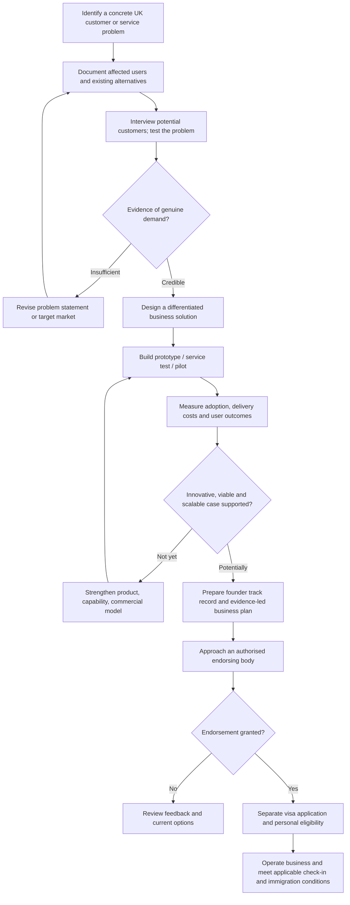

# UK Innovator Founder Visa — Build and Validate a UK Business

**Mettelo Practical Business & Innovation Guide**  
**Prepared by Johnson Taiwo · Updated 10 November 2026**

[🏠 Resource Hub](../../README.md) · [Start Here](../../START_HERE.md) · [Immigration resources](../README.md) · [Innovator Founder resources](README.md) · [Preparation checklist](checklist.md)

> **Who this guide helps:** founders in the UK, Nigeria or elsewhere who want to understand the Innovator Founder route, discover real UK problems, test whether a proposed business is genuinely different, and prepare evidence for an endorsing body's assessment. This is educational guidance, not immigration advice or a guarantee of endorsement. All costs, bodies, requirements and opportunity windows must be checked again before application. The practical targets in this guide are *Mettelo recommendations*, not Home Office requirements.

## Visual venture-development architecture — from UK problem to endorsement

Use this as a **business-development and evidence workflow**. It is not a substitute for approval by an authorised endorsing body or UK immigration requirements.



**Reader note:** Genuine validation improves a business case but does not guarantee that an endorsing body will find it innovative, viable and scalable. Requirements and check-in arrangements must be checked at the time.


## Choose where to start

| Your situation | Go to |
| --- | --- |
| I don't understand the visa | [1. Understand the route](#1-understand-the-innovator-founder-route) |
| I have no business idea | [3. Find UK problems worth solving](#3-how-to-find-real-problems-in-the-uk) |
| I want specific business ideas | [4. Twelve researched opportunity directions](#4-twelve-business-opportunity-directions-to-investigate) |
| I have an idea but don't know if it is innovative | [5. Check uniqueness and competitive advantage](#5-test-whether-the-idea-is-really-innovative) |
| I need customers and proof | [6. Discover, interview and validate](#6-customer-discovery-and-validation-that-produces-real-evidence) |
| I need a business plan and financial model | [7. Build a defensible business case](#7-build-a-defensible-innovative-viable-and-scalable-business-case) |
| I want to find UK organisations and funding | [8. Research directory](#8-uk-problem-research-funding-and-support-directory) |
| I need an actionable timetable | [9. First 90 days](#9-the-first-90-days--practical-implementation-plan) and [10. Twelve-month plan](#10-twelve-month-business-development-roadmap) |
| I am ready to approach endorsers | [11. Endorsing bodies and application process](#11-approach-authorised-endorsing-bodies-carefully) |
| I want a quality check or reusable prompts | [12. Templates](#12-copyable-worksheets-and-prompts) and [13. Readiness gate](#13-final-readiness-and-risk-checks) |

---

## 1. Understand the Innovator Founder route

This is a UK immigration route for a founder developing a business based on a genuinely **innovative, viable and scalable** idea that they created or significantly shaped. An approved organisation assesses the business and issues an **endorsement** if its requirements are satisfied. The Home Office then separately decides the visa. The initial route is different from a later endorsement for continuing an existing endorsed business.

### What the three business criteria mean

| Criterion | Meaning in ordinary English | Questions a credible assessor may ask |
| --- | --- | --- |
| **Innovative** | A genuine original idea addressing a market need or creating a competitive advantage, with meaningful differentiation that competitors cannot simply replicate | What exactly is new, what alternatives already exist, and why would customers prefer this approach? Is the innovation core and developed within the business? |
| **Viable** | Realistic given your skills, team, market awareness, costs, resources and plan | Can the founding team build and sell this? Do the budget and sales assumptions make sense? |
| **Scalable** | Evidence of structured growth potential, including employment and national/international expansion | Can the model serve more customers without costs rising at the same rate? What capabilities, hires and funding are needed? |

The law does **not** prescribe that every business must use AI. A generic app that copies an existing product, a consultancy simply selling the founder's hours, or a reselling business without genuine distinctive innovation may have difficulty meeting the standard. A product using an advanced algorithm can also fail if no customer needs it or the team cannot deliver it.

**Official basis:** [Immigration Rules Appendix Innovator Founder](https://www.gov.uk/guidance/immigration-rules/immigration-rules-appendix-innovator-founder) and [guidance to endorsing bodies](https://www.gov.uk/government/publications/scale-up-and-innovator-founder-visa-endorsing-bodies-guidance/innovator-founder-and-scale-up-visas-guidance-for-endorsing-bodies-accessible).

### Key personal and immigration requirements

| Requirement | What to verify with the official instructions |
| --- | --- |
| Genuine founding role | You generated or significantly contributed to the business idea, have an active day-to-day management/development role and are a sole founder or instrumental founding-team member |
| Age and English | Applicants generally need to be at least **18** and meet **B2 English** unless an exception applies |
| Personal maintenance | Generally **£1,270 held for 28 consecutive days**, with possible exceptions depending on current UK immigration permission; this is separate from business funding |
| Business resources | Be ready to show how development will actually be funded and where money comes from; there is **no universal initial £50,000 minimum investment** |
| Endorsement age | The endorsement letter generally must be dated **no more than three months** before visa application and not withdrawn |
| Immigration status | Switching restrictions, current permission, dependent family members, work conditions, fees and immigration health surcharge must be checked for the person applying |
| Ongoing contact | The plan requires at least **two** contact-point meetings with the endorsing body during permission |
| Settlement | Possible after a qualifying period, but **separate stringent conditions** apply; not automatic after three years |

Read [GOV.UK eligibility](https://www.gov.uk/innovator-founder-visa/eligibility), [visa overview](https://www.gov.uk/innovator-founder-visa), [required documents](https://www.gov.uk/innovator-founder-visa/documents-youll-need-to-apply) and the current [Immigration Rules](https://www.gov.uk/guidance/immigration-rules/immigration-rules-appendix-innovator-founder).

**Important:** An endorsement is not permission to remain in the UK. An applicant approaching visa expiry must not assume the business-assessment process extends their lawful status.

## 2. Start with a problem, not a business name or an AI tool

The strongest first question is **“Who repeatedly experiences an expensive problem, and what have they already tried?”** Business ideas developed only from fashionable technology often fail the more basic tests of market need, access to buyers and willingness to pay.

### A useful problem statement

> [Type of UK organisation/person] experiences [observable recurring issue] during [specific workflow], which causes [time, cost, risk or lost opportunity]. They currently use [alternative/workaround], but it fails because [specific limitation]. The founder intends to test [hypothesis], not assume the need is proven.

**Example — fictional and unvalidated:** Independent care providers may spend substantial administrative effort reconciling rota changes with approved attendance and invoice records. A possible business could test whether an auditable exception-detection workflow reduces manual correction. It would need research into existing rostering products, integration rights, safeguarding/data protection and whether providers will actually pay. This is an **idea to investigate**, not evidence that providers have requested the product or that it qualifies for endorsement.

### Choose a founder's unfair advantage

Look for domains where you already understand workflows or have legitimate access to potential buyers: retail stock, data engineering, transport, charities, schools, housing, logistics, construction, professional services or health administration. Sector knowledge can make a problem easier to investigate but **does not by itself satisfy innovation**.

## 3. How to find real problems in the UK

Use at least **three different kinds of evidence** before choosing a problem: official data, observed workflow and customer confirmation.

### Strategy A — investigate government statistics for recurring pressures

1. Open the latest [ONS Business Insights and Conditions Survey](https://www.ons.gov.uk/businessindustryandtrade/business/businessservices/bulletins/businessinsightsandimpactontheukeconomy/5november2026). Choose a problem domain: supply chains, energy costs, labour shortages, exporting, transport, cyber resilience.
2. Examine the exact question, respondent category, survey uncertainty and whether the pressure applies to your **specific target buyer**.
3. List an operational activity affected (for example: small distributors predicting late shipments, not just “supply chains”).
4. Identify three types of organisation that experience the activity. Contact real operations managers for workflow interviews.
5. Check whether existing paid tools already solve it and why users still struggle.

**Real signal, not guaranteed market demand:** ONS reported on **5 November 2026** that **21% of UK businesses with 10+ employees** were concerned about cyber attacks affecting supply chains, while **69% of businesses overall** expressed some concern about energy prices. These are **survey estimates, not proof that anyone will buy your software**. [ONS release](https://www.ons.gov.uk/businessindustryandtrade/business/businessservices/bulletins/businessinsightsandimpactontheukeconomy/5november2026).

### Strategy B — use public procurement as a problem radar

Search [Contracts Finder](https://www.gov.uk/contracts-finder) and [Find a Tender](https://www.find-tender.service.gov.uk/) for terms such as `data quality`, `supplier assurance`, `waste monitoring`, `housing repairs`, `school attendance` and `energy management`.

Read tender descriptions and past awards to learn **which outcomes buyers pay for**. Extract user needs, budgets where published, constraints and competing suppliers. A tender is **not automatically an invitation to pitch a novel startup**. Government procurement has qualification, contract, security and compliance conditions; use the material for discovery first.

**Concrete research task:** Review five tender notices in a chosen theme. For each, record the problem, named buying organisation, date, desired output, incumbent approach and a proposed customer interview—not a speculative endorsement claim.

### Strategy C — find local operational inefficiencies

Choose one town/sector and interview five to ten genuine organisations with relevant workflows: independent pharmacies, distributors, letting agencies, food wholesalers, community organisations, SMEs or construction subcontractors.

Ask about recurring **workarounds**: spreadsheets, manually rekeyed invoices, delayed service updates, duplicated data entry, lost requests and repeated exception handling. Ask **how often** the issue happens and **who approves spending** to address it. Never scrape private contact details or customer records without permission.

### Strategy D — follow regulator and service-quality findings

Use a published regulator's sector reports to identify systemic quality, transparency or compliance issues. Examples: [Care Quality Commission](https://www.cqc.org.uk/publications) (care services), [Ofsted](https://www.gov.uk/government/organisations/ofsted/about/statistics) (education), [Environment Agency data](https://environment.data.gov.uk/) (environment), [Ofgem](https://www.ofgem.gov.uk/publications) (energy). An issue in a regulator's report can guide **hypotheses**, not licence you to handle patient, pupil or consumer data without lawful permissions.

### Strategy E — talk to front-line operators and professional communities

Observe legally accessible professional forums, trade association events, small-business networks and webinars. Approach people with a **specific problem question**, not a long product pitch. Look for the same workarounds reported independently by several buyers. Avoid drawing conclusions from angry online comments without direct validation.

### Strategy F — compare unmet needs with what buyers already purchase

Use public supplier directories, customer reviews, actual procurement contracts, competitor demo videos, product documentation and [Companies House](https://find-and-update.company-information.service.gov.uk/) to identify providers. A competitor's existence may be **positive evidence of demand**; your task is to find the truly unresolved portion. Don't claim “no competition” until you have searched.

## 4. Twelve business opportunity directions to investigate

**These are original Mettelo research hypotheses, not endorsed or proven innovative ideas.** Every one requires customer discovery, competitor research, legal assessment and a distinctive technical/commercial advantage. The venture should be built around the founder's demonstrable competence and target UK market.

| No. | Potential UK customer and problem to investigate | Testable business concept | First people to approach / useful research | Innovation hurdle or critical risk |
| --- | --- | --- | --- | --- |
| **1. SME supplier-risk visibility** | Regional distributors lack a joined-up view of late deliveries, supplier status and manual orders | Auditable supplier-risk/forecasting layer linking permitted order, stock and delivery events | Wholesale operations leads; [ONS BICS](https://www.ons.gov.uk/economy/economicoutputandproductivity/output/datasets/businessinsightsandimpactontheukeconomy); [Contracts Finder](https://www.gov.uk/contracts-finder) | Existing ERP add-ons; integration and real differentiation |
| **2. Care-provider administrative reconciliation** | Care organisations may need to reconcile approved rota, visit and finance records | Permission-based exception management with explainable audit trails | Registered home-care operations managers; [CQC](https://www.cqc.org.uk/publications) | Sensitive health/care data, safeguarding, existing care-management tools |
| **3. Small-landlord repair triage** | Small property managers may face fragmented repair reports, contractor updates and evidence logs | Structured work-order prioritisation and verified repair evidence with tenant/contractor consent | Letting managers, housing associations; [English Housing Survey](https://www.gov.uk/government/collections/english-housing-survey) | Liability, tenant privacy, incumbent proptech |
| **4. Building-energy decision support** | SMEs may struggle to identify controllable energy waste across locations | Meter-data anomaly attribution and transparent savings recommendations | Hospitality sites, facilities managers; [DESNZ energy statistics](https://www.gov.uk/government/organisations/department-for-energy-security-and-net-zero/about/statistics) | Hardware access, causal proof of savings, metering accuracy |
| **5. Food redistribution coordination** | Food charities and suppliers may have unpredictable surplus and collection scheduling | Forecasting and verified matching to reduce missed collections | Food banks, wholesalers, [WRAP](https://www.wrap.ngo/) | Actual partner uptake; food safety and charity budgets |
| **6. Export document verification** | Small exporters may manually check multiple shipment and trade documents | Rules-based completeness checks, provenance and human review workflow | Export managers, freight forwarders; [DBT trade guidance](https://www.gov.uk/government/organisations/department-for-business-and-trade) | Trade law, customs compliance, liability |
| **7. Contractor compliance evidence** | Construction SMEs may repeatedly gather credentials, insurance and audit files | Consent-based credential validation and expiration/change monitoring | Principal contractors, subcontractors; [HSE construction](https://www.hse.gov.uk/construction/) | Existing compliance platforms and document authenticity |
| **8. Accessibility QA for small digital teams** | Small service providers may overlook recurring accessibility issues in online journeys | Human-in-the-loop testing workflow with traceable fixes and release checks | UK agencies, nonprofit service teams; [W3C WCAG](https://www.w3.org/WAI/standards-guidelines/wcag/) | Automated checks alone cannot establish full accessibility |
| **9. Education placement coordination** | Training providers may use fragmented placement approvals, evidence and employer communications | Workflow with verified placement milestones and consent-aware evidence | Colleges, training providers, employers; [DfE statistics](https://explore-education-statistics.service.gov.uk/) | Pupil/learner protection, safeguarding, existing systems |
| **10. SME receivables exception detection** | Small wholesalers may spend time reconciling payments to invoices | Explainable matching engine with exception review and clear control record | Finance managers, accountants; [Small Business Commissioner](https://www.smallbusinesscommissioner.gov.uk/) | Data privacy, finance integration, strong existing competitors |
| **11. Local freight utilisation** | Independent hauliers may struggle to match real capacity, return journeys and order changes | Verified capacity matching with route, permission and service-quality constraints | Hauliers, freight groups; [DfT transport statistics](https://www.gov.uk/government/organisations/department-for-transport/about/statistics) | Network effects, insurance, fleet integration |
| **12. Community service impact reporting** | Smaller charities may lack consistent outcome definitions across projects and funders | Lightweight privacy-safe impact data model with methodology checks and reusable funder exports | Community organisations, grant administrators; [Charity Commission register](https://register-of-charities.charitycommission.gov.uk/) | Limited budgets, uneven data availability, competitors |

**How to use the table:** Choose **two** relevant problems, investigate each for two weeks, and kill one if buyers cannot confirm urgency or there is no credible differentiation. Do not market any of these as already accepted Innovator Founder concepts.

### Three worked concept-development strategies

**Example A — supply-chain risk tool.** First learn how a distributor's procurement manager currently flags late shipments; obtain a synthetic or permitted sample order-event schema. Prototype a rule that joins purchase orders, expected dispatch and actual receipts, then generate a transparent exception log. Compare detection time and error rates against the existing spreadsheet **using real observations**. Show why your approach outperforms a specific competing ERP feature and what would make it hard to copy.

**Example B — energy waste for small chains.** Interview three multi-site operators and ask for historic (permission-cleared) meter/usage data, opening hours and tariff rules. Test whether weather-adjusted anomalies are actionable. Report false alerts and avoided maintenance time only when measured. Check supplier integrations and compare against incumbent energy analytics platforms.

**Example C — charitable impact reporting.** Talk to five funded organisations about evidence definitions and submission burden; map common inconsistent fields. Build a reusable dictionary and quality-control process using invented/synthetic records. Test whether two organisations can independently produce the same metric, document errors and confirm whether a funder would accept that format. A neat dashboard alone is not differentiated innovation.

## 5. Test whether the idea is really innovative

### Competitor and differentiation analysis

Investigate at least **five** alternatives where relevant: direct UK competitors, global competitors serving the UK, incumbent ERP/software modules, manual agency/consultancy services and “do nothing”/spreadsheets.

| Competitor / workaround | Target buyers | Core job it does | Current price / terms | Limit customers actually report | How our approach differs | Proof needed |
| --- | --- | --- | --- | --- | --- | --- |
| [Real company] | [Buyer] | [Workflow] | [Source/date] | [Interview/review] | [Specific advantage] | [Pilot/test] |
| Spreadsheet/manual team | [Buyer] | [Workflow] | [Time + errors] | [Observed] | [Specific design] | [Before/after] |

**A defensible uniqueness statement:** “For [specific user] dealing with [problem], our solution uses [distinct technical/process mechanism] to create [specific benefit], compared with [named alternative]. The difference matters because [customer-confirmed evidence], and we can defend it through [know-how/data permissions/validated method/integration/network/other real barrier].”

### Five ways to create *real* differentiation

1. **Novel method:** A technically distinct matching/decision process with measurable superiority on relevant cases, not merely an AI API call.
2. **Hard-to-replicate capability:** A genuine proprietary methodology, lawful data rights, specialist expertise or integration that takes time to reproduce.
3. **Unique workflow design:** A solution to specific regulatory or operational cases competitors demonstrably handle poorly.
4. **Verified performance:** Repeated tests showing a material difference against the strongest realistic alternative, with methods and limitations reported.
5. **Network or distribution advantage:** A genuine two-sided operational network or exclusive lawful access that produces sustainable user value rather than just a contact list.

**Red flags:** an AI wrapper with interchangeable prompts; an imported business franchise; reselling generic software; a website with no distinctive business; a paid course or ordinary consultancy labelled “platform”; unsubstantiated “UK's first” claims; outsourcing the entire core innovation without credible founder expertise.

The [Home Office endorsing-body guidance](https://www.gov.uk/government/publications/scale-up-and-innovator-founder-visa-endorsing-bodies-guidance/innovator-founder-and-scale-up-visas-guidance-for-endorsing-bodies-accessible) places specific emphasis on a compelling USP, replication barriers and innovation being central to the proposition.

## 6. Customer discovery and validation that produces real evidence

### Find interviewees — who and where

| Market | Roles to approach | Where to identify organisations | Opening question |
| --- | --- | --- | --- |
| Care administration | Registered manager, operations manager, finance lead | CQC public directory, relevant trade associations, provider websites | “How do rota changes become confirmed invoice and attendance records?” |
| Logistics/distribution | Operations director, fleet planner, supply-chain manager | Public company websites, trade associations, tenders | “Which delivery exceptions consume the most staff time?” |
| Property management | Lettings manager, repair coordinator, contractor | Local agency directories, public housing procurement | “What happens between the first repair report and signed completion?” |
| Charities | Project manager, operations or impact lead | [Charity Commission register](https://register-of-charities.charitycommission.gov.uk/) and charity websites | “Which figures are hardest to evidence consistently to funders?” |
| Schools/learning providers | Placement coordinator, operations manager | School/college official websites and published procurement | “Where do approvals or placement confirmations get delayed?” |

**Outreach method:** Write 80–120 words explaining your research, the particular work process, that you are not asking for a purchase, and a short 15–20 minute request. Respect refusals, UK GDPR, marketing/privacy rules and professional boundaries.

### Ten questions for a useful problem interview

1. Walk me through the last time this problem happened.
2. Which trigger starts the workflow?
3. Which systems and people are involved?
4. What part takes longest, and how do you know?
5. What happens when the process fails?
6. What are the costs, risks or service consequences?
7. What have you already bought or tried?
8. Why was that insufficient?
9. Who owns the problem, chooses a supplier and approves spending?
10. Would you be willing to test a clearly scoped prototype later, subject to permissions?

**Avoid leading questions** like “Would you pay £99 for this revolutionary product?” Real behaviours and recent failures are stronger signals than compliments.

### A useful evidence ladder

| Level | Real evidence | Interpretation |
| --- | --- | --- |
| 0 | Founder thinks problem exists | Hypothesis only |
| 1 | Credible official report or procurement notice | Sector-level signal |
| 2 | Several independently interviewed buyers describe recurring specific problem | Qualitative need validation |
| 3 | Buyers supply permission-cleared workflow/data samples and time for pilot | Stronger engagement |
| 4 | Written pilot scope, buyer-chosen success criterion, actual result | Product-value evidence |
| 5 | Genuine signed paid agreement, invoice and use | Stronger commercial validation |
| 6 | Repeatable renewals, referrals, retention and unit economics | Growing viability evidence |

**None of these levels alone proves endorsement eligibility.** Genuine innovation, viable team/costs and scalability must be assessed together.

## 7. Build a defensible innovative, viable and scalable business case

### Minimum business-plan structure

| Section | What it should explain | Actual supporting record |
| --- | --- | --- |
| Executive overview | Problem, specific customer, solution and why now | One-page decision summary |
| UK problem evidence | Survey, tender findings, interviews, citations and limitations | Dated source list and anonymised notes |
| Market selection | Number/type of genuinely addressable buyers and buying decision | Sensible bottom-up sizing, not UK population × fantasy conversion |
| Competitor analysis | Named products, strengths, price and remaining gaps | Evidence matrix |
| Core innovation | Distinct mechanism, architecture, constraints and defensibility | Prototype, design reviews, permissioned technical notes |
| Customer validation | Who was interviewed, tested, bought or declined | Consent records, pilot feedback, signed agreements |
| Delivery plan | Founders' actual capabilities, team, suppliers, legal and compliance | Technical plan and CV/credentials |
| Revenue/pricing | How someone actually pays, purchase cycle and charging basis | Price tests, quotes, contracts |
| Finances | Costs, funding sources, revenue assumptions and runway | Scenario model |
| Scale | UK expansion, growth channels, capacity, new jobs and overseas markets | Milestones with triggers and risks |
| Governance | Data protection, UK business obligations, insurance, IP and safeguarding where relevant | Action register and professional advice |
| Risks | Why the idea might fail and how you test/mitigate that | Prioritised risk list |

### Unit economics example (illustrative, not market evidence)

Assume a **hypothetical** SaaS product charges £120 per site per month; software hosting/support costs average £35 per active site, and acquiring a customer costs £300. Contribution before overheads is £85/site/month. Simple payback = £300 ÷ £85 ≈ **3.5 months** *if* customers remain, service/support costs are accurate and fees are collected. This **does not include** the founders' pay, fixed overheads, VAT, sales cycle uncertainty or churn, so it is not a profitability forecast.

**Three required founder scenarios:** base case, worse-than-expected customer uptake, and higher-than-expected delivery cost. Show what changes operationally under each rather than presenting best case as certain.

### Scalability demonstration

Explain the next 10, 100 and 1,000 customers: what must change in support, onboarding, data access, cloud/infrastructure costs, legal compliance, partnerships and recruitment? Describe actual triggers such as “hire customer-support lead after 40 active sites and stable gross margin,” not fabricated jobs promised by arbitrary dates.

## 8. UK problem research, funding and support directory

These are **research, customer-discovery, funding or business-support resources**. Being listed here does **not** mean an organisation endorses visas, guarantees investment or is recruiting founders.

| Resource | What to investigate | A specific action to take |
| --- | --- | --- |
| [ONS latest business survey — November 2026](https://www.ons.gov.uk/businessindustryandtrade/business/businessservices/bulletins/businessinsightsandimpactontheukeconomy/5november2026) | Supply-chain, energy, fuel, cyber and other pressures | Extract a sector-specific finding and test it through interviews |
| [ONS BICS datasets](https://www.ons.gov.uk/economy/economicoutputandproductivity/output/datasets/businessinsightsandimpactontheukeconomy) | More detailed survey measures and uncertainty | Filter by sector/size and note sample limitations |
| [UK Business Population Estimates 2026](https://www.gov.uk/government/statistics/business-population-estimates-2026) | Business numbers by industry, size and region | Calculate a defensible *candidate* market segment, not guaranteed demand |
| [data.gov.uk](https://www.data.gov.uk/) | Public datasets and licensed research inputs | Search a precise workflow term and inspect licence/freshness |
| [Contracts Finder](https://www.gov.uk/contracts-finder) | Published procurement problems and past contracts | Compare five problem specifications and incumbent services |
| [Find a Tender](https://www.find-tender.service.gov.uk/) | UK public procurement opportunities and prior notices | Search potential buyer pain and identify upcoming market engagement |
| [Companies House](https://find-and-update.company-information.service.gov.uk/) | Real competitors, incorporation and company records | Check competing businesses and their filed information |
| [UKRI Funding Finder](https://www.ukri.org/opportunity/) | Research/innovation competitions | Filter active calls, UK eligibility, business type, dates and funding terms |
| [Find a Grant](https://find-government-grants.service.gov.uk/) | Government grant opportunities | Search actual programmes and verify location/sector eligibility |
| [British Business Bank](https://www.british-business-bank.co.uk/) | UK business finance information | Learn finance types and the difference between loans and grants |
| [Business.gov.uk](https://www.business.gov.uk/) | Business support and startup information | Find relevant guidance and local support channels |
| [DBT UK Export Academy](https://www.great.gov.uk/learn/) | Export capability and regulations | Learn genuine cross-border selling and buyer requirements |
| [ICO — UK GDPR business guidance](https://ico.org.uk/for-organisations/uk-gdpr-guidance-and-resources/) | Lawful personal-data processing | Identify data minimisation, lawful basis, contracts and DPIA needs |
| [CQC](https://www.cqc.org.uk/) | Regulated care providers and quality reports | Develop care-admin research hypotheses without accessing patient data |
| [Ofgem](https://www.ofgem.gov.uk/) | Energy market publications | Study real energy risks and supplier/regulatory context |
| [Environment Agency open data](https://environment.data.gov.uk/) | Environmental monitoring and licensing | Validate availability and reuse conditions for a specific dataset |
| [Charity Commission register](https://register-of-charities.charitycommission.gov.uk/) | Registered organisations and public reports | Identify types of charities to interview on outcomes reporting |
| [UK Intellectual Property Office](https://www.gov.uk/government/organisations/intellectual-property-office) | IP and protectable inventions | Check trademarks/patents/designs and seek professional advice where needed |
| [British Library Business & IP Centre](https://www.bl.uk/business-and-ip-centre) | Business research and IP information | Explore accessible events/research support and current programme eligibility |
| [ONS Open Geography](https://geoportal.statistics.gov.uk/) | UK geographic boundaries for local market mapping | Map a genuine local customer segment with correct geography |

**Research hygiene:** Check each portal's current terms, update date, licence, geographic coverage and whether you need registration. **Do not scrape restricted customer details**, assume a grant is open, or portray a public tender as a partner endorsement.

## 9. The first 90 days — practical implementation plan

| Period | Precise tasks | Who to contact or where to look | Deliverable / decision |
| --- | --- | --- | --- |
| **Days 1–7** | Identify two fields where you understand operations; read ONS/sector reports and 5 tender or regulatory findings for each | ONS, Contracts Finder, relevant regulator | Two quantified/qualified **problem hypotheses** |
| **Days 8–14** | Interview 5 people across each field about recent workflow failures; log only permitted anonymised data | Operations managers via relevant directories and associations | 10 interview notes, recurring friction map |
| **Days 15–21** | Search five real alternatives/workarounds for each idea, compare features and price | Company websites, product manuals, actual buyers | Competitor matrix; drop idea without clear gap |
| **Days 22–30** | Select one problem and map full process: triggers, users, data flow, exception handling, decision maker | Two potential pilot users | One-page problem statement and requirements |
| **Days 31–45** | Build testable minimum feature using synthetic or permissioned data; review privacy, security, licence | Qualified technical collaborator and actual workflow owner | Demonstrable prototype and test log |
| **Days 46–60** | Run small pilot with agreed success measure, baseline and failure cases | 1–3 genuine pilot partners | Pilot result including negative findings |
| **Days 61–70** | Test pricing, procurement barriers, support costs, actual purchase authority | Finance/operations buyers, accountant as needed | Price evidence, funding and unit-economics model |
| **Days 71–80** | Build 12–24-month operating plan with UK customers, people, technology and expansion triggers | Potential delivery partners and appropriate professional advisers | Credible plan, risks, scenario budgets |
| **Days 81–90** | Review actual endorser criteria and immigration eligibility; request legitimate assessor information if appropriate | Official endorsers directory; regulated adviser for immigration | Written **go / refine / stop** decision |

**What if nobody replies?** Change the segment or research method: use a trade event, current service operator, association meeting, referral from a real contact, or a public webinar. Do not manufacture interview notes or buy “customer letters”.

## 10. Twelve-month business-development roadmap

| Month | Main practical objective | Output worth retaining | Decision gate |
| --- | --- | --- | --- |
| 1 | Identify 2 problems and research UK evidence | Source register and 10 genuine buyer interviews | Are these real recurring workflows? |
| 2 | Evaluate competing tools, buyer budget and legal constraints | 5-alternative matrix, decision-maker map | Is a distinctive solution plausible? |
| 3 | Specify original mechanism and deliver a testable prototype | Architecture, acceptance tests, honest limits | Can the founder build core innovation? |
| 4 | Complete first permissioned pilots | Baseline and actual outcomes | Does the user obtain meaningful value? |
| 5 | Iterate based on observed failure | Tested changes and customer feedback | Is there a defensible advantage? |
| 6 | Validate purchasing process and pricing | Paid pilot/commitment if earned; documented rejections | Will an actual buyer pay? |
| 7 | Develop data, security, licensing and operational controls | Governance review and service processes | Can this operate lawfully in the UK? |
| 8 | Confirm funding and viable runway | Three-scenario financial model | Can delivery continue if growth is slower? |
| 9 | Strengthen distribution and partner route | Actual channel tests, conversion evidence | Is customer acquisition repeatable? |
| 10 | Plan hiring and capacity thresholds | Scaling model, actual roles/skills gaps | Does national growth make sense? |
| 11 | Compare against approved endorser criteria and application terms | Factual business/evidence pack | Are innovation, viability and scaling evidenced? |
| 12 | Submit only if independently ready; otherwise continue customer/product development | Endorsement outcome if sought, or revised plan | Do not force application because month 12 arrived |

**This is an optional business-building timeline, not a 12-month visa qualifying requirement.** A business may need more or less time. The visa also has distinct subsequent contact points and settlement conditions.

## 11. Approach authorised endorsing bodies carefully

The [official UK government list, updated 7 August 2026](https://www.gov.uk/government/publications/endorsing-bodies-innovator-founder-and-scale-up-visas/innovator-founder-and-scale-up-visas-endorsing-bodies) lists these organisations for **new initial Innovator Founder endorsement**, subject to current conditions:

| Officially listed body | First step | Important caveat |
| --- | --- | --- |
| **UK Endorsing Services** | Follow its government-listed website; review eligibility and assessment documents | No guarantee of accepting the idea or opening an intake |
| **Innovator International** | Check detailed evidence, costs, timing and interview/assessment terms | Verify current operating arrangements directly |
| **Envestors Limited** | Check endorsement process and whether the venture matches its current assessment criteria | Endorsement is not a promise of investment |
| **Global Entrepreneurs Programme (GEP)** | Check its invitation-only programme via official government information | Only qualifying **invited** programme participants; not an open application alternative |

**Do not approach organisations listed only under “Legacy Innovator Endorsing Bodies” for a brand-new initial endorsement.** They generally serve qualifying applicants previously endorsed under earlier routes. Always recheck the live directory before paying any agent.

### Budget for endorsement assessments and contact meetings

The [official government endorsing-body directory (updated 7 August 2026)](https://www.gov.uk/government/publications/endorsing-bodies-innovator-founder-and-scale-up-visas/innovator-founder-and-scale-up-visas-endorsing-bodies) states these **endorser charges** for the Innovator Founder route:

| Endorser-stage expense | Official published charge | Planning implication |
| --- | ---: | --- |
| Initial endorsement application | **£1,000 per person** | Budget separately from Home Office application and product development |
| Mandatory contact-point meetings if granted | **£500 per meeting**; generally **at least two** | Plan for **at least £1,000** of contact-point charges over permission |
| **Total of these endorser-stage items** | **At least £2,000** under the cited charges | **Does not include** visa fee, Immigration Health Surcharge, legal/translation costs, dependants, company formation, IP or development |

**Do not treat £2,000 as the total cost of the visa.** Government application fees and immigration-health charges are separate and can change. Fees may be payable at different stages; read the current provider terms and official charge pages before committing funds. The cost of product development and actual business capital also depends on the business, with no universal fixed £50,000 minimum investment for the new-business route.


### What to send in an appropriate enquiry

Prepare a concise founder summary, problem statement, target buyer, distinctive innovation, credible test or commercial evidence, founding team's real capability, viable costs and structured growth plan. Ask **whether your business falls within current assessment scope, what documents are required, actual charges and process**. Never ask for “guaranteed endorsement” or pay an unverified intermediary.

### Application and post-endorsement

1. Verify legal route eligibility, permission expiry, switching conditions and whether you are applying in or outside UK.
2. Secure a genuine endorsement letter meeting the current format and timing; check all identity and business details.
3. Apply through the Home Office process with correct documents, financial and English requirements.
4. If granted, follow actual conditions of permission, manage the endorsed business and attend required contact meetings.
5. Preserve financial, customer, staffing, innovation and operational evidence for future endorsement and possible settlement; **settlement is a separate application with additional criteria**.

**Official help:** [GOV.UK visa](https://www.gov.uk/innovator-founder-visa) · [eligibility](https://www.gov.uk/innovator-founder-visa/eligibility) · [documents](https://www.gov.uk/innovator-founder-visa/documents-youll-need-to-apply) · [endorsers](https://www.gov.uk/government/publications/endorsing-bodies-innovator-founder-and-scale-up-visas/innovator-founder-and-scale-up-visas-endorsing-bodies).

## 12. Copyable worksheets and prompts

### A. Problem discovery record

| Field | Write down |
| --- | --- |
| Sector / customer segment | [Specific UK organisation type, size and location] |
| Person interviewed / role | [Consenting, anonymised role] |
| Last problem incident | [Date, trigger and exact workflow] |
| Current workaround | [Systems, manual work or existing vendor] |
| Observed scale and impact | [Real frequency/time/cost or “unknown”] |
| Purchasing authority | [Person/team responsible for budget] |
| Current alternatives | [Named providers and prices if verified] |
| Key permission/regulatory constraint | [Relevant licence, privacy, safety] |
| Proposed test | [Minimal prototype or offline experiment] |
| Confirmation level | [Hypothesis / interviews / pilot / payment] |

### B. Competitor-differentiation statement

> For **[specific buyer]** handling **[actual recurring problem]**, existing approaches **[named products/workarounds]** fail in **[customer-confirmed way]**. We propose **[specific novel method]** and expect **[testable improvement]**, which will be validated through **[real pilot design]**. We can build it because **[actual team expertise and resources]**. Main uncertainties are **[risk 1, risk 2]**.

### C. AI-supported opportunity research prompt

```text
Act as a UK market researcher, not a visa endorsement agent. I have experience in [SECTOR / SKILLS] and want to investigate a viable UK problem. Suggest at most FIVE specific problem hypotheses based on actual UK public statistics, procurement notices or regulator findings. For every factual claim provide an exact official source link and its publication date; label any idea not yet verified as a hypothesis.

For each hypothesis explain the narrow UK buyer, existing workflow, possible costs/risks, who controls budget, names or types of competitors to investigate, legal/privacy concerns and a feasible interview strategy. Do not claim market demand, product novelty or Innovator Founder eligibility without evidence. Give me ten non-leading interview questions and a two-week validation plan.
```

### D. Business-innovation challenge prompt

```text
Audit this UK founder concept as a sceptical business assessor, using the current official Innovator Founder innovative/viable/scalable definitions (but do not make a visa decision).

Business: [IDEA]. Founder experience: [TRUE SKILLS]. Target customer: [SEGMENT]. Existing alternatives: [NAMED COMPETITORS]. Evidence: [INTERVIEWS/PILOTS/SALES]. Funding: [ACTUAL AMOUNTS AND SOURCES, NO PRIVATE ACCOUNT DETAILS].

1. Explain why this might fail innovation, viability or scalability separately.
2. Challenge whether the core innovation is genuinely differentiated and delivered by the founding team.
3. Identify missing real market evidence, genuine technical risks, regulatory obligations and unfounded financial assumptions.
4. Propose a comparison experiment against the strongest existing alternative and a realistic customer pilot.
5. Create a 90-day action plan and a conditional go/refine/stop decision without promising endorsement.
```

### E. Founder evidence register

| Evidence ID | Claim | Real document / source | Date / owner | Independent confirmation | Missing or weak? |
| --- | --- | --- | --- | --- | --- |
| UK-01 | Actual buyer problem | Consent-based interviews | [Date] | [Role] | [Gap] |
| UK-02 | Product difference | Competitor matrix + method test | [Date] | [Tester] | [Gap] |
| UK-03 | Real founder capability | Prototype and technical review | [Date] | [Reviewer] | [Gap] |
| UK-04 | Commercial viability | Budget, agreements or sales | [Date] | [Authorised record] | [Gap] |
| UK-05 | Growth potential | Capacity/hiring/market model | [Date] | [Adviser/real inputs] | [Gap] |

## 13. Final readiness and risk checks

### Business readiness

- [ ] A **specific UK customer problem** is supported by interviews, workflow findings and relevant public research.
- [ ] Direct competitors and the status-quo workaround have been researched.
- [ ] The differentiating method can be explained plainly and is core to the business.
- [ ] Founders genuinely own or can deliver the key innovation.
- [ ] A pilot demonstrates actual value and records negative results honestly.
- [ ] Finance, sales, operations, security/privacy and scale assumptions are defensible.
- [ ] Job creation and national/international growth potential are planned credibly.
- [ ] Claims of “first”, “unique”, revenue, customers, grants or letters are truthful.

### Immigration readiness

- [ ] Exact live endorsing-body authorisation and assessment terms verified.
- [ ] New-business or same-business eligibility selected correctly.
- [ ] Founder contributions and active management role supported.
- [ ] Passport, English, maintenance funding, current permission and switching rules checked.
- [ ] Any endorsement letter valid and within permitted application timing.
- [ ] Sponsor/agent guarantees rejected; regulated advice sought where appropriate.
- [ ] Costs, deadlines, contact meetings and dependent-family position considered.

### Common founder traps

| Trap | Why it is weak | Better strategy |
| --- | --- | --- |
| “There are millions of SMEs, so demand is huge” | Population is not willingness to pay | Interview a niche buyer and calculate addressable market from real purchase conditions |
| A chatbot with a fashionable label | Easy to replicate and often not core innovation | Test genuinely distinct technology, integration, methodology or defensible workflow |
| A big deck without pilots | No tested user need or founder delivery | Build smallest permitted prototype, assess failures and record outcomes |
| Only friends saying they like it | Biased, low-commitment feedback | Speak to independent buyers and test purchase decisions |
| Complex five-year forecast with no assumptions | Looks precise but is not credible | Use scenarios with actual acquisition, cost and runway assumptions |
| Paid “guaranteed endorsement” | Misleading and risky | Follow the current authorised government list and documented criteria |

---

## Primary references and update policy

**Immigration and endorsement:** [Current Innovator Founder rules](https://www.gov.uk/guidance/immigration-rules/immigration-rules-appendix-innovator-founder) · [Overview](https://www.gov.uk/innovator-founder-visa) · [Endorsing bodies](https://www.gov.uk/government/publications/endorsing-bodies-innovator-founder-and-scale-up-visas/innovator-founder-and-scale-up-visas-endorsing-bodies) · [Endorsing-body criteria](https://www.gov.uk/government/publications/scale-up-and-innovator-founder-visa-endorsing-bodies-guidance/innovator-founder-and-scale-up-visas-guidance-for-endorsing-bodies-accessible).

**UK problem and opportunity data:** [ONS BICS November 2026](https://www.ons.gov.uk/businessindustryandtrade/business/businessservices/bulletins/businessinsightsandimpactontheukeconomy/5november2026) · [UK business population 2026](https://www.gov.uk/government/statistics/business-population-estimates-2026) · [Contracts Finder](https://www.gov.uk/contracts-finder) · [Find a Tender](https://www.find-tender.service.gov.uk/) · [UKRI opportunities](https://www.ukri.org/opportunity/) · [Government grants](https://find-government-grants.service.gov.uk/).

**Editorial policy:** Mettelo distinguishes official visa rules from original business-development advice. Business ideas above are hypotheses for research—not promises of innovation, demand, funding, endorsement or immigration success. Review government rules and opportunities on the actual application date.

**Mettelo editorial edition 1.0:** Complete practical guide. Live endorser terms, external opportunities and individual immigration eligibility must be checked before any application; a separate regulated immigration-adviser sign-off has not been performed.

**Mettelo · Built for What's Next · Prepared by Johnson Taiwo**

### Explore more

[← Innovator Founder resources](README.md) · [Preparation checklist](checklist.md) · [Tracker instructions](tracker-guide.md) · [Start Here](../../START_HERE.md) · [Resource Hub](../../README.md)
