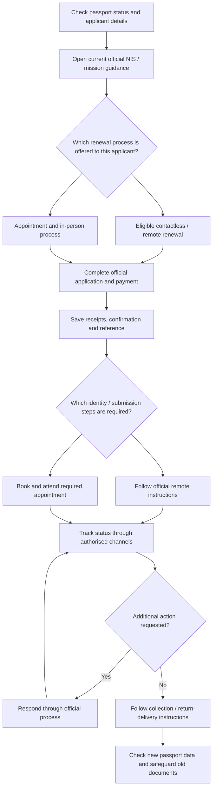

# Nigerian Passport Renewal from the UK

**Mettelo Practical Guide · Edition 1.0 · Updated 10 November 2026**  
**Prepared by Johnson Taiwo**

[🏠 Resource Hub](../../README.md) · [Start Here](../../START_HERE.md) · [Immigration resources](../README.md) · [Passport resources](README.md)

> **Important:** This is a practical community guide. Nigerian passport services, eligibility, booking locations, fees and postal requirements can change. **Always confirm the instructions for your actual case on the Nigeria Immigration Service (NIS) portal and Nigeria High Commission website before paying, attending or posting a passport.** Do not share NIN, passport numbers or receipts publicly.

## Visual service journey — passport renewal from the UK

Use this process map as an overview only. The **Nigerian Immigration Service and the relevant Nigerian mission** determine the current eligibility rules, locations and processing instructions.

**Reader note:** Remote renewal is conditional, and not all applicants can use it. Do not assume an appointment, biometric step, postal route or return-envelope rule without checking your actual processing centre.

## Start here — which application applies to you?

| Situation | Correct first action | Main warning |
| --- | --- | --- |
| Renewing an existing passport, no change of personal details | Check whether your case/location is **eligible for contactless renewal** or needs an in-person appointment | Contactless is not universal |
| First Nigerian passport | Select a **first-time** application, not a renewal workflow | Different documents and biometric process may apply |
| Lost, stolen or damaged passport | Use the **lost/damaged** process and check police/affidavit or other requirements where applicable | Different fees and documents may apply |
| Name/date/other details change | Use the authorised **change-of-data** route | Do not use ordinary renewal to bypass verification |
| Applicant under 18 | Check minor and parental-consent rules | Do not assume adult contactless eligibility |
| NIS Mobile errors | Check official technical support and avoid duplicate paid applications | Do not pay agents to “unlock” a payment or OTP |

**Use:** [NIS passport services](https://immigration.gov.ng/passports/) · [NIS contactless](https://immigration.gov.ng/contactless/) · [NIS general renewal instructions](https://immigration.gov.ng/info-center/renewal-of-passport/) · [Nigeria High Commission London](https://www.nigeriahc.org.uk/requirements-for-e-passport/).

## 1. Prepare your documents and details

Before opening an application, have your existing passport, NIN details where required, correct name/date information, contact email and payment access ready. For minors, changes of personal details and replacements, check the route-specific official document list.

**Never guess spelling, passport category or identity details.** Correct discrepancies through the official process. Keep scanned copies and payment receipts in a private, access-controlled location.

## 2. Verify your application route and processing centre

1. Open the [official NIS website](https://immigration.gov.ng/) and follow its **actual passport application** entry point.
2. Select the appropriate application category and UK/outside-Nigeria processing location if available.
3. Check if the live portal offers **contactless mobile capture** for your exact application or requires an **appointment and biometrics**.
4. Note your reference, allowed time windows, applicable submission centre, required printed forms and whether there are further steps.
5. Use the **High Commission's current announcement** to verify appointment centres and any temporary intervention exercises.

**Current example of why verification matters:** The High Commission's November 2026 special passport intervention notice names **Manchester and London (3–27 November 2026)**, with **Cardiff and Aberdeen (3–6 November 2026)**. These are **temporary dated exercises**, not permanent passport offices or guaranteed future appointments. Check the [actual notice](https://www.nigeriahc.org.uk/requirements-for-e-passport/) before travelling.

## 3. Complete the application and pay safely

Enter personal information exactly as it appears in the relevant identity records. Review contact and processing-centre details before continuing. Pay only through the official authorised portal or payment instructions displayed for your application and preserve the payment receipt.

**Costs:** NIS booklet/contactless charges can differ by passport type, route and updated policy. The High Commission's **11 September 2026 notice** confirms a **£20 standard administrative charge** and says claims that £70 had been authorised were incorrect. Its **November 2026 intervention notice** permits a £20 postal order **or e-payment** for the ordinary administrative charge, while replacement/lost/damaged cases can require different amounts. **Do not buy a postal order or send money until you have confirmed the current charge and accepted method for your precise process.** [Official High Commission announcement](https://www.nigeriahc.org.uk/requirements-for-e-passport/).

## 4. Contactless renewal — only when the official portal confirms eligibility

If NIS explicitly offers contactless renewal for your case, follow the latest authorised NIS Mobile installation and identity-linking instructions. The app may request face, fingerprint/liveness or other verification steps as applicable.

| Step | What to do | What to check |
| --- | --- | --- |
| Link application | Enter only your legitimate reference/identity details into official NIS service | App publisher and link originate from NIS |
| Complete capture | Follow on-screen approved biometric/identity steps | Lighting, device permissions, original passport details and supported device |
| Submit | Check all confirmations and payments against the official portal | Do not assume capture alone means final submission |
| Save confirmations | Keep official receipt and tracking references privately | Clear record of what was actually submitted |

**If a device fails:** Try the service's supported troubleshooting steps, verify device/app permissions, and use [NIS official support](https://immigration.gov.ng/contact/). Trying another compatible device may be practical, but is **not an official guaranteed workaround**. Avoid unofficial app links and anyone claiming they can bypass biometric security.

## 5. Appointment-based renewal — when required

1. Use the official appointment booking process indicated by NIS/High Commission.
2. Save and print the appointment slip and any required application form/receipts.
3. Confirm the **exact address for the particular booked appointment**. Temporary Manchester, London or regional exercise sites are not automatically the regular High Commission address.
4. Bring the specific documents indicated for your case: old passport for renewals if required, appointment confirmation, payment proof and any name-change, child or replacement documentation.
5. Follow staff instructions on biometrics, administrative charge/payment method and return-delivery arrangements.

**Do not book travel based on an address from a social media post.** Match it to the official dated confirmation.

## 6. Return envelopes, posting and receiving the passport

The High Commission has published requirements including a **prepaid Royal Mail C4 Special Delivery self-addressed return envelope** and the old passport where applicable. But **document delivery rules differ by route**.

Before posting anything, verify:
- whether **your case** actually requires postal submission or documents must be brought to the appointment;
- the **currently authorised delivery address**, recipient and contents;
- whether a postal order or e-payment is required;
- whether the old passport is required and how it will be handled;
- whether return-envelope tracking and proof of postage are required.

Use [Royal Mail Special Delivery](https://www.royalmail.com/sending/uk/special-delivery-guaranteed-1pm) where officially instructed. **Do not post an original passport until the official instructions for your actual application explicitly require it.**

## 7. Track and troubleshoot

Use the [NIS tracking service](https://track.immigration.gov.ng/) or the actual tracking method supplied for your application. Keep official receipt, payment record, appointment confirmation and any delivery tracking separate and private.

| Issue | Safe first response |
| --- | --- |
| Paid but no confirmation | Check official transaction/reference records; contact payment/NIS support before paying again |
| App cannot verify identity | Use official app guidance and supported device; contact NIS |
| Appointment availability unclear | Check official appointment availability and current intervention notices |
| Passport return delayed | Check official case status and tracked envelope; follow authorised help desk |
| Incorrect identity detail | Pause and use official correction process; avoid duplicate applications |
| Unofficial “fast-track” request | Do not disclose codes/passwords or pay unverified intermediaries |

## 8. Final checklist

- [ ] Correct application type (contactless, appointment, change of data, lost/damaged, minor or first-time).
- [ ] Personal data matches genuine identity records.
- [ ] Current NIS and High Commission route instructions checked.
- [ ] Correct official application/reference and payment receipt saved privately.
- [ ] Biometrics completed only through authorised process.
- [ ] Appointment location and date verified when relevant.
- [ ] Postal submission/return envelope confirmed only for applicable case.
- [ ] Current fees/payment methods verified, not copied from an old screenshot.
- [ ] Tracking numbers recorded safely.
- [ ] No personal identity information disclosed in a public repository or to an unofficial agent.

## Official links and continuing guidance

| Resource | Purpose |
| --- | --- |
| [Nigeria Immigration Service](https://immigration.gov.ng/) | Official passport services and application access |
| [NIS passport information](https://immigration.gov.ng/passports/) | Passport types and application methods |
| [NIS renewal information](https://immigration.gov.ng/info-center/renewal-of-passport/) | Appointment-based renewal processes |
| [NIS contactless service](https://immigration.gov.ng/contactless/) | Contactless eligibility/service instructions |
| [NIS application tracking](https://track.immigration.gov.ng/) | Case tracking |
| [Nigeria High Commission London](https://www.nigeriahc.org.uk/requirements-for-e-passport/) | Current UK requirements, notices, locations and charges |
| [High Commission contacts](https://www.nigeriahc.org.uk/contact-us/) | Official contact and announcements |
| [Royal Mail](https://www.royalmail.com/) | Mailing/tracking information when officially required |

**Review status:** Practical guidance checked against the listed primary websites in November 2026; the exact application experience, payment screen and any time-limited notices must be rechecked whenever used. Mettelo does not process passport applications or collect applicants' identity documents.

**Mettelo · Built for What's Next · Prepared by Johnson Taiwo**

### Find your way around

[← Passport resources](README.md) · [Start Here](../../START_HERE.md) · [All resources](../../RESOURCE_INDEX.md) · [🏠 Home](../../README.md)
